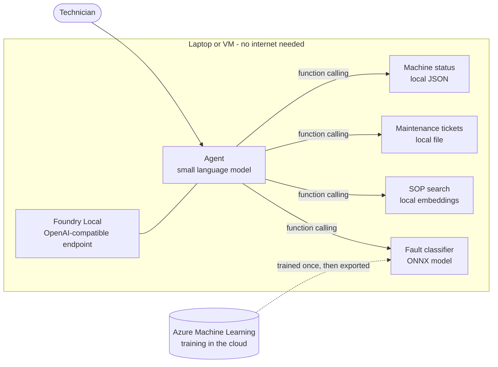

# **Offline Industrial Copilot - Foundry Local MicroHack**

- [**MicroHack introduction**](#microhack-introduction)
- [**MicroHack context**](#microhack-context)
- [**Objectives**](#objectives)
- [**MicroHack challenges**](#microhack-challenges)
- [**Contributors**](#contributors)

# MicroHack introduction

A capable AI agent can run **entirely offline on the factory floor**: local model, local knowledge and local tools. You build it with familiar cloud tooling and then pull the network cable.

In this MicroHack you build a **maintenance technician copilot** for a fictional manufacturer, Contoso Precision Machining. A technician on the shop floor asks:

> *"Spindle vibration on CNC-07 is above the limit. What do I do?"*

The copilot answers from the plant's standard operating procedures (SOPs) and **cites its source**, looks up the machine status, opens a maintenance ticket, and predicts the likely fault with a model that was trained in the cloud. At the end you disconnect the network and prove that every one of these still works.

This MicroHack is about the **agent**. It is not a deep dive into Kubernetes, Azure Arc or industrial protocols, and you do not need any of them.

Please read these short articles first (optional, 15 minutes):

- [What is Foundry Local?](https://learn.microsoft.com/azure/foundry-local/what-is-foundry-local)
- [Use the Foundry Local CLI](https://learn.microsoft.com/azure/foundry-local/how-to/how-to-use-foundry-local-cli)

# MicroHack context

The audience is **application and AI developers** who want to build agents that run close to production equipment, where the connection can be slow, expensive or missing. You need basic Python. You do not need to know Kubernetes, Azure Arc or any industrial protocol.

The day has six hours of challenges. Each challenge builds on the previous one. If a team falls behind, a coach hands out the solution so the team can continue.

| Time | Challenge | Duration |
|------|-----------|----------|
| 09:00 | Kickoff and scenario | 20 min |
| 09:20 | 1 - Get set up | 20 min |
| 09:40 | 2 - Choose your edge model | 45 min |
| 10:25 | 3 - Build your first local agent | 60 min |
| 11:25 | Lunch | 30 min |
| 11:55 | 4 - Agentic retrieval over local knowledge | 75 min |
| 13:10 | 5 - Train in the cloud, deploy at the edge | 60 min (shortcut 25 min) |
| 14:10 | 6 - Cut the cord | 30 min |
| 14:40 | Wrap-up and discussion | 20 min |

# Objectives

After completing this MicroHack you will:

- Run a small language model and an embedding model on your own device with Foundry Local, and call them with the OpenAI SDK.
- Choose a model with evidence: latency, size, tool calling and answer quality.
- Build an agent that calls tools with function calling, with a person approving every action that changes something.
- Ground an agent in local documents with agentic retrieval, citations and an evaluation set.
- Train a model in Azure Machine Learning, export it to ONNX and run it at the edge as an agent tool.
- Prove that the whole copilot works without an internet connection.

# MicroHack challenges

## General prerequisites

Complete these tasks **before** the session so the time goes to the agent and not to installation.

- A **laptop or a VM** that runs Foundry Local:
  - Windows 11 (x64 or ARM64) or macOS on Apple silicon, with at least 16 GB of RAM and 15 GB of free disk space.
  - Your coach can give you a Windows 11 VM instead. It runs the models on its CPU, so answers are slower.
  - Foundry Local does not have a command-line tool for Linux yet, so this MicroHack does not use Linux.
- **Python 3.11 or newer**.
- This repository (or a copy of this folder) on your device.
- An **Azure subscription** with permission to create an Azure Machine Learning workspace. Needed for challenge 5 only. If you take the shortcut in challenge 5 you do not need it.

You can start the model downloads early. They are a few gigabytes in total.

## Challenges

* [Challenge 1 - Get set up](challenges/challenge-01.md)  **<- Start here**
* [Challenge 2 - Choose your edge model](challenges/challenge-02.md)
* [Challenge 3 - Build your first local agent](challenges/challenge-03.md)
* [Challenge 4 - Agentic retrieval over local knowledge](challenges/challenge-04.md)
* [Challenge 5 - Train in the cloud, deploy at the edge](challenges/challenge-05.md)
* [Challenge 6 - Cut the cord](challenges/challenge-06.md)

## Solutions - Spoilerwarning

* [Solution 1 - Get set up](./walkthrough/challenge-01/solution-01.md)
* [Solution 2 - Choose your edge model](./walkthrough/challenge-02/solution-02.md)
* [Solution 3 - Build your first local agent](./walkthrough/challenge-03/solution-03.md)
* [Solution 4 - Agentic retrieval over local knowledge](./walkthrough/challenge-04/solution-04.md)
* [Solution 5 - Train in the cloud, deploy at the edge](./walkthrough/challenge-05/solution-05.md)
* [Solution 6 - Cut the cord](./walkthrough/challenge-06/solution-06.md)

## Contributors

* Digvijay Chauhan [GitHub](https://github.com/Digvijay)
