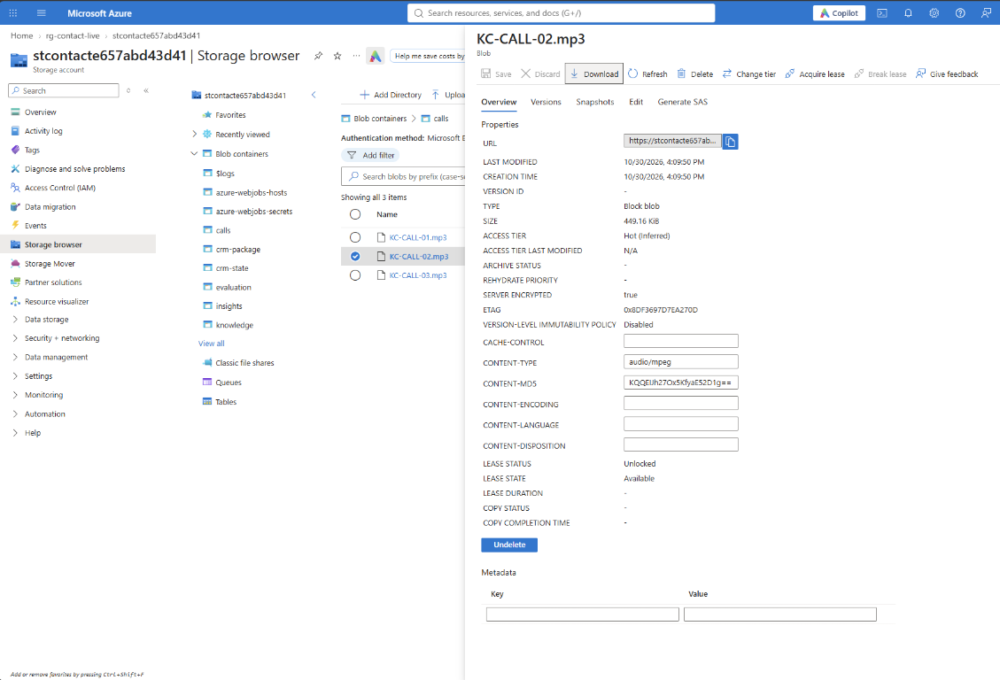
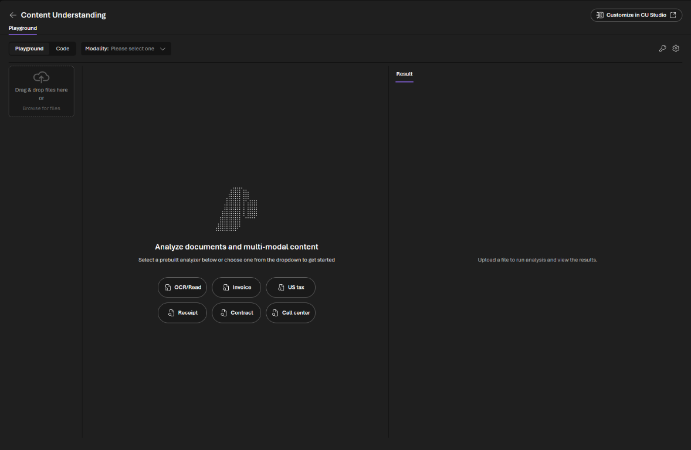
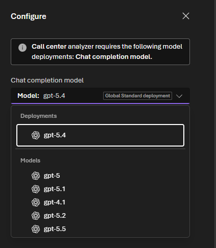
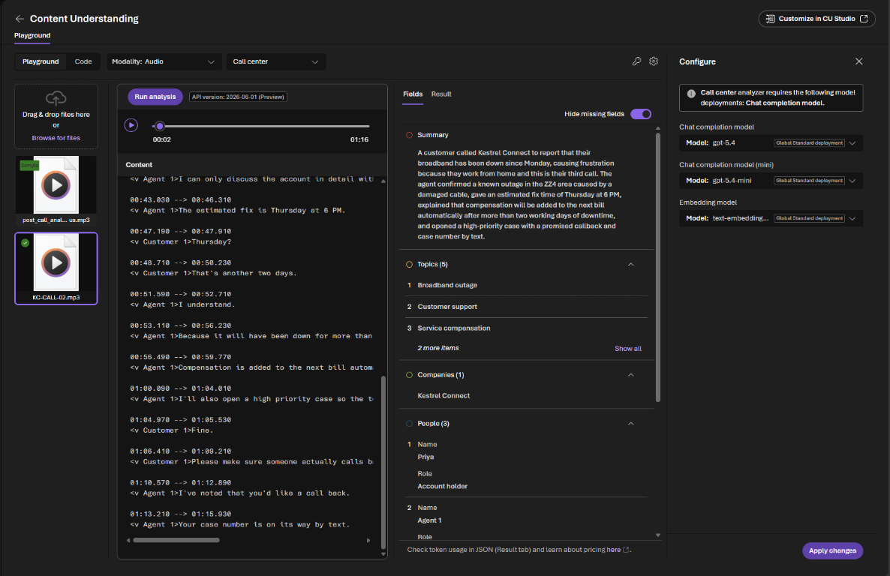

# Challenge 6: Post-contact analytics and supervisor insights

**[← Previous](challenge-05.md)** - [Home](../README.md) - [Next Challenge →](challenge-07.md)

## 🎯 Objective

Turn recorded calls into structured insight with **Content Understanding**: a transcript, a summary, the customer's intent and sentiment, and a **quality scorecard** you design. Then build a **supervisor agent** that looks across a week of contacts and finds the trends a team leader needs to act on.

## 🧭 Context

Most contact centers review a tiny sample of calls by hand, weeks later. With an analyzer, **every** contact gets the same structured review, and a supervisor can ask questions across all of them: *why are people calling, where, and are we handling it well?*

Your lab has two kinds of material for this:

| Material | Where | Used for |
|---|---|---|
| Three **recorded calls** for your company (MP3) | Storage container `calls` | Analysing individual calls in Parts A and B |
| A **week of analysed contacts** (30 contacts, 1 to 10 March 2027) | Storage container `insights` | Supervisor trends in Parts C and D |

## ✅ Tasks

### Part A: Analyse a recorded call (15 min)

1. In the Azure portal, open your storage account, then **Storage browser**, then the `calls` container, and **download** your company's three MP3 files. Play one: it is a short call between a customer and an adviser.

   

2. In the Foundry portal, type `content understanding` in the search bar at the top, select **Azure-AI-Content-Understanding** (a model) and **Open in playground**.

   

3. Select **Call center**. The first time, a **Configure** panel asks for model deployments. Choose:
   - **Chat completion model:** your `AnalysisModelDeploymentName` (`gpt-5.4`). The call center analyzer needs a full-size model; the lab deploys one for it.
   - **Chat completion model (mini):** your `ModelDeploymentName` (`gpt-5.4-mini`).
   - **Embedding model:** your `EmbeddingDeploymentName` (`text-embedding-3-large`).

   Pick `gpt-5.4` under **Deployments** in the list, not under **Models** (those would create a new deployment). Select **Apply changes**. Don't select **Deploy models** if it is offered: the deployment you need already exists.

   

4. Upload `<PREFIX>-CALL-02.mp3`, select it and select **Run analysis**. Check the **transcript** (are the adviser and the customer told apart as two speakers?), the **summary**, the **sentiment**, the **topics** and the **people** it found.



   Turn off **Hide missing fields** to see every field, and open the **Result** tab for the full JSON, including the sentiment.

### Part B: Design your quality scorecard (15 min)

A summary is nice; a **scorecard** changes coaching. In the Call center playground, select **Customize in CU Studio** to make your own analyzer based on it, name it `contactCallScorecard` (letters, numbers, dots and underscores only), and add these fields (method **generate**). Save, then run it on all three calls:

| Field | Type | Description to give the model |
|---|---|---|
| `intent` | string | The main reason for the contact, in two or three words |
| `identity_checked` | boolean | True if the adviser confirmed the account number and postcode before discussing the account |
| `resolved` | boolean | True if the customer's need was met during the call |
| `escalated` | boolean | True if the customer was passed to another person or team |
| `vulnerability_signs` | string | Any sign the customer may be vulnerable, or "none" |
| `empathy_score` | integer | 1 to 5: how well the adviser acknowledged the customer's feelings |
| `next_action` | string | What should happen next, if anything |

Compare the three results with your team. Do the scores match what you heard? Which field would you trust least, and why?

> 📸 **Screenshot to add:** `images/challenge-06-scorecard.png`: the scorecard fields for one call: intent, identity_checked, resolved, escalated, vulnerability_signs and empathy_score.

### Part C: The supervisor's knowledge base (10 min)

1. In **Build**, then **Knowledge**, create a second knowledge base `contact-insights-kb` with a new Azure Blob Storage source `contact-insights` on the **`insights`** container (same settings as Challenge 1). Wait until it is **Active**.
2. Create an agent `supervisor-insights` with **Interaction mode** **Text**, remove **Web search**, add `contact-insights-kb` under **Knowledge**, and paste:

   ```text
   You are the supervisor insights assistant for <Company>'s contact center team leaders.

   Your knowledge base holds analysed contacts: date, channel, intent, postcode area, sentiment,
   whether it was resolved at first contact, whether it was escalated, handle time, quality scores
   from 1 to 5 and a short summary. ALWAYS search it before answering. Never invent numbers.

   When asked about trends:
   - Count, don't guess. Give numbers and the contact IDs behind them.
   - Look for spikes by intent, by area and by day, and connect them (for example many outage
     contacts in one area on the same days).
   - Point out quality problems, especially any contact where verification scored 1, which means
     the identity check was missed.
   - Finish with two or three concrete actions for next week, each linked to the evidence.
   Keep answers short enough for a team leader to read in two minutes.
   ```

3. **Save**.

### Part D: Find the trends (10 min)

Ask `supervisor-insights`:

1. *What were the top three reasons customers contacted us from 1 to 10 March?*
2. *Is there a spike in any postcode area? On which days?*
3. *Which contacts missed the identity check?*
4. *What should we change next week?*

Check one answer against the contacts file in the `insights` container. Every company has one deliberate trend and two missed identity checks hidden in its week. Did the supervisor find them?

> 📸 **Screenshot to add:** `images/challenge-06-supervisor.png`: supervisor-insights naming the spike by intent and area, the two missed identity checks and recommended actions.

## ✔️ Success criteria

- [ ] The Call center analyzer produces a transcript, summary and sentiment for your company's calls, and `contactCallScorecard` adds your scorecard fields.
- [ ] Your scorecard fields are filled in for all three calls, and you discussed which ones you would trust.
- [ ] `supervisor-insights` uses only `contact-insights-kb`, and finds your company's trend and the two missed identity checks.
- [ ] Its recommended actions are tied to evidence from the contacts.

## 📚 Learning resources

- [Content Understanding audio overview](https://learn.microsoft.com/azure/ai-services/content-understanding/audio/overview)
- [What is Foundry IQ?](https://learn.microsoft.com/azure/foundry/agents/concepts/what-is-foundry-iq)

[Coach solution and expected answers](../walkthrough/challenge-06/solution-06.md)
