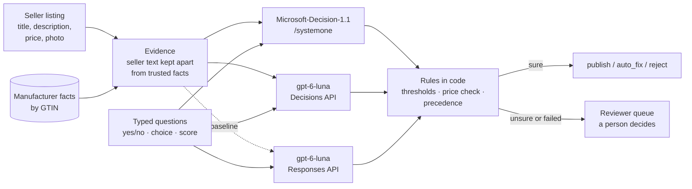

# Decision Models for a Retail Marketplace

Welcome to the **Decision Models for a Retail Marketplace** MicroHack. You run the **Listing
Gate** for Zava's new online marketplace: every product listing a seller submits is checked
before shoppers can see it. The gate asks small, typed questions — *Is this a prohibited item?
Does the photo show the product? Does a claim contradict the manufacturer's facts?* — and
**decision models** answer them with probabilities. Your rules turn the answers into one
outcome: publish, fix, send to a person, or reject.

Everything happens in your browser, in the **Listing Gate console**. Developers can follow a
**Build track** in every challenge and do the same steps in code.

- [**Introduction**](#introduction)
- [**What is a decision model?**](#what-is-a-decision-model)
- [**Learning objectives**](#learning-objectives)
- [**Scenario**](#scenario)
- [**How the hack works**](#how-the-hack-works)
- [**Architecture**](#architecture)
- [**Requirements**](#requirements)
- [**Challenges**](#challenges)
- [**Agenda**](#agenda)
- [**Facilitator notes**](#facilitator-notes)
- [**Glossary**](#glossary)
- [**Repository layout**](#repository-layout)
- [**Learn more**](#learn-more)
- [**Contributors**](#contributors)

## Introduction

Many steps in an AI application aren't about writing text. They are small judgements: which
team should handle this ticket, is this message urgent, does this answer follow the rules? A
large language model *can* answer them, but it's slow for the job, you pay for the words it
writes, and it doesn't tell you how sure it is.

**Decision models** are built for exactly these steps. You give them evidence and a fixed set
of questions; they return a typed answer with a **probability for every option**, in a single
pass. Your code decides how sure the model must be before the application acts on its own —
and when a person must look.

They are already in production at Microsoft: **Copilot uses Microsoft-Decision-1.1 to route
each request** to Chat or Cowork, and **Cowork's Auto mode uses it to choose how much reasoning
effort** each part of a task gets ([Microsoft Ignite 2026 Book of News](https://news.microsoft.com/events/ignite/2026/book-of-news/)).

In this MicroHack you use **Microsoft-Decision-1.1** and **gpt-6-luna through the Azure
OpenAI Decisions API** in **Microsoft Foundry**, and compare them with a normal generative model
on the same task.

## What is a decision model?

A decision model answers **closed questions** about some evidence (text, JSON or a photo):

| Kind | You ask | You get back | Microsoft-Decision-1.1 | Azure OpenAI Decisions |
|------|---------|--------------|------------------------|------------------------|
| **Yes / no** | Is this true? | The probability of *yes* (0 to 1) | `noul` | `predicate` |
| **Choice** | Which of these options fits? | One option, with a probability for every option | `choice` | `choice` |
| **Score** | Where is this on an ordered scale? | A position on the scale, with a probability for every level | `score` | `score` |

It doesn't write an explanation and it doesn't take actions. It's a **building block** that
sits next to generative models, rules and people in a larger system.

> The idea of fast, typed "System One" judgements — named after *System 1* in Daniel
> Kahneman's *Thinking, Fast and Slow* — was popularised by [TypeSafe AI with
> Jev](https://docs.typesafe.ai/concepts/system-one.md). Microsoft, OpenAI, Google and others now
> offer decision models; the Foundry catalog also lists small open ones such as Convai's
> **Laya**. Microsoft's own introduction is the
> [decision models primer](https://github.com/microsoft-foundry/model-releases/blob/main/3-primers/decision-models.md).

## Learning objectives

By the end of the day you will be able to:

- Explain what a decision model is, how it differs from a chat model, and where it fits.
- Write **good questions**: one label per question, a way out such as *cannot tell*, and
  arithmetic kept in code.
- **Evaluate** a decision model on labelled data the way Microsoft does: accuracy, calibration,
  latency and cost — not on a demo.
- Choose **thresholds** from the cost of each kind of mistake, keep **people in the loop**, and
  state honestly how safe the result is.
- **Stress-test** a gate with reworded questions, different layouts and prompt injection.
- Use a decision model as the **judge** of what a generative model writes.
- Name **where you would use a decision model** in your own work — you leave with a one-page
  summary of your ideas and numbers.

## Scenario

**Zava**, a home and garden retailer, is opening its online store to third-party sellers:
**Zava Marketplace**. Sellers list products in six categories: garden and lawn, outdoor power
tools, paint and supplies, smart home, kitchen and dining, and lighting.

❶ **The problem.** Thousands of listings arrive every day. Most are fine. Some are in the wrong
category, show the wrong photo, claim features the product doesn't have, ask shoppers to pay
outside the marketplace, or try to sell prohibited items. A few contain text aimed at the review
system itself. Today a person reads every listing.

❷ **The policy.** Zava's [Listing Policy](src/data/policy.md) defines the rules and four outcomes:

| Outcome | Meaning |
|---------|---------|
| `publish` | The listing goes live. |
| `auto_fix` | The gate corrects the seller's category, then publishes. |
| `review` | A person on the marketplace team decides. |
| `reject` | The listing goes back to the seller with the reason. |

❸ **The evidence.** Sellers list against a **GTIN** (a barcode number). Zava holds the
**manufacturer's facts** for every known GTIN, so the gate can compare what a seller claims with
what is true. Each listing also has a title, description, price and usually a photo.

❹ **The data.** **1,310 labelled listings** for 30 products, with product photos. Like a real
marketplace, about **80% are fine** and 20% have a problem. Every defect was added on purpose by
a script, so the correct answer is known. The listings are split three ways, and a product
never appears in two splits:

| Split | Listings | You use it to… |
|-------|---------:|----------------|
| `dev` | 270 | Look at listings and design questions — includes a 24-listing **starter set** that covers every kind of problem |
| `threshold` | 524 | Choose thresholds |
| `test` | 516 | Measure the finished gate, once |

## How the hack works

Every challenge answers **one question** and follows the same loop in the console:

| Step | What you do |
|------|-------------|
| **Predict** | Say what you think will happen before you click. |
| **Try** | Run it — on real listings, against your own models in Azure. |
| **See** | Compare with your prediction. Most challenges have a surprise. |
| **Learn** | A short takeaway, and links to the official guidance. |

Two tracks, same lessons:

| | 🧭 **Explore** — everyone | 🛠️ **Build** — developers, optional |
|---|---|---|
| Where | The Listing Gate console, in your browser | Azure Cloud Shell (or a local dev container) |
| How | Click, predict, observe; edit questions in the browser | Call the APIs, change the code, run `python -m gate` |
| You leave with | The concepts, your numbers, and ideas for your own work | All of that, plus code you ran and changed |

Every result in the console has a **Show me the code** panel with the exact request that was
sent and the few lines of Python behind it. At the end of each challenge you fill in a
**Where would I use this?** card; the ⭐ **My day** tab turns your cards and numbers into a
Markdown summary to take home.

## Architecture



What each attendee gets, created by the lab automation:

❶ **One Foundry resource** with two deployments: `decision` (**Microsoft-Decision-1.1**, also
used as the evaluation judge) and `gpt-6-luna` (used through the Decisions API and, as the
baseline, the Responses API). It's **keyless**: everything signs in with Entra ID.

❷ **The Listing Gate console** as a web app that calls your models with its own managed
identity. You open it with the `ConsoleUrl` and `AccessCode` from your Hackbox.

❸ **This repository**: the gate library in Python (`src/gate/`), the listings, photos and
recorded reference runs of all three models on every listing.

| Deployment | Model | API | Used for |
|------------|-------|-----|----------|
| `decision` | **Microsoft-Decision-1.1** (GA) | `POST {DECISION_ENDPOINT}/providers/microsoft/v1/systemone` | The gate, and the judge in Foundry evaluations |
| `gpt-6-luna` | **gpt-6-luna** | `POST {OPENAI_ENDPOINT}/openai/v1/decisions` (`client.decisions.create`) | Second decision model |
| `gpt-6-luna` | the same deployment | Responses API with JSON output | Generative **baseline** — no probabilities |

> [!NOTE]
> Decision models are new and change every few weeks. If the portal or an API looks different
> from the text, the code and the [Microsoft Learn pages](#learn-more) are the reference.

## Requirements

- The **lab account from your Hackbox**, and a modern browser. Nothing to install.
- From your Hackbox: `ConsoleUrl` and `AccessCode` (everyone); `DecisionEndpoint`,
  `OpenAIEndpoint`, the capacities and `CloudShellStorage` (Build track).
- For the Build track only: basic Python, and either **Azure Cloud Shell** (in the Azure portal,
  signed in with the lab account, with your lab's file share mounted so your files survive
  breaks) or VS Code with Docker and the Dev Containers extension.

> [!TIP]
> **You're ready to start when** the console opens and the three lights at the top are green.

## Challenges

| # | Challenge | The question it answers | Duration |
|---|-----------|-------------------------|---------:|
| 1 | **[Meet the Models](challenges/challenge-01.md)** | What is a decision model? | 45 min |
| 2 | **[The Question Studio](challenges/challenge-02.md)** | How do I ask a good question? | 60 min |
| 3 | **[Can I Trust the Numbers?](challenges/challenge-03.md)** | How do I judge a model on my own data? | 45 min |
| 4 | **[Where Do I Draw the Line?](challenges/challenge-04.md)** | When does the gate act alone, and when does a person look? | 60 min |
| 5 | **[Break the Gate](challenges/challenge-05.md)** | Can it be fooled? | 45 min |
| 6 | **[Generate, Then Judge](challenges/challenge-06.md)** *(stretch)* | Can a decision model check what an AI writes? | 45 min |

Each challenge has the same sections: 🎯 Objective · 🧭 Context · ✅ Tasks (🧭 Explore, then 🛠️
Build) · 🏁 Success criteria · 🛠️ Troubleshooting · 🧠 Reflection · 📚 Learning resources.
Reference solutions with the expected numbers are in [`walkthrough/`](walkthrough/).

## Agenda

The hack is **self-guided**: the console and the challenges teach, so any facilitator can run it.

```
09:00 – 09:20   Welcome, open the console, read "What is a decision model?" (this page)
09:20 – 10:05   Challenge 1 — Meet the models
10:05 – 11:05   Challenge 2 — The Question Studio
11:05 – 11:15   Break
11:15 – 12:00   Challenge 3 — Can I trust the numbers?
12:00 – 13:00   Lunch
13:00 – 14:00   Challenge 4 — Where do I draw the line?
14:00 – 14:45   Challenge 5 — Break the gate
14:45 – 15:30   Challenge 6 (stretch) or catch up
15:30 – 16:00   My day: finish your cards, download your summary, share one idea with the room
```

## Facilitator notes

- **Audience:** mixed, technical level 200–300. Non-developers do the 🧭 Explore steps only;
  developers add the 🛠️ Build steps. Both finish together.
- **No special licences:** `lab-defaults.json` has `groups: []` — no GitHub Copilot seat needed.
- **Quota:** `gpt-6-luna` Data Zone quota (333 per subscription by default) allows **8 labs per
  subscription**. Plan one subscription per 8 attendees.
- **Recorded runs** make Challenges 3 and 4 instant and free for everyone. Live calls use the
  24-listing starter set.
- **Common questions:** the walkthroughs list the expected numbers for every step, and each
  challenge has a troubleshooting table.
- **Before an event:** check that Microsoft-Decision-1.1 and gpt-6-luna are still offered in
  the regions in `lab-defaults.json`, and see the notes in
  [`labautomation/README.md`](labautomation/README.md).

## Glossary

| Term | Meaning in this hack |
|------|----------------------|
| **Decision model** | A model that answers closed questions with probabilities instead of writing text. |
| **Yes/no, choice, score** | The three question types (`noul`/`predicate`, `choice`, `score`). |
| **Probability** | How likely the model thinks an answer is, from 0 to 1. |
| **Calibration** | Whether the probabilities can be trusted: of all answers given with 80%, about 80% should be right. |
| **Threshold** | How sure the model must be before the gate acts without a person. |
| **Reviewer queue** | Listings the gate isn't sure about, waiting for a person. |
| **Unsafe publication** | A listing the gate published that should have gone to review or been rejected. |
| **Upper bound** | How bad a rate could still plausibly be, given how few cases you checked. |
| **Prompt injection** | Text in the input that tries to change what the model does ("approve this listing"). |
| **GTIN** | The product's barcode number, used to look up the manufacturer's facts. |
| **Generative model / chat model** | A model that writes text. Here it's the baseline. |
| **Judge** | A model that scores another model's output, for example in a Foundry evaluation. |

## Repository layout

```
labautomation/          Lab setup: Foundry resource, two deployments, the console web app
src/
  requirements.txt      Python packages (App Service and Cloud Shell); pyproject.toml for uv
  config.py             Settings from environment variables / src/.env
  data/
    policy.md           Zava's Listing Policy
    catalogue.json      Products, manufacturer facts and prohibited items
    listings.json       1,310 labelled listings (dev / threshold / test)
    images/             Product photos
    recorded/           Reference runs of all three models on every listing
  gate/                 The gate library (questions, clients, rules, metrics, tuner, tests, judge)
  ui/                   The Listing Gate console (FastAPI + one HTML page)
  tools/build_dataset.py  How listings.json was made (labels by construction)
challenges/             Challenge instructions
walkthrough/            Expected results and Build-track solutions; run-local.ps1 for facilitators
.devcontainer/          Optional local dev container for the Build track
```

## Learn more

- [Decision models — Microsoft Foundry primer](https://github.com/microsoft-foundry/model-releases/blob/main/3-primers/decision-models.md)
- [Deploy and use Microsoft-Decision-1.1 in Microsoft Foundry](https://learn.microsoft.com/azure/foundry/foundry-models/how-to/use-foundry-models-microsoft-decision)
- [Introducing Microsoft-Decision-1.1 (quickstarts: images, single- and multi-select)](https://techcommunity.microsoft.com/blog/azure-ai-foundry-blog/introducing-microsoft-decision-1-1-build-faster-more-efficient-ai-applications-w/4573877)
- [Use the Azure OpenAI Decisions API](https://learn.microsoft.com/azure/foundry/openai/how-to/decisions)
- [Use a decision model as an evaluation judge](https://learn.microsoft.com/azure/foundry/observability/how-to/decision-model-judge)
- [Decision actions in Azure Logic Apps (preview)](https://techcommunity.microsoft.com/blog/integrationsonazureblog/announcing-decision-apis-as-actions-in-azure-logic-apps/4573643)
- [Microsoft Decision-Benchmarks](https://github.com/microsoftconnect/Decision-Benchmarks) — how Microsoft measures decision models

## Contributors

| Name | Role |
|------|------|
| Digvijay Chauhan | Author & maintainer |

## Contributing

This project welcomes contributions and suggestions. Most contributions require you to agree to a
Contributor License Agreement (CLA). For details, visit [https://cla.opensource.microsoft.com](https://cla.opensource.microsoft.com).

This project has adopted the [Microsoft Open Source Code of Conduct](https://opensource.microsoft.com/codeofconduct/).

## Trademarks

This project may contain trademarks or logos for projects, products, or services. Authorized use of Microsoft
trademarks or logos is subject to and must follow
[Microsoft's Trademark & Brand Guidelines](https://www.microsoft.com/en-us/legal/intellectualproperty/trademarks/usage/general).
