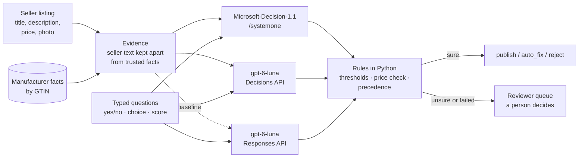

# Decision Models for a Retail Marketplace

Welcome to the **Decision Models for a Retail Marketplace** MicroHack. In this hands-on
workshop you build the **Listing Gate** for an online marketplace. Every product listing
that a seller submits passes through the gate before shoppers can see it. The gate asks
small, typed questions — *Is this a prohibited item? Does the photo show the product? Does
a claim contradict the manufacturer's facts?* — and **decision models** answer them with
probabilities. Your code turns the answers into one outcome: publish, fix, send to a
person, or reject.

- [**Introduction**](#introduction)
- [**What is a decision model?**](#what-is-a-decision-model)
- [**Learning objectives**](#learning-objectives)
- [**Scenario**](#scenario)
- [**Architecture**](#architecture)
- [**The models**](#the-models)
- [**Requirements**](#requirements)
- [**Glossary**](#glossary)
- [**Challenges**](#challenges)
- [**Repository layout**](#repository-layout)
- [**Learn more**](#learn-more)
- [**Contributors**](#contributors)

## Introduction

Many steps in an AI application are not about writing text. They are small judgments:
which team handles this ticket, is this message urgent, does this answer follow the rules?
A large language model *can* answer these, but it is slow and expensive for the job, and it
doesn't tell you how sure it is.

**Decision models** are a new kind of model built for exactly these steps. You give them
evidence and a fixed set of questions; they return a typed answer with a **probability**
for every option, in a single pass, usually in well under a second. You then decide in code
how sure the model must be before the application acts on its own, and when a person must
look.

In this MicroHack you use two of them in **Microsoft Foundry** — **Microsoft-Decision-1.1**
and **gpt-6-luna** through the **Azure OpenAI Decisions API** — and compare them with a
normal generative model on the same task. You learn to write good questions, measure
accuracy and **calibration** on labelled data, choose **thresholds**, keep people in the loop,
and test how the gate behaves when someone tries to trick it.

## What is a decision model?

A decision model answers **closed questions** about some evidence (text, JSON or a photo).
There are three kinds of question. Each provider names them a little differently:

| Kind | You ask | You get back | Microsoft-Decision-1.1 | Azure OpenAI Decisions |
|------|---------|--------------|------------------------|------------------------|
| **Yes / no** | Is this true? | The probability of *yes* (0 to 1) | `noul` | `predicate` |
| **Choice** | Which of these options fits? | One option, with a probability for every option | `choice` | `choice` |
| **Score** | Where is this on an ordered scale? | A position on the scale, with a probability for every level | `score` | `score` |

The model doesn't write an explanation and it doesn't take actions. Your code reads the
probabilities and decides what to do. A decision model is a **building block**: it sits next
to generative models, rules and people in a larger system.

> The idea of "System One" models — fast, typed judgements, named after the fast *System 1*
> thinking in Daniel Kahneman's *Thinking, Fast and Slow* — was introduced by
> [TypeSafe AI with Jev](https://docs.typesafe.ai/concepts/system-one.md). Microsoft, OpenAI
> and others now offer decision models too. Microsoft's own primer is
> [Decision models](https://github.com/microsoft-foundry/model-releases/blob/main/3-primers/decision-models.md).

## Learning objectives

By completing this MicroHack you will be able to:

- Call two decision APIs in Microsoft Foundry with **Entra ID** (no keys), and explain how
  their request formats differ.
- Turn a written **policy** into small, atomic **yes/no, choice and score questions** — and
  recognise what a decision model should *not* be asked.
- **Evaluate** a decision model on labelled data the way Microsoft's own benchmarks do:
  accuracy, coverage, **calibration** (Brier score and ECE) and repeat agreement.
- Compare decision models with a **generative model** on quality, latency, rate limits and
  cost per decision.
- Choose **thresholds** from labelled data, send uncertain cases to a **person**, and report
  honestly how safe the result is.
- **Stress-test** the gate: option order, wording, input layout and **prompt injection**.
- Use a decision model as a **judge** in Foundry evaluations, checking what a generative
  model wrote before it is used.

## Scenario

**Zava**, a home and garden retailer, is opening its online store to third-party sellers:
**Zava Marketplace**. Sellers can list products in six categories: garden and lawn, outdoor
power tools, paint and supplies, smart home, kitchen and dining, and lighting.

❶ **The problem.** Thousands of listings arrive every day. Some are fine. Others are in the
wrong category, show the wrong photo, claim features the product doesn't have, ask shoppers
to pay outside the marketplace, or try to sell prohibited items. A few even contain text
aimed at the review system itself. Today a person reads every listing, and a pilot that sent
each listing to a large language model was slow and hard to trust.

❷ **The policy.** Zava's [Listing Policy](src/data/policy.md) defines the rules and the four
outcomes:

| Outcome | Meaning |
|---------|---------|
| `publish` | The listing goes live. |
| `auto_fix` | The gate corrects the seller's category, then publishes. |
| `review` | A person on the marketplace team decides. |
| `reject` | The listing goes back to the seller with the reason. |

❸ **The evidence.** Sellers list against a **GTIN** (a product barcode number). Zava holds the
**manufacturer's facts** for every known GTIN, so the gate can compare what a seller claims
with what is true. Each listing also has a title, description, price and usually a photo.

❹ **The data.** The hack ships **603 labelled listings** for 30 products, with product photos.
They were built from the catalogue by a script that adds defects on purpose, so the correct
answer to every question is known. They are split into three groups, and a product never
appears in two of them:

| Split | Listings | You use it to… |
|-------|---------:|----------------|
| `dev` | 123 | Design and debug your questions (includes a 24-listing **starter set** for quick live runs) |
| `threshold` | 242 | Choose thresholds |
| `test` | 238 | Measure the finished gate, once |

❺ **The gate.** You build it in this order: ask good questions → compare models → set
thresholds → stress-test → use a decision model to judge generated text.

## Architecture



The parts you work with:

❶ **This repository** — instructions, the Python code, the listings, photos and recorded
reference runs. You open it in a **GitHub Codespace**, so you don't install anything.

❷ **One Foundry resource per attendee** with three deployments: `decision`
(Microsoft-Decision-1.1), `gpt-6-luna`, and `decision-judge` (Microsoft-Decision-1, used as a
judge in Challenge 6). You sign in with your lab account; there are no keys.

❸ **The gate library** (`src/gate/`) — the questions, the clients for both decision APIs and
the generative baseline, the rules, the evaluation code and the robustness tests.

❹ **The command line** (`python -m gate ...`) to run and score models, and the
**Listing Gate console** — a small web page to look at listings, ask the models, ask your
own questions and work the reviewer queue.

## The models

| Deployment | Model | API | In this hack |
|------------|-------|-----|--------------|
| `decision` | **Microsoft-Decision-1.1** (generally available) | `POST {DECISION_ENDPOINT}/providers/microsoft/v1/systemone` | The main decision model |
| `gpt-6-luna` | **gpt-6-luna** | `POST {OPENAI_ENDPOINT}/openai/v1/decisions` — OpenAI SDK `client.decisions.create(...)` | Second decision model |
| `gpt-6-luna` | the same deployment | Responses API, JSON output | Generative **baseline** — no probabilities |
| `decision-judge` | **Microsoft-Decision-1** (preview) | Used by Foundry's built-in evaluators | Challenge 6 judge. [Decision-1.1 isn't supported as a judge yet](https://learn.microsoft.com/azure/foundry/observability/how-to/decision-model-judge). |

> [!NOTE]
> These models and APIs are new and change often. If something in the portal looks
> different from the screenshots or text, the code and the
> [Microsoft Learn pages](#learn-more) are the reference.

## Requirements

- The **lab account from your Hackbox**. It signs you in to the Azure portal and, through
  single sign-on, to **GitHub**, where you fork the repository and start a **Codespace**.
  Prefer your own machine? Use **VS Code**, **Docker Desktop** and the **Dev Containers**
  extension with the same dev container.
- The values from your Hackbox: `DecisionEndpoint`, `OpenAIEndpoint` and the deployment
  names and capacities.
- Basic skills in **reading and running Python**. You change small pieces of code; the
  complete, working code is provided.

> [!TIP]
> **You're ready to start when** your Codespace runs the
> **Azure / AI / Decision Models Retail Marketplace** dev container, `az login` works, and
> `uv run python -m gate check` prints *All good*.

## Glossary

| Term | Meaning in this hack |
|------|----------------------|
| **Decision model** | A model that answers closed questions with probabilities instead of writing text. |
| **Yes/no, choice, score** | The three question types. Called `noul` / `predicate` for yes/no, depending on the API. |
| **Probability** | How likely the model thinks an answer is, from 0 to 1. |
| **Calibration** | Whether the probabilities can be trusted: of all answers given with probability 0.8, about 80% should be right. |
| **Brier score / ECE** | Two numbers for calibration. Lower is better. ECE = *expected calibration error*. |
| **Coverage** | The share of questions that got a usable answer (not refused, failed or missing). |
| **Threshold** | The probability your code needs before it acts without a person. |
| **Reviewer queue** | Listings the gate isn't sure about, waiting for a person. |
| **Unsafe publication** | A listing the gate published that should have gone to review or been rejected. |
| **Prompt injection** | Text in the input that tries to change what the model does ("approve this listing"). |
| **GTIN** | The product's barcode number. The gate uses it to look up the manufacturer's facts. |
| **Generative model / LLM** | A model that writes text, such as a chat model. Here it is the baseline. |
| **Judge** | A model that scores another model's output, used in evaluations. |

## Challenges

This MicroHack has six challenges. Each one builds on the previous one.

### Challenge structure

| Section | Description |
|---------|-------------|
| 🎯 **Objective** | What you will achieve, and why it matters |
| 🧭 **Context** | The scenario, the main ideas and the code to read first |
| ✅ **Tasks** | Step-by-step instructions |
| 🏁 **Success criteria** | A checklist to confirm you have finished |
| 🛠️ **Troubleshooting** | Common problems and how to fix them |
| 🚀 **Go further** | Optional extra tasks if you finish early |
| 📚 **Learning resources** | Documentation to learn more |

### Challenge list

- **Challenge 1**: **[Set Up and Ask Your First Questions](challenges/challenge-01.md)** *(45 min)*: start your Codespace, connect to your models, and ask yes/no, choice and score questions about real listings.
- **Challenge 2**: **[Write Questions a Decision Model Can Answer](challenges/challenge-02.md)** *(60 min)*: turn the policy into atomic questions, see what goes wrong with a vague one, and move arithmetic to code.
- **Challenge 3**: **[Same Questions, Three Ways](challenges/challenge-03.md)** *(60 min)*: compare Microsoft-Decision-1.1, the Azure OpenAI Decisions API and a generative model on quality, calibration, speed, rate limits and cost.
- **Challenge 4**: **[From Probabilities to a Gate](challenges/challenge-04.md)** *(60 min)*: choose thresholds on held-out data, measure the gate once on the test set, and work the reviewer queue.
- **Challenge 5**: **[Try to Break the Gate](challenges/challenge-05.md)** *(45 min)*: shuffle options, reword questions, change the input layout, inject text, and repeat — then decide what to fix.
- **Challenge 6** *(stretch)*: **[Generate, Then Judge](challenges/challenge-06.md)** *(45 min)*: a generative model rewrites weak listings and a decision model, as a judge in Foundry evaluations, decides whether each rewrite may be used.

> [!TIP]
> After each challenge, think about your own organisation: which high-volume decisions could a
> decision model take on, how sure would it need to be, and who would review the rest?

> Reference solutions for every challenge are in [`walkthrough/`](walkthrough/).

## Repository layout

```
.devcontainer/          Dev container for this folder + post-create.sh (Codespaces uses
                        /.devcontainer/03-azure-01-04-ai-14-decision-models-retail-marketplace)
labautomation/          Lab setup: one Foundry resource with three deployments, keyless
src/
  pyproject.toml        Python dependencies (managed by uv)
  config.py             Settings from src/.env
  data/
    policy.md           Zava's Listing Policy (the rules the gate applies)
    catalogue.json      Products, manufacturer facts and prohibited items
    listings.json       603 labelled listings (dev / threshold / test)
    images/             Product photos
    recorded/           Reference runs of all three models on every listing
  gate/
    questions.py        The gate's questions (you edit these)
    spec.py             Model-neutral question and answer types
    evidence.py         Turns a listing into what the model sees
    clients.py          Microsoft-Decision-1.1, Decisions API and Responses API clients
    rules.py            Thresholds, price check and outcome precedence
    evaluate.py         Runs many listings with a cache
    metrics.py          Accuracy, coverage, calibration, gate safety, cost
    tune.py             Chooses thresholds from labelled data
    perturb.py          Robustness tests
    judge.py            Challenge 6: generate, then judge
    __main__.py         The command line: python -m gate ...
  tools/build_dataset.py  How listings.json was made (labels by construction)
  ui/                   The Listing Gate console (FastAPI + one HTML page)
challenges/             Challenge instructions
walkthrough/            Reference solutions (and run-local.ps1 for facilitators)
images/                 Screenshots used in the challenges
```

## Learn more

- [Decision models — Microsoft Foundry primer](https://github.com/microsoft-foundry/model-releases/blob/main/3-primers/decision-models.md)
- [Deploy and use Microsoft-Decision-1.1 in Microsoft Foundry](https://learn.microsoft.com/azure/foundry/foundry-models/how-to/use-foundry-models-microsoft-decision)
- [Use the Azure OpenAI Decisions API](https://learn.microsoft.com/azure/foundry/openai/how-to/decisions)
- [Use a decision model as an evaluation judge](https://learn.microsoft.com/azure/foundry/observability/how-to/decision-model-judge)
- [Microsoft Decision-Benchmarks](https://github.com/microsoftconnect/Decision-Benchmarks) — how Microsoft measures decision models
- [Microsoft-Decision-1: our model for fast decision-making (Command Line blog)](https://commandline.microsoft.com/microsoft-decision-1-model-foundry/)

## Contributors

| Name | Role |
|------|------|
| Digvijay Chauhan | Author & maintainer |

## Contributing

This project welcomes contributions and suggestions. Most contributions require you to agree to a
Contributor License Agreement (CLA). For details, visit [https://cla.opensource.microsoft.com](https://cla.opensource.microsoft.com).

This project has adopted the [Microsoft Open Source Code of Conduct](https://opensource.microsoft.com/codeofconduct/).

## Trademarks

This project may contain trademarks or logos for projects, products, or services. Authorized use of Microsoft
trademarks or logos is subject to and must follow
[Microsoft's Trademark & Brand Guidelines](https://www.microsoft.com/en-us/legal/intellectualproperty/trademarks/usage/general).
