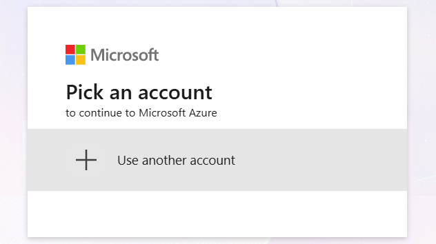
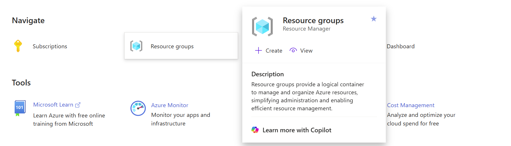
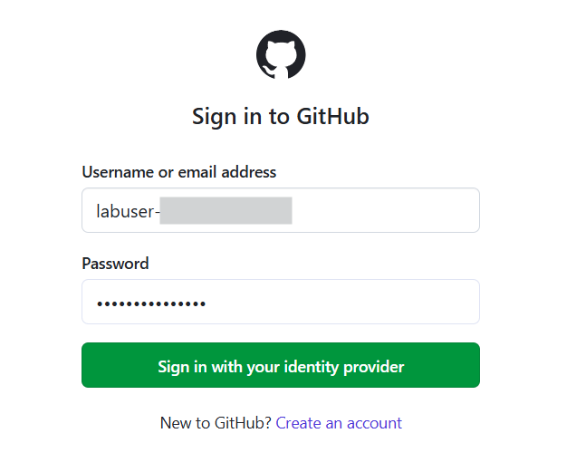
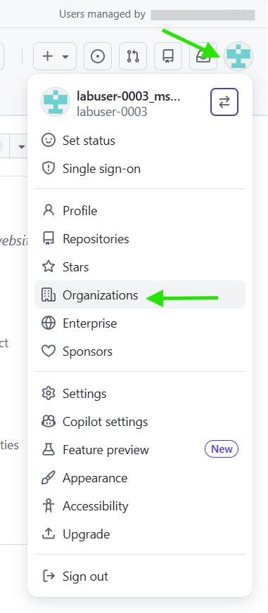
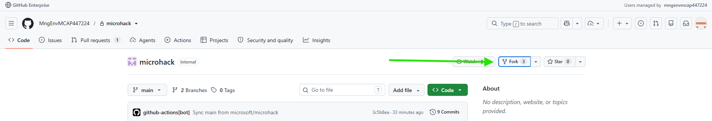
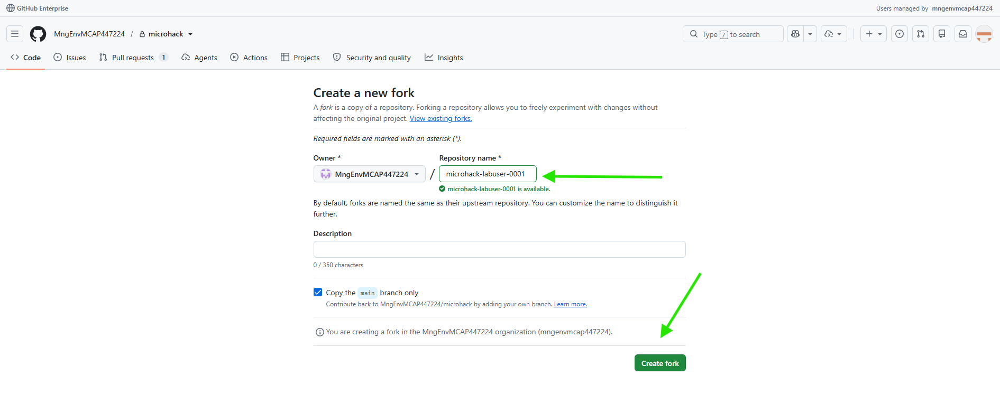
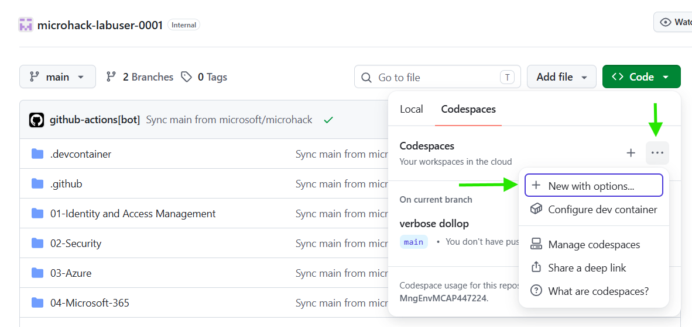
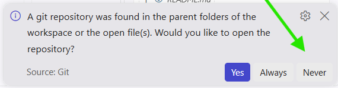

# Challenge 1 — Set Up and Ask Your First Questions

**[Home](../README.md)** - [Next Challenge →](challenge-02.md)

## 🎯 Objective

In this challenge you:

- sign in with your lab account and start your **Codespace**,
- connect to your **two decision models** and the generative baseline,
- open the **Listing Gate console** and look at the marketplace listings, and
- ask your first **yes/no, choice and score** questions and read the probabilities.

## 🧭 Context

Zava Marketplace receives thousands of listings from third-party sellers. Before a listing goes
live, the **Listing Gate** checks it against Zava's [Listing Policy](../src/data/policy.md) and
gives one outcome: **publish**, **auto-fix** (correct the category), **review** (a person decides)
or **reject**.

The gate asks **decision models** small questions about each listing. A decision model doesn't
write text. It answers a closed question with a **probability for every possible answer**:

| Question type | Example | Answer |
|---------------|---------|--------|
| **Yes / no** | *Does the listing ask shoppers to pay outside the marketplace?* | P(yes) = 0.98 |
| **Choice** | *Which category does this product belong to?* | `garden_and_lawn` with 0.97, `lighting` 0.01, ... |
| **Score** | *How useful is this listing to a shopper?* Unusable → Excellent | Most likely *Good*, with a probability per level |

You have three ways to ask, all in your own Foundry resource:

| In the code | Model | API |
|-------------|-------|-----|
| `decision` | Microsoft-Decision-1.1 | `/providers/microsoft/v1/systemone` |
| `luna` | gpt-6-luna | Azure OpenAI **Decisions API**, `/openai/v1/decisions` |
| `llm` | gpt-6-luna | **Responses API** (a normal generative model) — the baseline |

Use the credentials from your **Hackbox** (see **Credentials** at the top of the Hackbox page)
for all of this setup. Don't use a personal or work account.

## ✅ Tasks

### Part A — Sign in to Azure (5 min)

1. Open the [Azure portal](https://portal.azure.com) and sign in with your Hackbox credentials.
   When asked to choose an account, select **Use another account**.

   

2. Select **Resource groups** and open the resource group from your Hackbox.

   

3. Confirm it contains one **Foundry** resource named `dm-…`. Open it and select
   **Model deployments** (or open it in the Foundry portal): you should see `decision`,
   `gpt-6-luna` and `decision-judge`.

### Part B — Sign in to GitHub and fork the repository (10 min)

1. Open [GitHub](https://github.com) and select **Sign in**. You **don't have a separate GitHub
   password**: select **Sign in with your identity provider** and use the same lab account.

   

2. Open your profile menu → **Organizations** and select the lab organization.

   

3. Open the `microhack` repository and click **Fork**. Give the fork a **unique name**, for
   example `microhack-labuser-0001`, and select **Create fork**.

   

   

### Part C — Start the Codespace (10 min)

1. On your fork, select **Code → Codespaces**, open the `...` menu and choose
   **New with options...**. Don't use *Create codespace on main*: it uses a different
   dev container.

   

2. Set **Dev container configuration** to
   **Azure / AI / Decision Models Retail Marketplace** (the list is sorted by area, so scroll),
   keep the **2-core** machine type and select **Create codespace**.

3. The first start takes a few minutes. The container installs Python, `uv` and the Azure
   CLI, then `.devcontainer/post-create.sh` installs the Python packages and creates
   `src/.env`. The Explorer shows the `14_Decision_Models_Retail_Marketplace` folder.

   > [!IMPORTANT]
   > If VS Code asks whether to open the git repository in the parent folders, select **Never**.
   > If it asks **Do you trust the authors of the files in this folder?**, select
   > **Trust Folder & Continue**.
   >
   > 

### Part D — Connect to your models (10 min)

1. In a terminal, sign in with your Hackbox credentials:
   ```bash
   az login --use-device-code
   ```
2. Open `src/.env` and paste the values from your Hackbox:
   ```
   DECISION_ENDPOINT=<DecisionEndpoint>
   OPENAI_ENDPOINT=<OpenAIEndpoint>
   DECISION_DEPLOYMENT=decision
   LUNA_DEPLOYMENT=gpt-6-luna
   JUDGE_DEPLOYMENT=decision-judge
   DECISION_CAPACITY=<DecisionCapacity>
   LUNA_CAPACITY=<LunaCapacity>
   ```
3. Check that everything answers:
   ```bash
   cd src
   uv run python -m gate check
   ```
   You should see three `ok` lines and **All good - you're ready.** Each line asked the same
   question — *Is this a garden product?* — about a garden hose. The two decision models answer
   with a probability, the generative model with `True`.

There are **no keys** anywhere. Your code gets an Entra ID token from `az login`, and the lab
gave your account the **Cognitive Services User** role on the Foundry resource.

### Part E — Explore the listings (10 min)

1. Start the console from `src/`:
   ```bash
   uv run uvicorn ui.app:app --reload --port 8000
   ```
   Codespaces opens the forwarded **port 8000**.
2. The **Inbox** shows the 24-listing **starter set**. Click a few listings. For each one you see
   the seller's title, description, category, price and photo, and the **manufacturer facts**
   that Zava holds for the product's GTIN.
3. Read [`src/data/policy.md`](../src/data/policy.md). For three listings, decide yourself which
   outcome the policy requires. Then click **Show answer key** to check.
4. Click **Ask the three models**. Each card shows the answer to every gate question, the
   probability, and the outcome the gate's rules chose. Look for:
   - questions where the two decision models give different probabilities,
   - the generative model's card, which has answers but **no probabilities**,
   - the **tokens in/out** line: the decision models return almost no output tokens.

### Part F — Ask your own questions (10 min)

Use **Ask your own question**, below the model cards, with a listing selected.

1. A **yes/no** question, for example *"Is this product meant to be used outdoors?"* Note the
   probability. Try it on a garden hose and on a desk lamp.
2. A **choice** question, for example *"Which room would a shopper most likely use this in?"*
   with options `garden, kitchen, living_room, cannot_tell`. Look at the probability of *every*
   option, not only the chosen one.
3. A **score** question, for example *"How expensive does this product seem for its type?"*
   with levels `cheap, average, premium`, lowest first.
4. Ask the same question to both decision models. Do they agree? Are they equally sure?

> [!NOTE]
> A yes/no probability close to **0** means the model is confident the answer is **no**. It
> doesn't mean the model is unsure. "Unsure" is a probability near the middle.

## 🏁 Success criteria

- [ ] You forked the `microhack` repository under a unique name and your Codespace runs the **Azure / AI / Decision Models Retail Marketplace** dev container.
- [ ] `uv run python -m gate check` prints **All good - you're ready.**
- [ ] The Listing Gate console shows the starter set and the three model cards for a listing.
- [ ] You asked your own yes/no, choice and score question and can explain what each probability means.
- [ ] You can name the question type each provider uses for yes/no (`noul` and `predicate`).

## 🛠️ Troubleshooting

| Symptom | Fix |
|---------|-----|
| **Azure / AI / Decision Models Retail Marketplace** isn't in the dev container list | Make sure you're on your **fork** and used **New with options...**. |
| `uv: command not found` or no `src/.venv` | The Codespace used the wrong dev container. Recreate it with **New with options...**, or run `bash .devcontainer/post-create.sh`. |
| `DECISION_ENDPOINT is not set` | Paste the values from your Hackbox into `src/.env` (not `.env.example`). |
| `Could not get a token` | Run `az login --use-device-code` in the same terminal and sign in with the lab account. |
| `HTTP 401` or `HTTP 403` | Your role on the Foundry resource can take a few minutes to become active after the lab is created. Wait, then run `gate check` again. Check that `az account show` shows the lab account. |
| `HTTP 429` | Too many requests for your deployment's capacity. Wait a minute. Don't raise `GATE_MAX_CONCURRENCY`. |
| Local Dev Container: `uv sync` fails with SSL errors | Your network needs a proxy or package mirror. Export `HTTPS_PROXY` or `UV_DEFAULT_INDEX` in the container terminal and re-run `bash .devcontainer/post-create.sh`. |
| Port 8000 didn't open | Open the **Ports** tab and click the globe icon next to 8000. |

## 🚀 Go further

- Open [`src/gate/clients.py`](../src/gate/clients.py) and find `systemone_question` and
  `decisions_question`. They turn the same question into the two APIs' formats. List three
  differences.
- In a terminal, ask about one listing with all three models, without the console:
  `uv run python -m gate ask ZM-0008 --model decision luna llm --show-answer`.

## 📚 Learning resources

- [Decision models — Microsoft Foundry primer](https://github.com/microsoft-foundry/model-releases/blob/main/3-primers/decision-models.md)
- [Deploy and use Microsoft-Decision-1.1 in Microsoft Foundry](https://learn.microsoft.com/azure/foundry/foundry-models/how-to/use-foundry-models-microsoft-decision)
- [Use the Azure OpenAI Decisions API](https://learn.microsoft.com/azure/foundry/openai/how-to/decisions)
- [Azure OpenAI starter — Decisions samples in six languages](https://github.com/Azure-Samples/azure-openai-starter)
