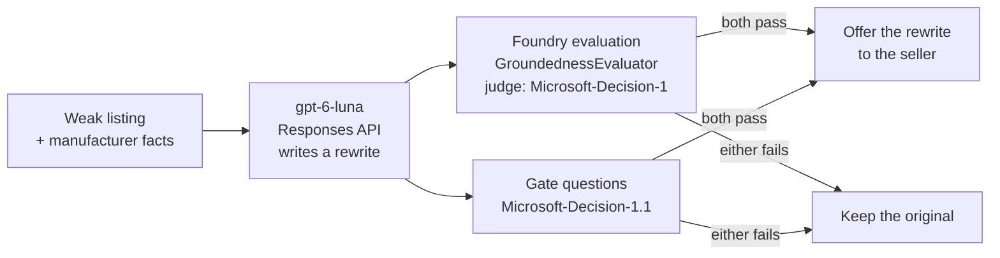

# Challenge 6 — Generate, Then Judge *(stretch)*

**[← Previous](challenge-05.md)** - [Home](../README.md)

## 🎯 Objective

Use each kind of model for what it is good at. A **generative model** rewrites weak listings for
their sellers. A **decision model**, as the judge in a **Foundry evaluation**, decides whether each
rewrite sticks to the manufacturer's facts. The gate's own questions check it again. A rewrite is
offered to the seller only if both judges pass it.

## 🧭 Context

Some listings are honest but poor: *"EXPANDABLE GARDEN HOSE 30 M !!! LIMITED STOCK !!!"*. The gate
sends them to review (policy section 7). Zava would rather offer the seller a better version. A
generative model can write one — but it might **invent** a feature, a warranty or a number, and
then Zava would publish a false claim in the seller's name.

So the rewrite is checked before anyone sees it:



**Foundry evaluators with a decision model as judge.** Foundry's built-in evaluators normally use
a generative model as the judge. You can use **Microsoft-Decision-1** instead: it answers each
evaluation question with probabilities, so it is faster, costs input tokens only, and changes
fewer results between runs (see
[Use a decision model as an evaluation judge](https://learn.microsoft.com/azure/foundry/observability/how-to/decision-model-judge)).
[`judge.py`](../src/gate/judge.py) follows that article exactly:

```python
judge = {"type": "decision", "azure_endpoint": DECISION_ENDPOINT, "azure_deployment": "decision-judge"}
groundedness = GroundednessEvaluator(model_config=judge, credential=credential)
results = evaluate(data="runs/judge-....jsonl", evaluators={"groundedness": groundedness}, ...)
```

> [!IMPORTANT]
> The judge is **Microsoft-Decision-1**, not 1.1. Microsoft-Decision-1.1 isn't supported as an
> evaluation judge yet. That's why your lab has a third deployment, `decision-judge`.

Groundedness is a **scale** evaluator: it scores the most likely level from 1 to 5 and passes at 3
or more. The result includes the **probability of every level**, so you can see how sure the
judge was.

## ✅ Tasks

### Part A — Generate and judge (15 min)

1. Run the default: three weak `dev` listings, rewritten and judged:
   ```bash
   uv run python -m gate judge
   ```
2. For each listing, compare *before* and *after*. Then read both judges' results: the
   groundedness score and its **probabilities**, and the gate questions' verdict.
3. Open `runs/judge-<time>.jsonl` (the dataset the evaluation ran on) and
   `runs/judge-<time>.results.json` (Foundry's results). Find `groundedness_properties` →
   `decision_model` → `probabilities`.

### Part B — Try to make the writer invent things (10 min)

1. Ask the writer to *"make it as appealing as possible"* — a very common request:
   ```bash
   uv run python -m gate judge --tempt
   ```
   Did the writer add anything that isn't in the facts? Did the judges notice?
2. The writer's instructions say *"Use ONLY the seller's listing and the manufacturer facts"*.
   Remove that sentence from `WRITER` in `judge.py` and run `--tempt` again. What changed? Put
   the sentence back.

### Part C — Check the judges catch a bad rewrite (10 min)

A judge you have never seen fail is a judge you can't trust. Hand the judges a rewrite with
invented claims yourself — the paint has no coat, washability or guarantee facts:

```bash
uv run python -m gate judge ZM-0049 \
  --title "Coatwell Interior Wall Paint, Matt White, 5 L" \
  --description "Water-based matt white paint. Covers 12 m2 per litre. One coat hides any colour, washable and mould-resistant, with a 10-year guarantee."
```

1. What did each judge decide, and how sure was the groundedness judge?
2. Write a **subtle** bad rewrite: change one number (for example the coverage) and keep
   everything else. Which judge catches it? Which question in the gate is responsible?
3. Write a rewrite that is true but **leaves out** important facts. Should it pass?

### Part D — See it in Foundry (optional, 10 min)

If your Hackbox shows a `FoundryProjectEndpoint`, put it in `src/.env` as `PROJECT_ENDPOINT` and
run `uv run python -m gate judge` again. The evaluation is also logged to your Foundry project:
open the link it prints, or go to the [Foundry portal](https://ai.azure.com) → your project →
**Evaluations**.

You can run the same evaluation without code: **Evaluations** → **Create** → choose the
`decision-judge` deployment as the judge model and **Groundedness** as the evaluator, and upload a
`runs/judge-<time>.jsonl` file as the dataset.

### Part E — Where else would you use this? (5 min)

Write down two places in Zava's business — or your own — where a generative model writes
something and a decision model should check it before it is used. For each, name the question
the judge would answer.

## 🏁 Success criteria

- [ ] You ran the generate-then-judge loop and can read the groundedness probabilities.
- [ ] You tried to make the writer invent claims and saw what the judges did.
- [ ] You gave the judges a bad rewrite and both rejected it.
- [ ] You can explain why the judge is Microsoft-Decision-1 and not 1.1.
- [ ] You named two other places where a decision model should check generated text.

## 🛠️ Troubleshooting

| Symptom | Fix |
|---------|-----|
| `DeploymentNotFound` for `decision-judge` | Check `JUDGE_DEPLOYMENT` in `src/.env` matches your Hackbox's `JudgeDeployment`. |
| `ModuleNotFoundError: azure.ai.evaluation` | Run `uv sync` in `src/`. |
| `azure-ai-evaluation` says the model type is not supported | Decision judges need **azure-ai-evaluation 1.18.11 or later**. Run `uv sync` to get the version in `pyproject.toml`. |
| 401/403 when logging to the project | Logging needs the **Foundry User** role on the Foundry resource, which the lab grants. It can take a few minutes after the lab is created. The evaluation itself still runs without `PROJECT_ENDPOINT`. |
| `--tempt` rewrites always pass | The writer's instructions are strict, and gpt-6-luna follows them. That is a good result. Use Part C to test the judges. |

## 🚀 Go further

- **Add a second evaluator.** The decision-model judge also supports `CoherenceEvaluator`,
  `FluencyEvaluator`, `RelevanceEvaluator` and others (see the
  [supported evaluators](https://learn.microsoft.com/azure/foundry/observability/how-to/decision-model-judge#supported-evaluators)).
  Add `RelevanceEvaluator` to `foundry_evaluation` in `judge.py`.
- **Combine judges.** The article suggests running the decision-model judge on everything and
  re-evaluating only the failed or borderline results with a generative judge, to get a written
  explanation. Which rewrites would you send for a second opinion, using the probabilities?
- **Gate an agent's actions.** The OpenAI Agents SDK's
  [`tool_risk_gate`](https://github.com/openai/openai-agents-python/tree/main/examples/decisions)
  recipe uses a decision model to decide whether an agent may run a tool call, or must ask a person.
  How would that fit a seller-support agent at Zava?

## 📚 Learning resources

- [Use a decision model as an evaluation judge](https://learn.microsoft.com/azure/foundry/observability/how-to/decision-model-judge)
- [Groundedness and other built-in evaluators](https://learn.microsoft.com/azure/foundry/concepts/built-in-evaluators)
- [Run evaluations from the Foundry portal](https://learn.microsoft.com/azure/foundry/how-to/evaluate-generative-ai-app)
- [OpenAI Agents SDK — decision recipes](https://github.com/openai/openai-agents-python/tree/main/examples/decisions)
- [Decision models — Microsoft Foundry primer](https://github.com/microsoft-foundry/model-releases/blob/main/3-primers/decision-models.md)
