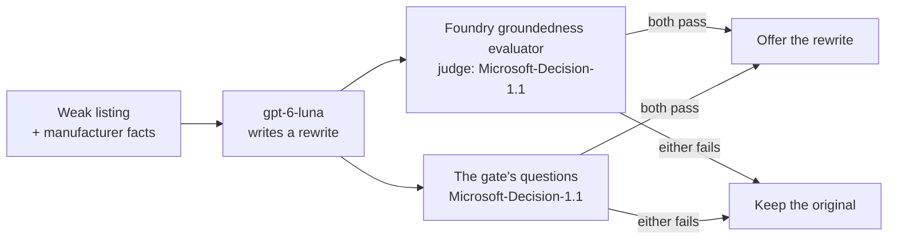

# Challenge 6 — Generate, Then Judge *(stretch)*

**[← Previous](challenge-05.md)** - [Home](../README.md)

## 🎯 Objective

Use each kind of model for what it's good at: a **generative model writes** a better listing for
the seller, and a **decision model judges** it before anyone sees it.

## 🧭 Context

Some listings are honest but poor: *"EXPANDABLE GARDEN HOSE 30 M !!! LIMITED STOCK !!!"*. The gate
sends them to review. Zava would rather offer the seller a better version — but if a generative
model **invents** a warranty or a number, Zava publishes a false claim in the seller's name.

So every rewrite is judged twice before the seller sees it:



**A decision model as the judge.** Foundry's built-in evaluators — groundedness, coherence,
relevance, task adherence and more — can use a **decision model** instead of a chat model as the
judge. It answers with probabilities, costs input tokens only and changes fewer results between
runs ([Use a decision model as an evaluation judge](https://learn.microsoft.com/azure/foundry/observability/how-to/decision-model-judge)).
This hack uses **Microsoft-Decision-1.1**, your `decision` deployment.

> [!NOTE]
> The [Microsoft-Decision-1.1 announcement](https://techcommunity.microsoft.com/blog/azure-ai-foundry-blog/introducing-microsoft-decision-1-1-build-faster-more-efficient-ai-applications-w/4573877)
> says 1.1 can be used as a judge, and it works with `azure-ai-evaluation` 1.18.11 or later. At
> the time of writing, the Learn article still names the preview Microsoft-Decision-1, which
> retires in February 2027.

Groundedness is a **scale**: level 1 (not grounded) to 5 (fully grounded); 3 or more passes. The
judge returns the **probability of every level**, so you can see how sure it was.

## ✅ Tasks

### 🧭 Explore — in tab **6 · Generate, then judge**

#### Part A — Rewrite and judge (10 min)

1. Pick a weak listing. Read it and its manufacturer facts.
2. Click **Rewrite with AI**. Read the rewrite: is every fact in it from the facts?
3. Read the verdict: the groundedness level and its probabilities, the gate's own questions, and
   the decision — **offer** or **keep the original**.
4. Click **Rewrite — "make it as appealing as possible"**. Did the writer add anything that isn't
   in the facts? Did the judges notice?

#### Part B — Test the judges (15 min)

A judge you've never seen fail is a judge you can't trust. Load each prepared rewrite and click
**Judge this rewrite**. **Predict** first: pass or fail?

| Button | What the rewrite does |
|--------|-----------------------|
| **faithful** | Says only what's in the facts |
| **invents a guarantee** | Adds *"a 10-year guarantee and free spare parts for life"* |
| **changes one number** | Doubles one number from the facts |
| **says almost nothing** | True, but useless |

Then write your own bad rewrite in the boxes. Can you get one past both judges?

#### Part C — In the Foundry portal, no code (10 min)

1. Open the [Foundry portal](https://ai.azure.com) with your lab account and go to the
   **marketplace-gate** project.
2. Open **Evaluations** and start a new evaluation. Choose **Groundedness** and your `decision`
   deployment as the judge model, and upload a few rewrites as a dataset with `query`, `context`
   and `response` columns.
3. Compare the portal's result with the console's.

> [!TIP]
> Want decisions in a workflow without code? **Logic Apps** now has **Yes/No, Choice and Score**
> decision actions (public preview) with a fully managed decision model — see
> [Decision actions in Azure Logic Apps](https://techcommunity.microsoft.com/blog/integrationsonazureblog/announcing-decision-apis-as-actions-in-azure-logic-apps/4573643).

#### Part D — Where would I use this? (5 min)

Name two places in your work where a generative model writes something and a decision model
should check it first — and the question the judge would answer.

### 🛠️ Build *(optional, for developers)*

```bash
python -m gate judge                       # rewrite three weak listings, judge them as a dataset
python -m gate judge --tempt
python -m gate judge ZM-0062 --title "..." --description "..."
```

1. Read `judge_one()` and `groundedness_judge()` in [`gate/judge.py`](../src/gate/judge.py): the
   judge is one `model_config` with `"type": "decision"`.
2. Add `RelevanceEvaluator` to `foundry_evaluation()`. Set `PROJECT_ENDPOINT` in `.env` to log
   the run to your project's **Evaluations** page.
3. **Combine judges:** the Learn article suggests a decision-model judge on everything, and a
   generative judge with a written explanation only for failed or borderline results. Which
   rewrites would you send for a second opinion, using the probabilities?

## 🏁 Success criteria

- [ ] You rewrote a listing with AI and read both judges' verdicts.
- [ ] Both judges rejected the invented guarantee and the changed number.
- [ ] You can explain why the "says almost nothing" rewrite passes groundedness but not the gate.
- [ ] You named two places where a decision model should check generated text.

## 🛠️ Troubleshooting

| Symptom | Fix |
|---------|-----|
| The AI rewrite always passes | gpt-6-luna follows its instructions well. Use the prepared rewrites to test the judges. |
| The judge call fails | It uses your `decision` deployment and the console's identity. Reload after a minute; if it persists, check the light for Microsoft-Decision-1.1. |
| You can't find the evaluation in the portal | Make sure you're in the **marketplace-gate** project of your own resource group. |

## 🧠 Reflection

- Groundedness asks *"is everything it says supported?"* What does it **not** ask?
- Why might a decision-model judge be better than a chat-model judge for a nightly evaluation of
  thousands of outputs — and when would you still want the chat model?

## 📚 Learning resources

- [Use a decision model as an evaluation judge](https://learn.microsoft.com/azure/foundry/observability/how-to/decision-model-judge)
- [Built-in evaluators in Microsoft Foundry](https://learn.microsoft.com/azure/foundry/concepts/built-in-evaluators)
- [Run evaluations from the Foundry portal](https://learn.microsoft.com/azure/foundry/how-to/evaluate-generative-ai-app)
- [Decision actions in Azure Logic Apps (preview)](https://techcommunity.microsoft.com/blog/integrationsonazureblog/announcing-decision-apis-as-actions-in-azure-logic-apps/4573643)
- [OpenAI Agents SDK — decision recipes (tool risk gate)](https://github.com/openai/openai-agents-python/tree/main/examples/decisions)
