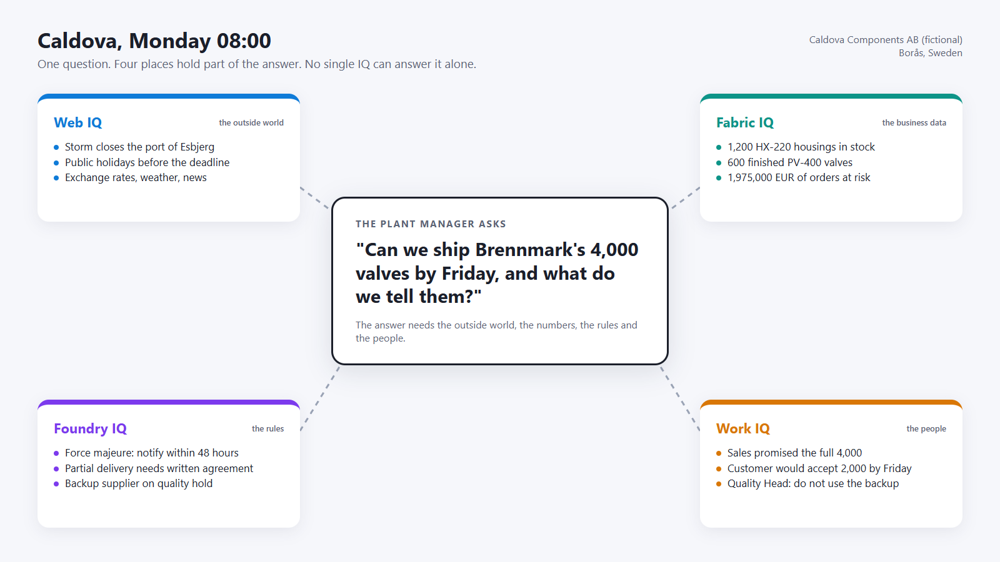
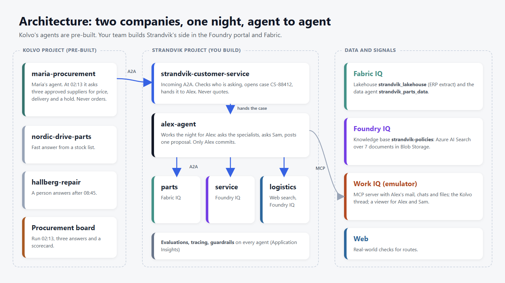

# Microsoft IQ: Alex sleeps through 02:13

> **Tuesday, 02:10.** At Kolvo's cab plant in Gothenburg, the drive unit on press line 2 starts shaking. The vibration sensors go red. The night shift cuts the press to half speed, which buys time until Thursday morning.
>
> At **02:13**, Maria's agent does what Maria told it to do: ask the approved suppliers for price and delivery, and never order without her. Three requests leave the plant. One of them lands at **Strandvik Drives**.
>
> Nobody at Strandvik is awake. Alex, the key account manager for Kolvo, is asleep. **Your team is Strandvik's agent team.** By 07:30, Alex must wake up to one thread, a grounded proposal and **one decision**.

Welcome to the **Microsoft IQ** MicroHack. You build every piece of Strandvik's night: the agent that checks who is knocking at 02:13, the specialists that know the stock, the contracts and the trucks, the colleague in Singapore who knows what no system knows yet, and the evaluation that tells you whether Alex can trust any of it.



- [**What you will learn**](#what-you-will-learn)
- [**The story**](#the-story)
- [**The four IQs, plus A2A**](#the-four-iqs-plus-a2a)
- [**Who this hack is for**](#who-this-hack-is-for)
- [**The clock and the challenges**](#the-clock-and-the-challenges)
- [**Team roles**](#team-roles)
- [**Prerequisites**](#prerequisites)
- [**Your lab environment**](#your-lab-environment)
- [**What is GA and what is preview**](#what-is-ga-and-what-is-preview)
- [**Repository layout**](#repository-layout)
- [**Credits and contributors**](#credits-and-contributors)

## What you will learn

**For the business role**

- How to describe what an agent **may** and **may not** do, in words a model follows and an auditor can read.
- Why every agent needs an **owner**, and why "a note is a reason to ask" is a business rule, not a technical one.
- How to map a business as an **ontology**: units, machines, sites, customers, reservations and the people who own them.
- How to judge an agent with **evaluations** and a **custom rubric**, instead of a gut feeling.

**For the builder role**

- Build prompt agents in the **Foundry portal** and give each one tools, knowledge and a guardrail.
- Let another company's agent call yours over **A2A** (agent to agent), with **agent identity** and an IAM role as the lock on the door.
- Ground agents in business data (**Fabric IQ**), documents (**Foundry IQ**), people (**Work IQ**) and the web (**Web IQ**).
- Orchestrate specialist agents over A2A, then **trace**, **evaluate** and **cost** the whole night.

## The story

**Strandvik Drives AB** builds and services drive units: the big motor and gearbox that make a heavy machine move. Its factory is in Pune, India, its spare-parts warehouse is in Rotterdam, and its technicians work all over Europe. Customers pay for **uptime**.

| Who | What they own tonight |
|---|---|
| **Alex**, Strandvik, key account manager for Kolvo | Any delivery date or price promised to Kolvo. Asleep until 06:30. |
| **Sam**, Strandvik, key account manager for Poliden | The reservation of the SD-900 on the shelf in Rotterdam. At a trade fair in Singapore, where it is mid-morning. |
| **Maria**, Kolvo, production manager | Her agent's standing instruction: price and delivery only, never order without her. |
| **Maria's agent**, Kolvo | Already built in your lab. It calls Strandvik and two rival suppliers over A2A. |

There are two candidate units. A brand-new one in Pune (expensive to fly in, lands Wednesday evening) and one on the shelf in Rotterdam (cheap, at Kolvo on Wednesday morning) that is **reserved for Poliden**. Sam left a note last Friday: Poliden's stop "will probably move two weeks". Probably.

The agents do the groundwork. Sam knows the customer. **Alex makes the call.** That is the whole point: an agent can do the work, only a person can answer for it.

The full facts (serials, times, prices and rules) are in [walkthrough/scenario-facts.md](walkthrough/scenario-facts.md), the single source of truth for coaches.

## The four IQs, plus A2A

Every company has access to the same frontier models. What makes Strandvik's agents useful at 02:13 is **context**, and the permission to use it.

| Layer | What it knows | Tonight's question |
|---|---|---|
| **Fabric IQ** (ontology, data agent) | The state of the business: units, machines, reservations, owners | Which SD-900 could replace SD9-K-0412, and who owns it? |
| **Foundry IQ** (knowledge bases) | Policies and contracts | May we take a reserved unit? What is Kolvo's replacement target? |
| **Work IQ** (emulator, same MCP contract) | People: chats, mail, calendars | What did Sam write on Friday? Can we ask him now? |
| **Web IQ** (web search) | The live web | Does the Kiel to Gothenburg ferry route exist, and what is the weather doing? |
| **A2A** (agent to agent) | Other agents, inside and outside the company | Maria's agent calls Strandvik; Alex's agent calls its specialists |
| **Evaluations and tracing** | What the agents did and what it cost | Can you show Alex that the proposal is grounded and that nothing was committed? |



## Who this hack is for

- **Business people** (account managers, service and supply chain leads, architects who talk to the business): you design the agents, write their instructions and guardrails, play Sam and Alex, and judge the answers. You never need to write code.
- **Developers and data people**: you load the data, wire the tools, run the one Cloud Shell script and make the agents talk to each other.
- **Teams of two to four** split the roles and must talk, which is the point. **Solo hackers** do both roles; an "auto-Sam" answers for you when nobody can play Sam.

There is no CLI to learn. Everything is built in the **Azure portal**, the **Foundry portal** (ai.azure.com, New Foundry) and the **Fabric portal**, plus one short script in Azure Cloud Shell. You install nothing.

## The clock and the challenges

The hack runs on story time. The clock on the wall says 02:10 at the start and 07:30 at the end. Each challenge is one moment of the night.

| # | Clock | Challenge | IQ / product | Time |
|---|---|---|---|---|
| 1 | 02:10 | [Lights on](challenges/challenge-01.md) | Setup, the Strandvik world | 45 min |
| 2 | 02:13 | [Who's asking?](challenges/challenge-02.md) | Foundry Agent Service, A2A, agent identity, guardrails | 45 min |
| 3 | 03:10 | [Know the business](challenges/challenge-03.md) | Fabric IQ: lakehouse, ontology, data agent | 75 min |
| 4 | 03:41 | [Why didn't it take the unit?](challenges/challenge-04.md) | Foundry IQ: knowledge base (stretch: knowledge graph) | 60 min |
| 5 | 03:52 | [Sam in Singapore](challenges/challenge-05.md) | Work IQ (emulator) | 60 min |
| 6 | 04:10 | [The night shift](challenges/challenge-06.md) | Web IQ, A2A orchestration | 75 min |
| 7 | 07:30 | [Alex makes the call](challenges/challenge-07.md) | Evaluations, tracing, cost, the 02:13 replay | 45 min |
| | | [Finish: the John Blund test](challenges/finish.md) | All five layers | 15 min |

That is about **7 hours** of hacking. With a welcome, breaks and lunch, plan a full day (for example 09:00 to 17:15, see the [coach guide](walkthrough/README.md#timing-plan)).

Every challenge has the same shape: a story beat, a **goal**, a **business task**, a **builder task**, constraints, success criteria a coach can check, and hints that reveal a little more each time you open one.

## Team roles

| Role | You own | Typical tasks |
|---|---|---|
| **Business** | What the agents may do, and whether they did it well | Map the world, write instructions and agent cards, pick guardrails, design the ontology, play Sam and Alex, write the rubric, judge |
| **Builder** | That the agents exist, are wired and can be seen | Load data, create agents and tools, run the Cloud Shell script that assigns the A2A roles, connect knowledge, run evaluations, read traces |
| **Clock keeper** (optional) | The story | Calls the clock time at each challenge, runs the votes, keeps the team honest about what only Alex may do |

Solo? You are all three. Switch hats out loud; it helps.

## Prerequisites

- A lab from the MicroHack platform (your coach gives you the sign-in). The lab user has a Fabric licence.
- A modern browser. Three portals stay open all day: [Azure portal](https://portal.azure.com), [Foundry portal](https://ai.azure.com) (switch **New Foundry** on) and [Fabric portal](https://app.fabric.microsoft.com).
- **Nothing to install, no Codespace.** One step in challenges 2, 6 and 7 runs a short script in **Azure Cloud Shell** (Azure portal top bar, the `>_` icon, **Bash**), which is in the browser and already signed in.
- The hack files on your machine for the uploads in challenge 1: on GitHub, **Code** > **Download ZIP**.
- Optional, for developers who want to run the notebooks: a GitHub Codespace or a local clone. **Fork the repository to your own GitHub account** and create the Codespace on your fork (or clone it locally with Python, the Azure CLI and `az login`, then run `create-env.ps1` or `create-env.sh`). Codespaces are billed to the GitHub account that creates them; Microsoft does not pay for them. See [challenge 1](challenges/challenge-01.md#if-you-run-in-github-codespaces-optional).
- Useful, not required: you have built one agent or one Power BI report before.

## Your lab environment

Your lab is one resource group, built for you before the day. You build everything on Strandvik's side yourself.

| Resource | State at the start | You will |
|---|---|---|
| Foundry resource with project **strandvik** | Empty, with models `gpt-5.4-mini`, `gpt-5.6-luna` and `text-embedding-3-large` | Build all Strandvik agents here |
| Foundry project **kolvo** | Pre-built: `maria-procurement` and two rival suppliers (`nordic-drive-parts`, `hallberg-repair`), with A2A connections to all three suppliers | Watch Maria's agent fail, then succeed, against your agent |
| Azure AI Search (Foundry IQ) and a storage account | Empty `documents` container | Upload the policies and build a knowledge base |
| Fabric capacity (F2) and workspace | Empty | Load the lakehouse, build the ontology and a data agent |
| Work IQ emulator | Seeded with Alex's and Sam's Microsoft 365 world | Connect Alex's agent, play Sam in the viewer, run Kolvo's procurement board |
| Application Insights | Connected to both projects | Read the traces of the whole night |

Your **lab dashboard** shows every name, endpoint and key you need (project links, the Work IQ viewer, board, endpoint and keys). In the optional Codespace, `create-env.sh` (or `create-env.ps1`) reads the same values and writes `.env` for the notebooks. Details for coaches and platform owners are in [labautomation/README.md](labautomation/README.md).

> **Why a Work IQ emulator?** Real Work IQ needs Microsoft 365 Copilot licences that lab users do not have. The emulator speaks the same MCP contract, so only the URL and the key change. See [the emulator's README](labautomation/workiq-emulator/README.md).

## What is GA and what is preview

| Feature | Status | Challenge |
|---|---|---|
| Foundry prompt agents, playground, tracing | GA | 2 to 7 |
| A2A tool and incoming A2A endpoint (protocol 1.0) | GA | 2, 6 |
| Agent identity (Microsoft Entra Agent Identity) | Preview | 2, 6 |
| Guardrails on an agent | Preview | 2 |
| Fabric data agent | GA | 3 |
| Fabric IQ ontology, Fabric IQ tool in Foundry | Preview | 3 |
| Foundry IQ knowledge bases | GA | 4 |
| Foundry IQ knowledge graph | Preview (REST only) | 4 (stretch) |
| Work IQ MCP (emulated in this lab) | Preview | 5 |
| Web search tool (Web IQ) | GA | 6 |
| Foundry evaluations (custom rubric evaluators in preview) | GA | 7 |

> Foundry portal **Workflows** are being retired. This hack orchestrates with A2A instead.

## Repository layout

```text
15_Microsoft_IQ/
├── challenges/          The challenges (participants)
├── walkthrough/         Coach guide, step-by-step solutions, scenario facts
├── data/                Lakehouse CSVs, documents, Work IQ seed, evaluation set, ontology
├── scripts/             enable-a2a.py, run in Azure Cloud Shell (challenges 2, 6, 7)
├── notebooks/           Optional (Codespace or local): 00 load the world, 02 knowledge graph (stretch)
├── labautomation/       Lab provisioning, Kolvo pre-build, Work IQ emulator and procurement board
├── techtalk/            Day-opener talk "02:13": 15 animated slides with a timed script, and its PDF
├── images/              Diagrams and screenshots
├── create-env.sh        Optional: fills .env for the notebooks (create-env.ps1 on Windows)
└── .env.example         What .env looks like
```

## Credits and contributors

The story of this hack comes from **Johan Wallquist**'s keynote *Enter the Agentic Enterprise Era* (Microsoft), used with permission. "A note is a reason to ask", "an agent can do the work, only a person can answer for it" and the John Blund test are his. Strandvik Drives, Kolvo, Poliden, Nordic Drive Parts, Hallberg Repair Services and all the people are fictional.

**Contributors**

- Digvijay Chauhan, Solution Engineer, Microsoft

**Start here:** [Challenge 1: Lights on](challenges/challenge-01.md)
