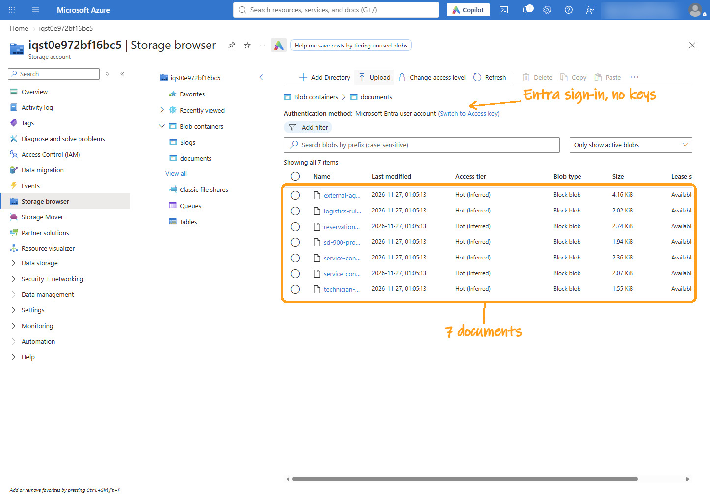
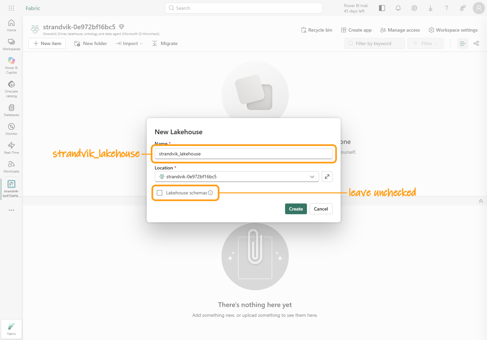
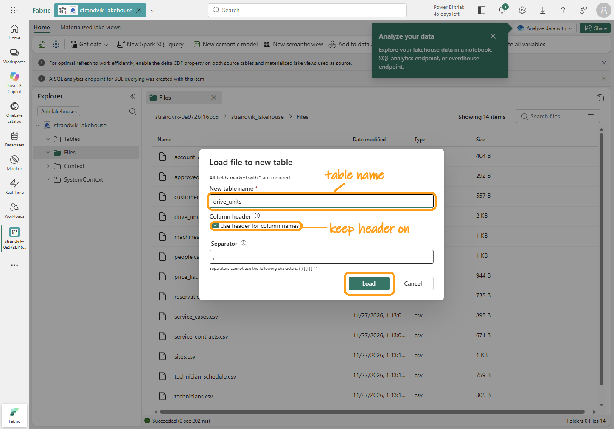
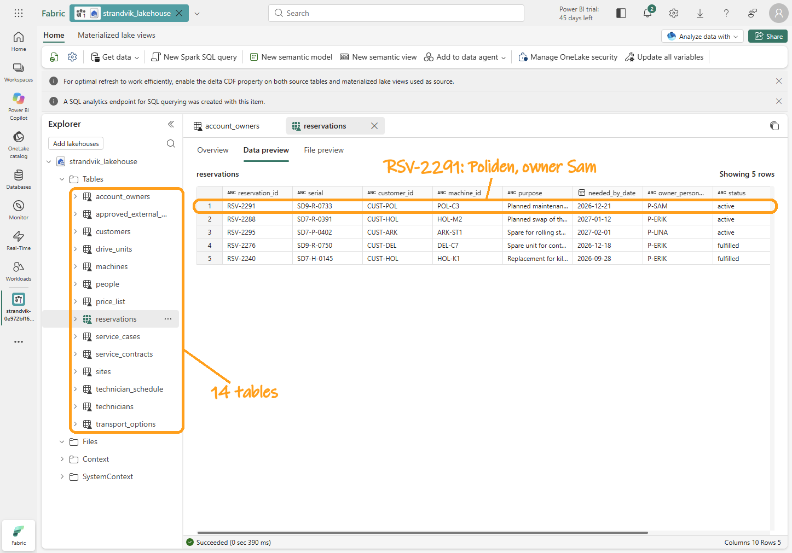
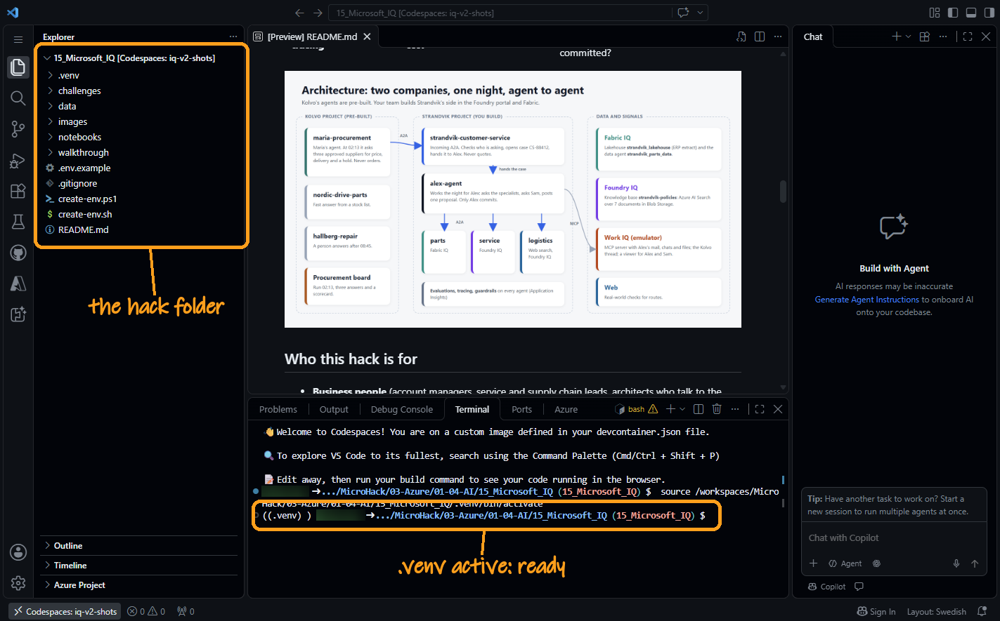
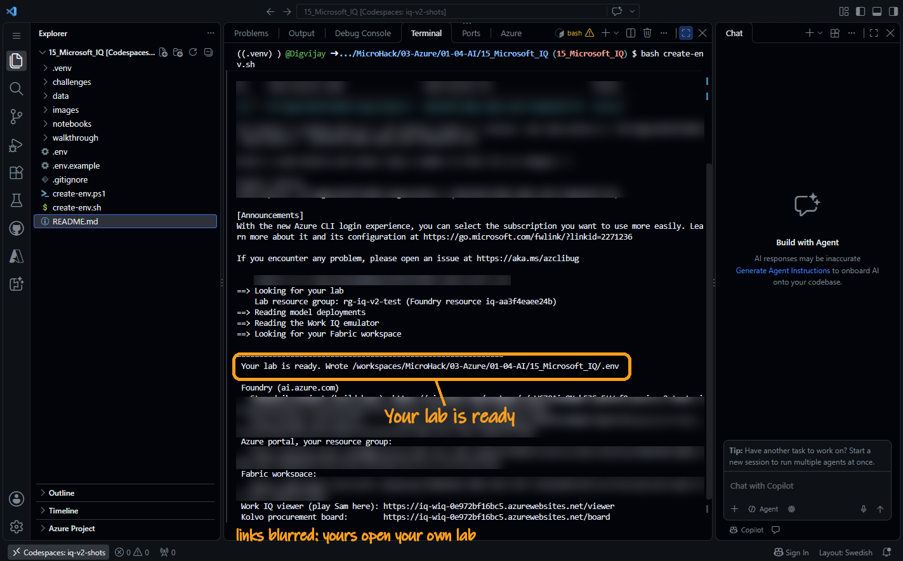

# Challenge 1: Lights on

**[Home](../README.md)** - [Next Challenge](challenge-02.md)

**Clock: 02:10** · **Time:** 45 minutes · **Products:** your lab, Azure portal, Foundry portal, Fabric portal

## Objective

Open your lab, get to know the Strandvik world, and put its data where the agents will need it: the seven documents in Blob Storage and the fourteen business tables in a Fabric lakehouse. You also draw a paper map of who owns what. Every later challenge builds on this data and this map.

## Context

> It's ten past two. At Kolvo's cab plant on Hisingen, the drive unit on press line 2 starts shaking, and the vibration sensors go red. The night shift cuts the press to half speed. That buys time until Thursday 06:00. Then the press stops, and the cab line with it.
>
> Alex is asleep. Alex works at Strandvik Drives, which builds and services the drive units that keep heavy machines running. Customers pay Strandvik for uptime.
>
> In three minutes, Maria's agent will knock on Strandvik's door. Before anyone can answer it, someone has to switch the lights on: know what Strandvik owns, where it is, and **who owns what**. That someone is your team.

> [!IMPORTANT]
> Use your **lab user** everywhere. Your own corporate account will not see the lab. Build in the **strandvik** project only. The **kolvo** project belongs to Kolvo: look, don't touch.

## Tasks

### Part A: Open your lab and get the hack files (10 min)

Everything in this hack runs in the browser: the Azure portal, the Foundry portal, the Fabric portal, the Work IQ viewer and Kolvo's board. One step in challenges 2, 6 and 7 runs a short script in **Azure Cloud Shell**, also in the browser. You install nothing.

1. Open your **lab dashboard** (the lab page your coach gives you). Keep it open all day. It shows your lab user and password, the resource group, and the values you need later:

   | Value | Used for |
   |---|---|
   | `StrandvikProjectUrl`, `KolvoProjectUrl` | The two Foundry projects (Part B) |
   | `FabricPortalUrl` | Your Fabric workspace (Part B) |
   | `StorageAccountName` | The `documents` container (Part C) |
   | `WorkIQBoardUrl`, `WorkIQViewerUrl` | Kolvo's procurement board (challenge 2) and the Work IQ viewer (challenge 5) |
   | `WorkIQEmulatorEndpoint`, `WorkIQKey`, `WorkIQKeySam` | Alex's Work IQ tool and the viewer sign-in for Alex and Sam (challenge 5) |

2. Open a **private (InPrivate or Incognito) browser window** and sign in to the [Azure portal](https://portal.azure.com) with the **lab user**. A private window keeps your corporate account out of the way.
3. Get the hack files on your machine: Parts C and D upload the documents and the CSV files from your computer. On the hack's GitHub page select **Code** > **Download ZIP** and unzip it. The hack is in the folder `03-Azure/01-04-AI/15_Microsoft_IQ`; you need its `data/documents` and `data/lakehouse` folders. If a ZIP download is blocked, open each file in [`data/documents/`](../data/documents/) and [`data/lakehouse/`](../data/lakehouse/) on GitHub and select **Download raw file**.

> [!TIP]
> One set of files per team is enough: whoever uploads in Parts C and D needs them. Everyone else can start reading for the map in Part E.

> [!NOTE]
> Developers who want to run the optional notebooks can use a Codespace or a local clone. See [If you run in GitHub Codespaces (optional)](#if-you-run-in-github-codespaces-optional) at the end of the tasks. Nobody needs it.

### Part B: Open the three portals and Cloud Shell (5 min)

1. **Foundry portal**: open `StrandvikProjectUrl` from the lab dashboard (or [ai.azure.com](https://ai.azure.com), switch **New Foundry** on at the top, and pick the project **strandvik** of the `iq-<hash>` resource in the project picker at the top left). Check that **Build** > **Agents** is empty. Open the **kolvo** project the same way (`KolvoProjectUrl`) and check that `maria-procurement`, `nordic-drive-parts` and `hallberg-repair` are listed.
2. **Azure portal**: open **Resource groups** > your lab resource group (its name is on the lab dashboard). You see the Foundry resource `iq-<hash>`, the Search service `iq-srch-<hash>`, the storage account `iqst<hash>`, the Fabric capacity `iqcap<hash>`, Application Insights `iq-appi-<hash>` and the emulator `iq-wiq-<hash>`.
3. **Fabric portal**: open `FabricPortalUrl` (or [app.fabric.microsoft.com](https://app.fabric.microsoft.com)) with the lab user and go to **Workspaces** > `strandvik-<hash>`.
4. **Azure Cloud Shell**: in the Azure portal top bar select the **Cloud Shell** icon (`>_`) and choose **Bash**. If asked about storage, choose **No storage account required** (an ephemeral session is fine) and your lab subscription. When the prompt appears, close it again. You use it in challenge 2; if it does not open, tell your coach now.

> [!NOTE]
> **No Fabric workspace?** Fabric portal > **Workspaces** > **+ New workspace**. **Name**: `strandvik-<your initials>`. Expand **Advanced** > **License mode**: **Fabric capacity** > pick `iqcap<hash>`. Select **Apply**.

### Part C: Upload the documents to Blob Storage (5 min)

1. Find the 7 files in `data/documents` of the hack files you downloaded in Part A (on GitHub: [`data/documents/`](../data/documents/)).
2. Azure portal > the lab resource group > the storage account `iqst<hash>` > **Storage browser** > **Blob containers** > `documents`.
3. If you see "You do not have permissions" or a key error, switch **Authentication method** to **Microsoft Entra user account**. Shared key access is off; the lab user has Storage Blob Data Contributor.
4. Select **Upload** > drag the 7 files > **Upload**.

<!-- SHOT: c01-storage-browser-upload | Azure portal, storage account iqst<hash> > Storage browser > Blob containers > documents | Container after upload, listing the 7 .md files | Highlight the Authentication method set to Microsoft Entra user account and the 7 files -->


Expected files (do not rename them; later challenges and the evaluation set expect these names):

| File | Document |
|---|---|
| `external-agent-access-policy-eap-01.md` | EAP-01 |
| `reservation-policy-res-02.md` | RES-02 |
| `service-contract-kolvo-sc-kol-2024.md` | SC-KOL-2024 |
| `service-contract-poliden-sc-pol-2025.md` | SC-POL-2025 |
| `logistics-rules-log-03.md` | LOG-03 |
| `sd-900-product-sheet.md` | PS-SD900 |
| `technician-scheduling-fs-04.md` | FS-04 |

### Part D: Load the lakehouse in Fabric (15 min)

1. Fabric portal > your workspace > **+ New item** > **Lakehouse**. **Name**: `strandvik_lakehouse`. Leave **Lakehouse schemas** off. Select **Create**.

<!-- SHOT: c01-fabric-new-lakehouse | Fabric portal, workspace strandvik-<hash> > + New item > Lakehouse dialog | The "New lakehouse" dialog with the name strandvik_lakehouse and schemas unchecked | Highlight the name field and the schemas checkbox -->


2. In the lakehouse explorer, next to **Files** select **...** > **Upload** > **Upload files**. Select the 14 CSV files from `data/lakehouse` in the hack files you downloaded (on GitHub: [`data/lakehouse/`](../data/lakehouse/)) and select **Upload**.
3. Open **Files**, then for each CSV: **...** > **Load to Tables** > **New table**. Keep the table name (the file name without `.csv`), **Column header** on, **Separator** `,`. Select **Load**.

<!-- SHOT: c01-fabric-load-to-table | Fabric portal, strandvik_lakehouse > Files > drive_units.csv > ... menu | The "Load to Tables" > "New table" dialog for drive_units.csv | Highlight "Load to Tables", the table name and the header option -->


4. Repeat for all 14 files.

   > [!TIP]
   > An F2 capacity runs few loads at a time. If you get HTTP 430 or "capacity busy", wait 20 seconds and load again.

5. Check: the **Tables** folder shows 14 tables. Select `reservations` and confirm the preview shows `RSV-2291`, `SD9-R-0733`, `P-SAM`.
6. Switch the lakehouse view to **SQL analytics endpoint** (top right) once, and select **Refresh** if a table is missing there. The data agent in challenge 3 reads the schema from this endpoint.

<!-- SHOT: c01-lakehouse-tables | Fabric portal, strandvik_lakehouse (Lakehouse view) | Tables folder expanded with 14 tables, reservations preview open | Highlight the table count and the RSV-2291 row -->


> [!TIP]
> **Running the optional Codespace?** [`notebooks/00-load-the-world.ipynb`](../notebooks/00-load-the-world.ipynb) does Parts C and D in one go. See [If you run in GitHub Codespaces (optional)](#if-you-run-in-github-codespaces-optional). Both paths end in the same place.

### Part E: Map the Strandvik world (10 min)

Map the world **on paper** (a whiteboard, a sheet, a Loop page, anything). Use [`data/README.md`](../data/README.md), the CSV files in [`data/lakehouse/`](../data/lakehouse/) and the documents in [`data/documents/`](../data/documents/).

Your map shows at least:

- The **units** that matter tonight (by serial), and where each one is.
- The **machines** they run on, and at which **customer** and **site**.
- The **reservations**, and the **person who owns** each one.
- Who owns the **Kolvo** account and who owns the **Poliden** account.
- One line per agent you expect to build: what it **may** do and what it **may not** do.

> [!TIP]
> Start from `machines.csv` (press line 2 is `KOL-PL2`), follow `drive_unit_serial` into `drive_units.csv`, then look for SD-900s with status `in_stock`. For each one, check `reservations.csv` and follow `owner_person_id` into `people.csv`. Watch out: not every SD-900 on a shelf is free, and not every drive unit fits a press.

Keep the map. You turn it into an ontology in challenge 3 and into instructions in every challenge after that.

### If you run in GitHub Codespaces (optional)

Not needed for the hack. Use it only if you are a developer and want to run the optional notebooks (`00-load-the-world` for Parts C and D, `02-knowledge-graph-stretch` for the challenge 4 stretch), or run the Cloud Shell script from your own terminal.

> [!IMPORTANT]
> **Fork the hack repository to your own GitHub account** and create the Codespace on your fork (or clone it to your machine). Codespaces are billed to the GitHub account that creates them. Microsoft does not pay for them.

**In a Codespace**

1. On **your fork**, select **Code** > **Codespaces** > **...** > **New with options...**.
2. Under **Dev container configuration**, choose **Azure / AI / Microsoft IQ**. Select **Create codespace**.
3. Wait until VS Code opens in the browser with the hack folder in the explorer and a terminal whose prompt starts with `(.venv)`. The setup takes a few minutes. Its log is under **View** > **Command Palette** > **Codespaces: View Creation Log**.

<!-- SHOT: c01-codespace-ready | GitHub Codespaces (VS Code in the browser) | Hack folder open in the explorer, terminal with the (.venv) prompt | Highlight the hack folder and the (.venv) prompt -->


4. In the terminal (the hack folder is the working folder), run:

   ```bash
   bash create-env.sh
   ```

5. When asked, open `https://microsoft.com/devicelogin`, enter the code and sign in with the **lab user**.
6. The script finds the lab resource group (tagged `microhack=15_Microsoft_IQ`), only reads from Azure, and writes `.env` with every endpoint and key the notebooks need. At the end it prints the Foundry links for **strandvik** and **kolvo**, the Azure portal link, the Fabric workspace link, the Work IQ viewer and the procurement board.

<!-- SHOT: c01-create-env-output | Codespace terminal | Output of bash create-env.sh: "Your lab is ready", the project links, the viewer and board URLs | Highlight "Your lab is ready". Blur the subscription, the account and the links -->


7. To run a notebook: open it, **Select Kernel** > **Jupyter Kernel** > **Python (Microsoft IQ)**, then **Run All**. Notebook 00 takes 3 to 8 minutes on F2 and is safe to run again: section 1 uploads the documents; section 2 creates the lakehouse, loads every CSV as a table and refreshes the SQL endpoint metadata.

**On your own machine**

Clone the repository (your fork or the original). You need Python 3.11 or later and the Azure CLI. Run `az login` with the lab user, then from the hack folder run `bash create-env.sh` (on Windows without bash: `./create-env.ps1` in PowerShell). Install the notebook packages with `pip install jupyter -r notebooks/requirements.txt`. VS Code with **Dev Containers** and the same dev container works too.

> [!IMPORTANT]
> Never commit `.env`. It holds your Work IQ keys.

| Symptom | Fix |
|---|---|
| `create-env.sh` says "no Microsoft IQ lab found" | You signed in with the wrong account. Run `az logout`, then run the script again and sign in with the lab user. Or pass the resource group: `bash create-env.sh <rg>`. |
| `FABRIC_WORKSPACE_ID` stays empty | Create the workspace (name starting with `strandvik`) on the lab capacity (Part B), then run the script again. |

## Success criteria

- [ ] Every team member can open the lab dashboard and has signed in to the three portals with the lab user.
- [ ] The team has the hack files (`data/documents`, `data/lakehouse`) on at least one machine.
- [ ] The coach sees 7 `.md` files in the `documents` container (Azure portal > storage account > Storage browser).
- [ ] The coach sees 14 tables in `strandvik_lakehouse` in Fabric, and a preview of `reservations` shows `RSV-2291`.
- [ ] Your paper map answers, without a laptop: *Which unit runs press line 2? Which two SD-900s could replace it? Who owns the Rotterdam one?*
- [ ] Every team member can open the Kolvo project and see `maria-procurement`.

## Troubleshooting

| Symptom | Fix |
|---|---|
| The portals show no lab resources, or "You don't have access" | You are signed in with your corporate account. Use a private browser window and sign in with the lab user from the lab dashboard. |
| The ZIP download is blocked or very slow | Open the files in `data/documents` and `data/lakehouse` on GitHub one by one and select **Download raw file**. |
| No `strandvik-<hash>` workspace in Fabric | Create it on the lab capacity (Part B note). |
| Cloud Shell does not open, or is blocked by a policy | Tell your coach. A teammate who runs the optional Codespace (or a local clone with the Azure CLI) can run the same script for the team in challenges 2, 6 and 7. |
| Storage browser: "This request is not authorized" | Switch **Authentication method** to **Microsoft Entra user account**. Right after the lab is created, wait a minute for the role to apply. |
| Fabric: **Load to Tables** is greyed out | You selected a folder or a non-CSV file. Select one CSV file. |
| Fabric: HTTP 430 | The F2 capacity is busy. Wait 20 seconds and try again. |
| A table is missing in the SQL analytics endpoint | Open the SQL analytics endpoint view and select **Refresh**. |
| Fabric capacity paused | Azure portal > `iqcap<hash>` > **Resume**. |

## Go further

- Add the **sites** and **transport options** to your map: where would a unit from Pune or Rotterdam travel to reach Gothenburg?
- Read [`EAP-01`](../data/documents/external-agent-access-policy-eap-01.md) and mark on your map which agents may talk to outsiders at all.

## Reflection

- Which facts on your map would an agent get wrong if it only had the documents, and which if it only had the tables?
- Why does it matter tonight **who owns** each reservation, not just where each unit is?
- Which "may not" line on your map would hurt Strandvik most if an agent broke it?

## Learning resources

- [What is Microsoft Foundry Agent Service?](https://learn.microsoft.com/azure/ai-foundry/agents/overview)
- [Upload, download and list blobs in the Azure portal](https://learn.microsoft.com/azure/storage/blobs/storage-quickstart-blobs-portal)
- [Lakehouse: Load to Delta Lake tables](https://learn.microsoft.com/fabric/data-engineering/load-to-tables)
- [What is Fabric IQ?](https://learn.microsoft.com/fabric/iq/overview)

**[Home](../README.md)** - [Next Challenge](challenge-02.md)
