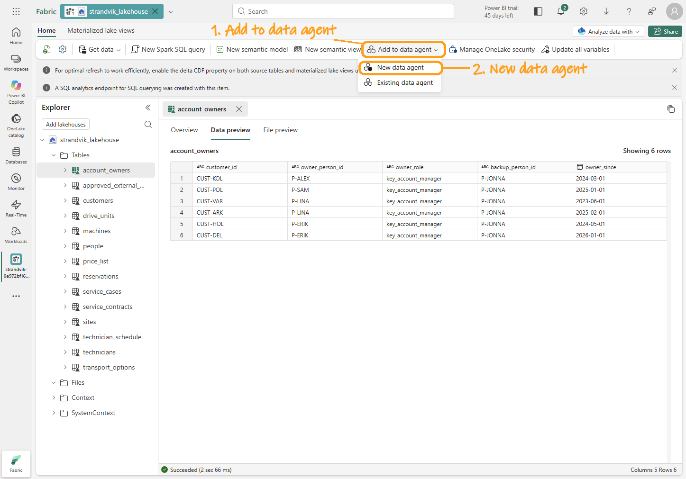
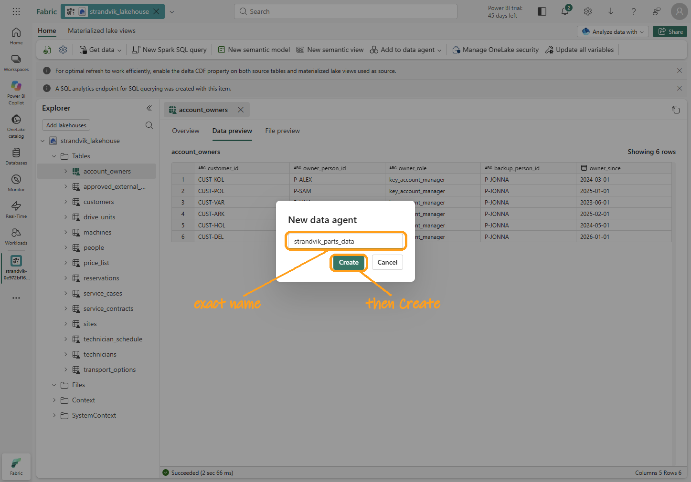
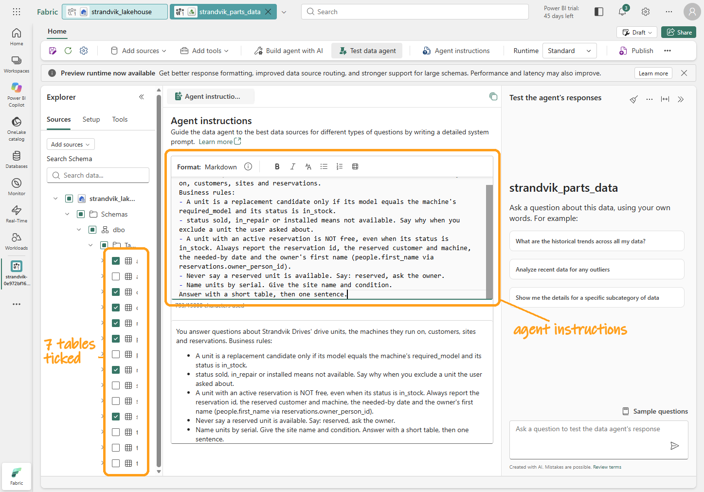
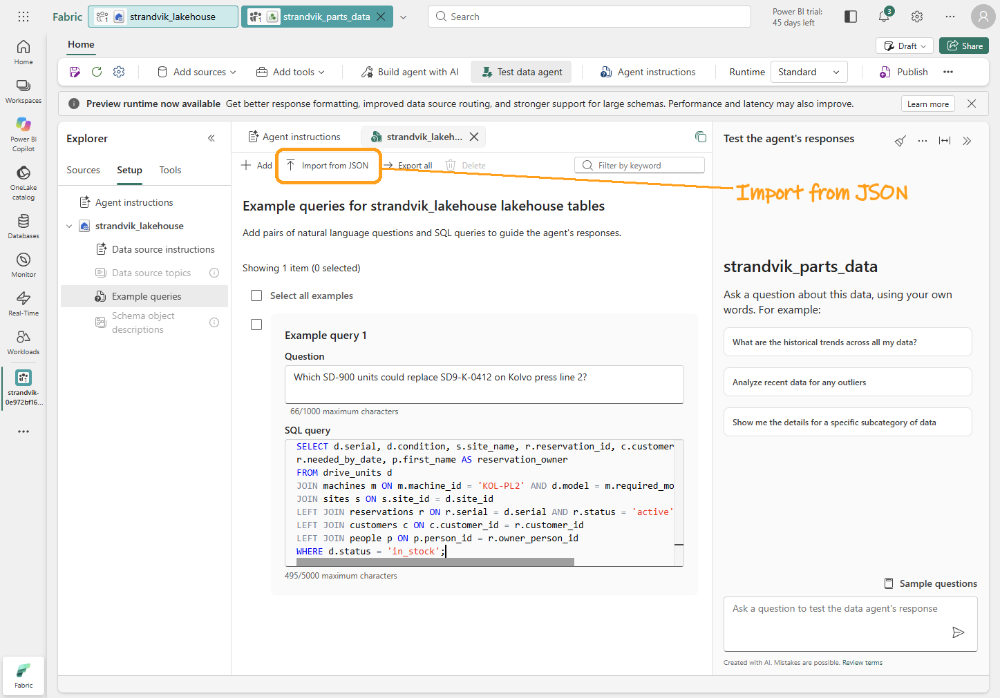
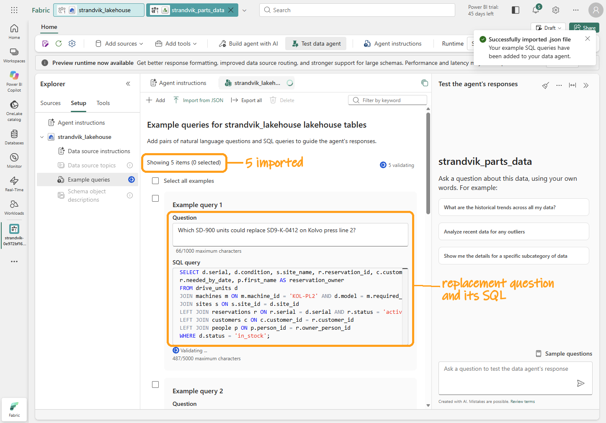
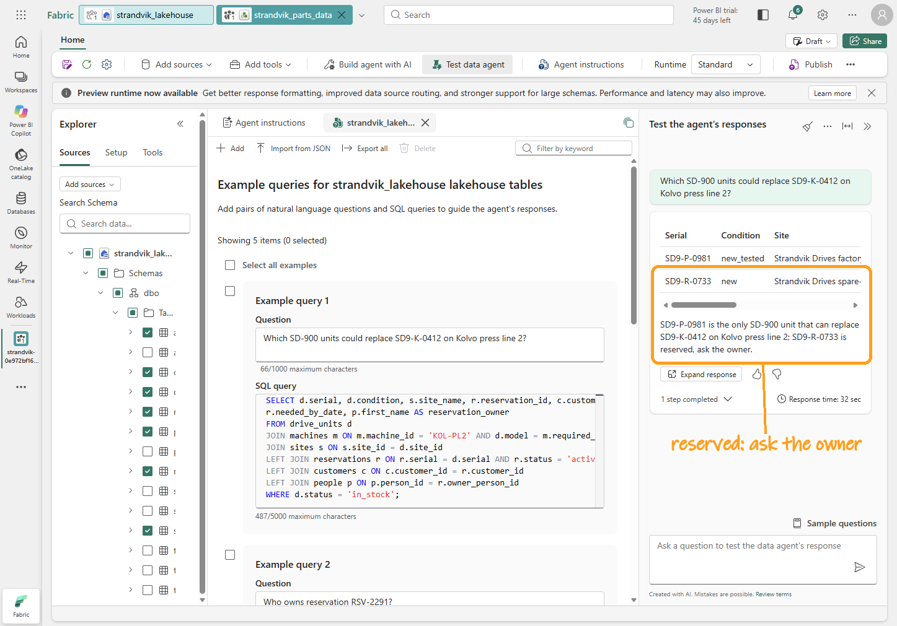
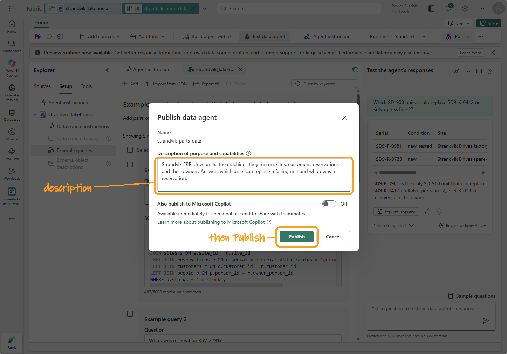
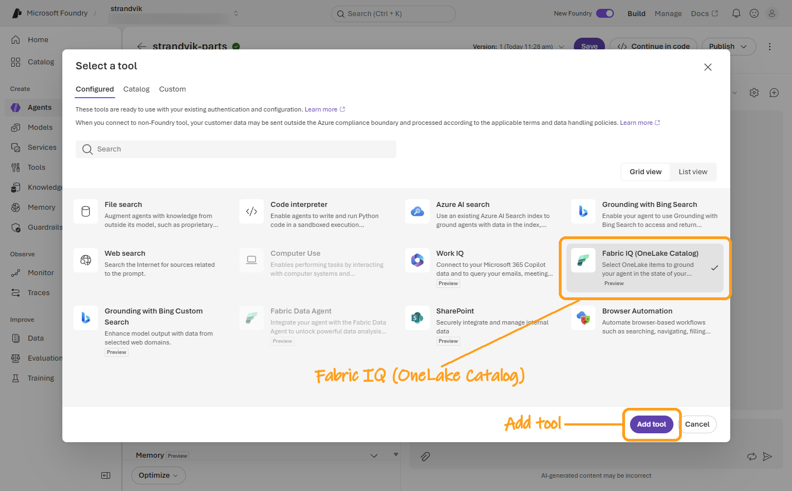
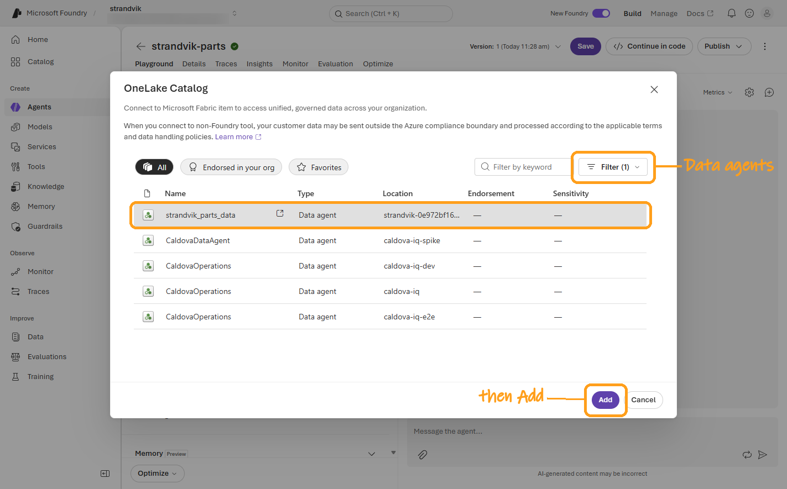
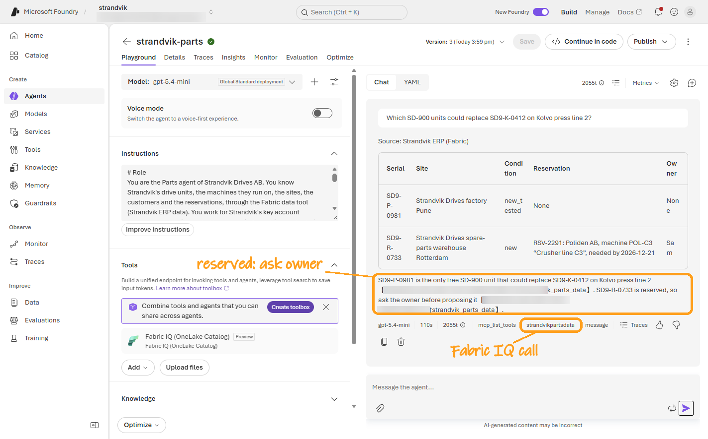

# Challenge 3: Know the business

[Previous Challenge](challenge-02.md) - **[Home](../README.md)** - [Next Challenge](challenge-04.md)

**Clock: 03:10** · **Time:** 75 minutes · **Products:** Fabric IQ (lakehouse, ontology, data agent), Foundry Agent Service

## Objective

Build a **Parts agent** that answers stock questions from Strandvik's business data through **Fabric IQ**. You turn your paper map of the business into an ontology on paper, put it in a Fabric data agent over the lakehouse, and connect that data agent to a Foundry prompt agent. The Parts agent must know that a unit on a shelf can still belong to somebody else: a reserved unit has an owner.

## Context

> 03:10. The case is with Alex's agent now. When it needs to check something in another part of the business, it brings in the agent that knows that part. First up: the parts agent. Where is there an SD-900 that could replace Kolvo's?
>
> The ERP knows the stock. But the ERP is a pile of tables, and a pile of tables doesn't know that a unit on a shelf can still belong to somebody else. Strandvik has described how its business fits together: which unit is on which machine, at which customer, and **who owns the reservation** when a unit is promised to someone.
>
> That's the ontology. A map of the business that agents can read. You drew it on paper in challenge 1. Now make it real.

## Tasks

### Part A: Design the ontology on paper (20 min)

1. Turn your paper map from challenge 1 into an **ontology design** in a text file: entity types, their key and useful properties, and the **relationships** between them. Start from this minimum and add what you need (for example ServiceContract, Technician, TechnicianSlot, ExternalAgent):

   ```text
   Ontology (how Strandvik's business fits together)
   Entity types (table, key):
   - DriveUnit (drive_units, serial): model, status, condition, notes
   - Machine (machines, machine_id): machine_name, criticality, required_model, status
   - Site (sites, site_id): site_name, site_type, city, country
   - Customer (customers, customer_id): customer_name, tier
   - Reservation (reservations, reservation_id): purpose, needed_by_date, status, policy_id
   - Person (people, person_id): first_name, company, role, current_location, time_zone
   Relationships:
   - Machine runs on DriveUnit: machines.drive_unit_serial = drive_units.serial
   - DriveUnit located at Site: drive_units.site_id = sites.site_id
   - Machine belongs to Customer: machines.customer_id = customers.customer_id
   - Reservation reserves DriveUnit: reservations.serial = drive_units.serial
   - Reservation reserved for Customer and Machine: reservations.customer_id, reservations.machine_id
   - Reservation owned by Person: reservations.owner_person_id = people.person_id
   - Customer account owner Person: account_owners.customer_id, account_owners.owner_person_id
   ```

2. Mark the relationships that tell an agent "ask this person first".
3. Write three to five **example questions** with the answer you expect. One must be:

   ```text
   Which SD-900 units could replace SD9-K-0412 on Kolvo press line 2?
   ```

4. Agree the Parts agent's **may / may not**: it may check stock, units, reservations and owners. It may never sell, reserve, release or move a unit, or say a reserved unit is available.

> [!NOTE]
> The main path is the **ontology on paper**: the data agent reads the lakehouse tables, and your design lives in its instructions. If your tenant shows an **Ontology (preview)** item, see [Go further](#go-further). Tell the coach which path you used.

### Part B: Create the Fabric data agent (15 min)

1. Fabric portal > your workspace > open the lakehouse `strandvik_lakehouse`. In the ribbon select **Add to data agent** > **New data agent**.

<!-- SHOT: c03-add-to-data-agent | Fabric portal, workspace > strandvik_lakehouse, Home ribbon | Lakehouse ribbon with the Add to data agent menu open | Highlight Add to data agent and New data agent -->


2. In the name dialog enter `strandvik_parts_data` > **Create**.

<!-- SHOT: c03-new-data-agent | Fabric portal, lakehouse > Add to data agent > New data agent | Name dialog with strandvik_parts_data entered | Highlight the name field and Create -->


3. The data agent editor opens and sets itself up for a few seconds. In the explorer tree on the left (**Sources**), under `strandvik_lakehouse` > **Schemas** > **dbo** > **Tables**, tick the 7 tables (widen the explorer, or use **Search data**, if the names are cut off): `drive_units`, `machines`, `reservations`, `people`, `account_owners`, `customers`, `sites`.
4. Select **Agent instructions** in the ribbon. In its Markdown editor, replace the template text: paste your ontology on paper from Part A under the heading `Ontology (how Strandvik's business fits together)`. Then paste these rules below it:

   ```text
   You answer questions about Strandvik Drives' drive units, the machines they run on, customers, sites and reservations.
   Business rules:
   - A unit is a replacement candidate only if its model equals the machine's required_model and its status is in_stock.
   - status sold, in_repair or installed means not available. Say why when you exclude a unit the user asked about.
   - A unit with an active reservation is NOT free, even when its status is in_stock. Always report the reservation id, the reserved customer and machine, the needed-by date and the owner's first name (people.first_name via reservations.owner_person_id).
   - Never say a reserved unit is available. Say: reserved, ask the owner.
   - List reserved candidates too, in the same table, marked "reserved, ask the owner". Leaving them out hides the one unit that may save the customer.
   - Name units by serial. Give the site name and condition.
   - Look for candidates at every Strandvik site (factories and warehouses). The customer's site is where a unit is installed, not where spares are kept.
   - When a question names a customer, plant or line instead of a machine id (for example "Kolvo's Hisingen plant" or "press line 2"), first find the machine: join machines to customers and sites and match names with LIKE. Then use that machine's required_model.
   Answer in English with a short table, then one sentence.
   Give times as weekday and clock time (for example Wednesday 09:00). A date without a time (such as needed_by_date) is just the weekday, for example "needed by Monday". Never write a calendar date.
   ```

<!-- SHOT: c03-data-agent-instructions | Fabric portal, strandvik_parts_data data agent editor | Explorer tree with the 7 lakehouse tables ticked and the Agent instructions editor filled with the ontology on paper and rules | Highlight the ticked tables and the Agent instructions editor -->


> [!TIP]
> Fabric items do not open, or the data agent never answers? The Fabric capacity may be paused. Ask the coach to resume it.

### Part C: Add example queries and test (15 min)

1. In the editor select **Setup** > **Example queries**. The pane has **Add**, **Import from JSON** and **Export all**.

<!-- SHOT: c03-data-agent-example | Fabric portal, strandvik_parts_data > Setup > Example queries | Example queries pane with the Add, Import from JSON and Export all buttons | Highlight Import from JSON -->


2. Download the file first: select [data-agent-example-queries.json](https://github.com/microsoft/MicroHack/raw/main/03-Azure/01-04-AI/15_Microsoft_IQ/data/fabric/data-agent-example-queries.json) and the click saves it (you can read it in the repo at [`data/fabric/data-agent-example-queries.json`](../data/fabric/data-agent-example-queries.json)). Then select **Import from JSON** and pick the downloaded file (5 question and SQL pairs, format `{"question": "sql"}`). A "Preview runtime" banner may appear: that is expected. The main one looks like this:

   ```sql
   -- Which SD-900 units could replace SD9-K-0412 on Kolvo press line 2?
   SELECT d.serial, d.condition, s.site_name, r.reservation_id, c.customer_name AS reserved_for,
          r.needed_by_date, p.first_name AS reservation_owner
   FROM drive_units d
   JOIN machines m ON m.machine_id = 'KOL-PL2' AND d.model = m.required_model
   JOIN sites s ON s.site_id = d.site_id
   LEFT JOIN reservations r ON r.serial = d.serial AND r.status = 'active'
   LEFT JOIN customers c ON c.customer_id = r.customer_id
   LEFT JOIN people p ON p.person_id = r.owner_person_id
   WHERE d.status = 'in_stock';
   ```

   The other four cover the owner of RSV-2291, the account owner for Kolvo AB, all active reservations, and where SD9-R-0733 is.

<!-- SHOT: c03-data-agent-examples-imported | Fabric portal, strandvik_parts_data > Setup > Example queries | The 5 imported question and SQL pairs listed, Preview runtime banner visible | Highlight the replacement question and its SQL -->


3. Test in the data agent chat. The answer takes about 30 seconds.

   ```text
   Which SD-900 units could replace SD9-K-0412 on Kolvo press line 2?
   ```

4. Check the answer: two units, and the second one is **reserved**. Units that are sold, in repair or of another model must not be offered.

<!-- SHOT: c03-data-agent-answer | Fabric portal, strandvik_parts_data data agent | Chat answer to the replacement question with SD9-P-0981 available (Pune) and SD9-R-0733 reserved (RSV-2291 for Poliden, owner Sam) | Highlight the reserved row and "ask Sam" -->


5. Try your own example questions from Part A.

> [!TIP]
> Example queries with exact answers help more than long prose. If the agent calls a reserved unit "available", sharpen the reservation rule. If it offers an SD-700, check the `required_model` rule: a unit is only a candidate if its model matches the machine's `required_model` in `machines`.

### Part D: Publish the data agent (5 min)

1. Top bar > **Publish**. In the dialog add a short description such as `Strandvik ERP: drive units, machines, reservations and owners`. Leave **Also publish to Microsoft Copilot** off > **Publish**.
2. After publishing, a **Draft / Published** switcher appears at the top of the editor.

<!-- SHOT: c03-publish-data-agent | Fabric portal, strandvik_parts_data > Publish | Publish dialog with the description filled and "Also publish to Microsoft Copilot" off | Highlight the description field and the Publish button -->


> [!IMPORTANT]
> Foundry can only use a **published** data agent.

### Part E: Build the Parts agent in Foundry (20 min)

1. Foundry portal > project **strandvik** > **Build** > **Agents** > **New agent**. In the **Build an agent** dialog: **Agent name** `strandvik-parts`, **Interaction mode** Text > **Create agent and open playground**.
2. The default model is `model-router`: switch **Model** to `gpt-5.4-mini`. If a default **Web search** tool is attached, remove it (**Actions for Web search** > **Remove**): the Parts agent answers from data only.
3. Paste the **Instructions**:

   ```text
   # Role
   You are the Parts agent of Strandvik Drives AB. You know Strandvik's drive units, the machines they run on, the sites, the customers and the reservations, through the Fabric data tool (Strandvik ERP data). You work for Strandvik's key account managers and their agents. Your owner is Strandvik supply chain.

   # You may
   - Look up drive units: model, status, condition and location.
   - Find which units could replace a unit on a machine.
   - Report reservations: reservation id, customer, machine, needed-by date and the owner.

   # You may never
   - Sell, reserve, release or move a unit, or change a reservation.
   - Say a reserved unit is available. A reserved unit belongs to its reservation until its owner releases it (RES-02).
   - Quote prices or delivery dates. Other agents do that.

   # How to answer
   1. Always call the Fabric data tool. Never answer from memory, and never invent a serial. Pass the question to the tool in the asker's words, short and plain, with any machine, serial or reservation id they gave. Do not add your own plan or steps to it: the data agent writes its own query.
   2. For a replacement question: find the machine and its required model; list every unit of that model that is in stock at any Strandvik site (factories and warehouses, not the customer's site); exclude sold, in repair and installed units and units of another model.
   3. For every candidate, check for an active reservation. If there is one, give the reservation id, the reserved customer and machine, the needed-by date and the owner's name, and say: "Reserved: ask the owner before proposing it."
   4. Answer with a short table (serial, site, condition, reservation, owner), then one or two sentences. Name the source: "Strandvik ERP (Fabric)".
   5. If the tool fails or returns nothing, say so. Do not guess.
   6. Answer in English.
   7. Give times as weekday and clock time (for example Wednesday 09:00). A date without a time (such as needed_by_date) is just the weekday, for example "needed by Monday". Never write a calendar date.
   ```

4. **Add** > **Add tools** > **Configured** > **Fabric IQ (OneLake Catalog)** (preview) > **Add tool**.

<!-- SHOT: c03-select-fabric-iq | Foundry portal, strandvik-parts > Add > Add tools > Configured tab | "Select a tool" dialog with Fabric IQ (OneLake Catalog) selected | Highlight Fabric IQ (OneLake Catalog) (preview) and Add tool -->


5. A **OneLake Catalog** picker opens. It is pre-filtered to **Semantic model** (the filter shows **Filter (1)**). Open the filter > **Type** > untick **Semantic model**, tick **Data agent**. Select `strandvik_parts_data` whose **Location** is **your** workspace `strandvik-<hash>` (other labs in the tenant can have a data agent with the same name) > **Add**.

<!-- SHOT: c03-onelake-catalog-data-agent | Foundry portal, strandvik-parts > Fabric IQ (OneLake Catalog) picker | OneLake Catalog filtered to Type = Data agent with strandvik_parts_data selected | Highlight the Type filter (Data agent ticked) and the Add button -->


6. **Save**, then test in the playground with the same replacement question:

   ```text
   Which SD-900 units could replace SD9-K-0412 on Kolvo press line 2?
   ```

7. Expect the same two units, the reservation and Sam, and a tool call chip `strandvikpartsdata` under the answer.

<!-- SHOT: c03-parts-agent-playground | Foundry portal, strandvik project > Agents > strandvik-parts > Playground | Answer to the replacement question with the table and the strandvikpartsdata tool call chip | Highlight the tool chip and "Reserved: ask the owner" -->


> [!NOTE]
> The first Fabric call is slow (about 96 seconds in testing). Wait for it before you retry. The tool runs with the signed-in user's permissions, so your lab user needs access to the workspace.

## Success criteria

- [ ] The data agent in Fabric answers the replacement question with **SD9-P-0981** (new, tested, Pune) and **SD9-R-0733** (Rotterdam, **reserved** for Poliden, **RSV-2291**, owner **Sam**).
- [ ] It does **not** offer SD9-R-0750 (sold), SD9-P-0902 (in repair) or SD7-R-0388 (an SD-700, which does not fit).
- [ ] `strandvik-parts` gives the same answer in the Foundry playground, with a Fabric tool call visible in the response.
- [ ] Every serial the Parts agent names comes from a tool call, and it never calls a reserved unit "available".
- [ ] Your team can show the ontology on paper (or the ontology item) and point at the relationship that leads to Sam.

## Troubleshooting

| Symptom | Fix |
|---|---|
| Fabric items do not open, or the data agent never answers | The Fabric capacity is paused. Ask the coach to resume it |
| No **Data agent** in the workspace **+ New item** list | Expected. Create the data agent from the lakehouse ribbon: **Add to data agent** > **New data agent** |
| Data agent "cannot find table" | Open the lakehouse SQL analytics endpoint and **Refresh** its metadata |
| Data agent lists SD9-R-0733 as "available" | Check the reservation rule in the agent instructions and import the example queries |
| Data agent lists SD7-R-0388 | Check the `required_model` rule |
| Fabric IQ tool not in **Configured** | Refresh the Foundry page. The data agent must be published (Part D) |
| OneLake Catalog picker shows no data agent | It is filtered to **Semantic model**. Change the **Type** filter to **Data agent**. Check that the data agent is published |
| Playground seems stuck on the first question | The first Fabric call is slow (about 96 seconds in testing). Wait before retrying |
| Fabric IQ tool call fails with an auth error | Sign in to the Foundry portal and Fabric with the same lab user. The user must be a member of the workspace |
| Answers show a calendar date | Check that the weekday line is in the instructions, then **Save** and ask again |

## Go further

- **A real ontology item.** Only if **+ New item** in your workspace offers **Ontology (preview)** and creating one works (if it fails with `FeatureNotAvailable`, skip this). Create `strandvik_ontology`, add the entity type `DriveUnit` bound to `strandvik_lakehouse` table `drive_units` with key `serial`, then `Machine`, `Site`, `Customer`, `Reservation` and `Person`. Add the relationships from Part A (for `owned by`: Reservation `owner_person_id` to Person `person_id`). Check in the graph that `RSV-2291` links to `SD9-R-0733`, to Poliden and to Sam. Optionally add the ontology as a source of the data agent and publish again.
- Add more entity types (ServiceContract, TechnicianSlot) and an example question that uses them.
- Ask the Parts agent to release RSV-2291. It must refuse and name the owner.

## Reflection

- Which relationship in your design makes an agent say "ask Sam first"? What would happen without it?
- Why do example queries with exact answers help the data agent more than long prose?
- Where else in your business does "in stock" not mean "free"?

## Learning resources

- [What is Fabric IQ?](https://learn.microsoft.com/fabric/iq/overview)
- [What is ontology (preview)?](https://learn.microsoft.com/fabric/iq/ontology/overview) and the [ontology tutorial](https://learn.microsoft.com/fabric/iq/ontology/tutorial-0-introduction)
- [Fabric data agent concepts](https://learn.microsoft.com/fabric/data-science/concept-data-agent) and [create a Fabric data agent](https://learn.microsoft.com/fabric/data-science/how-to-create-data-agent)
- [Data agent example queries](https://learn.microsoft.com/fabric/data-science/data-agent-example-queries)
- [Use the Microsoft Fabric data agent with Foundry agents](https://learn.microsoft.com/azure/ai-foundry/agents/how-to/tools/fabric)

[Previous Challenge](challenge-02.md) - **[Home](../README.md)** - [Next Challenge](challenge-04.md)
