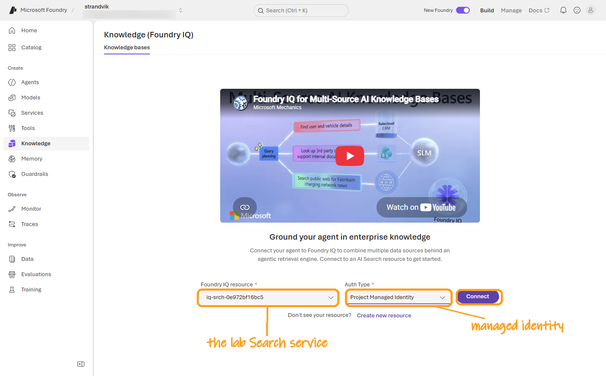
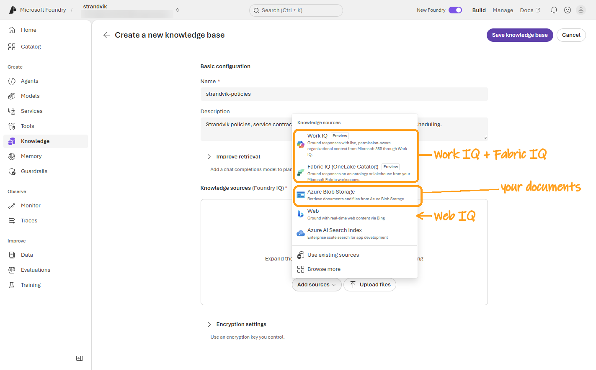
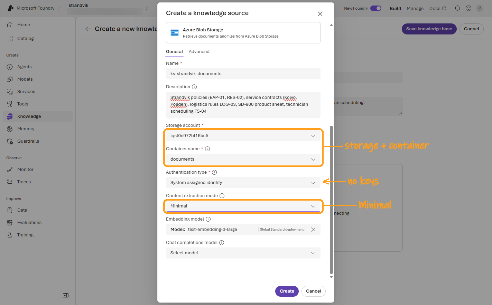
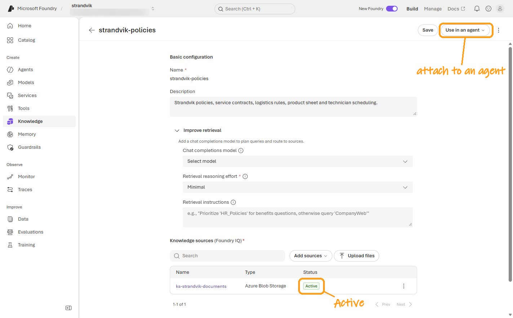
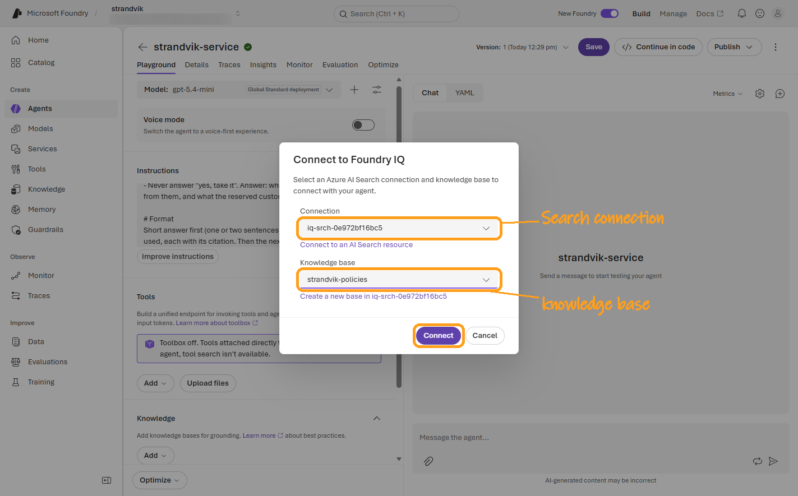
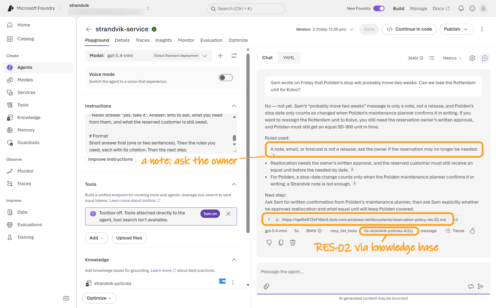

# Challenge 4: Why didn't it take the unit?

[Previous Challenge](challenge-03.md) - **[Home](../README.md)** - [Next Challenge](challenge-05.md)

**Clock: 03:41** · **Time:** 60 minutes · **Products:** Foundry IQ (knowledge bases), Foundry Agent Service; stretch: knowledge graph

## Objective

Build a **Service agent** that answers contract, policy and scheduling questions from Strandvik's documents through a **Foundry IQ knowledge base**. It cites its sources and treats a note as a reason to ask, not as a decision. You then judge its answers yourself.

## Context

> 03:41. Let's stop the clock here. Alex's agent has found two units. One is brand-new, at Strandvik's factory in India. The other one is on the shelf in Rotterdam. So why doesn't it take that one? It's right there.
>
> Because it's reserved for Poliden, a mining company and another Strandvik customer, for a maintenance stop next Monday. And the reservation has an owner: Sam. There is even a note from Sam, from last Friday: Poliden's stop will *probably* move two weeks.

## Tasks

### Part A: The vote and the rule (5 min)

1. Quick vote in your team: is Sam's note enough to take the unit? Hands up if yes.
2. Now read the reservation policy [`RES-02`](../data/documents/reservation-policy-res-02.md), section 4. **A note is a reason to ask.** It's not a decision.
3. Note in your own words: who may release a reservation, what counts as a release, what does not, and what the reserved customer is still owed. You check your words against the instructions in Part D.

### Part B: Connect Foundry IQ to Search (5 min)

1. Foundry portal > project **strandvik** > **Build** > **Knowledge**.
2. The first time, the page asks for a **Foundry IQ resource**: pick the lab's Search service `iq-srch-<hash>` (the list shows the resource group under each name; pick the one in your lab's resource group).
3. **Auth Type**: **Project Managed Identity**. Select **Connect**.

<!-- SHOT: c04-foundry-iq-connect-search | Foundry portal, Build > Knowledge (first visit) | The "connect a Foundry IQ resource" panel with the Search service selected and Auth Type | Highlight the Foundry IQ resource dropdown, Auth Type and Connect -->


> [!NOTE]
> No keys pasted into forms when an identity works. The lab has already given the Search service and the projects the roles they need.

### Part C: Create the knowledge base (15 min)

1. **Build** > **Knowledge** > **Create a knowledge base**.
2. **Name**: `strandvik-policies`. **Description**:

   ```text
   Strandvik policies, service contracts, logistics rules, product sheet and technician scheduling.
   ```

3. **Improve retrieval**:
   - **Chat completions model**: `gpt-5.4-mini`. It plans the queries, and the retrieval instructions below only work with a model selected. (If the list only shows "Browse more models", leave it empty, set the effort to **Minimal** and skip the retrieval instructions.)
   - **Retrieval reasoning effort**: **Low** (one pass of query planning).
   - **Retrieval instructions**:

     ```text
     Policies have ids such as EAP-01, RES-02, LOG-03, FS-04, SC-KOL-2024, SC-POL-2025. Prefer the document whose id the question names.
     ```

4. **Knowledge sources** > **Add sources**. The menu offers **Work IQ (preview)**, **Fabric IQ (OneLake Catalog) (preview)**, **Azure Blob Storage**, **Web**, **Azure AI Search Index**, **Use existing sources** and **Upload files**. Choose **Azure Blob Storage**.

<!-- SHOT: c04-add-sources-menu | Foundry portal, Create a knowledge base > Knowledge sources > Add sources | The Add sources menu with the five source types | Highlight Azure Blob Storage -->


5. Fill the **Create a knowledge source** form:

   | Field | Value |
   |---|---|
   | Name | `ks-strandvik-documents` |
   | Description | `The seven Strandvik documents: EAP-01, RES-02, SC-KOL-2024, SC-POL-2025, LOG-03, the SD-900 product sheet, FS-04` |
   | Storage account | `iqst<hash>` |
   | Container | `documents` |
   | Authentication type | **System assigned identity** |
   | Content extraction mode | **Minimal** |
   | Embedding model | `text-embedding-3-large` |
   | Chat completions model | empty (the dropdown may only show "Browse more models") |

<!-- SHOT: c04-blob-knowledge-source | Foundry portal, Create a knowledge source (Azure Blob Storage) | The form with storage account, container documents, System assigned identity, Content extraction mode Minimal, embedding model | Highlight storage account, container, authentication, Minimal and embedding model -->


> [!IMPORTANT]
> Use **Minimal**. The seven documents are plain text, so Standard is not needed, and in this lab **Standard** fails with "Unable to connect to AI Services using managed identity".

> [!TIP]
> `text-embedding-3-large` not in the list? The form only lists deployments that existed when the page loaded. Reload the page and open the form again.

6. **Create**, then **Save knowledge base**. Wait until the source goes from **Creating** to **Active** (about one minute).

<!-- SHOT: c04-knowledge-base-ready | Foundry portal, Build > Knowledge > strandvik-policies | The knowledge base page with the source Active and the Use in an agent button | Highlight Active and Use in an agent -->


### Part D: Agree the Service agent's instructions (10 min)

Read these instructions as a team. Compare the reservation rule with your words from Part A and adjust the wording if you want, but stay true to RES-02. The Service agent may check contracts and technician slots; it never changes a contract or books a technician.

```text
# Role
You are the Service agent of Strandvik Drives AB. You know Strandvik's service contracts, policies and field service scheduling, through the knowledge base "strandvik-policies" (Foundry IQ). You work for Strandvik's key account managers and their agents. Your owner is Noor, field service coordinator.

# You may
- Look up contract terms: replacement targets, uptime credits, who may order, how date changes are confirmed.
- Explain the policies: external agents (EAP-01), reservations (RES-02), logistics (LOG-03), product fit (SD-900 product sheet), technician scheduling (FS-04).
- Check technician slots and the notice they need, and propose (not make) a booking.

# You may never
- Change a contract, book or cancel a technician, release or move a reservation, or commit to a date or a price.

# Always
- Search the knowledge base before every answer about a contract, a policy, a reservation, a product or a technician.
- Cite the document id for every rule you use, for example "(RES-02 4.2)".
- If the documents do not answer the question, say so. Do not fill gaps from memory.

# The reservation rule (RES-02)
- A reserved unit belongs to its reservation until its owner releases it. The owner is the key account manager named on the reservation.
- A note, an email or a forecast is NOT a release. A note is a reason to ask. When anything suggests a reservation may no longer be needed, the answer is: ask the owner, and get the answer in writing (a chat message counts).
- Reallocation needs the owner's written approval. The reserved customer must still get an equal unit (same model, new or equal condition) before its needed-by date. The key account manager who reallocates carries the cost risk.
- For Poliden, a change of the maintenance stop date counts only when Poliden's maintenance planner confirms it in writing (SC-POL-2025).
- Never answer "yes, take it". Answer: who to ask, what you need from them, and what the reserved customer is still owed.

# Format
Short answer first (one or two sentences). Then the rules you used, each with its citation. Then the next step.
Give times as weekday and clock time (for example Wednesday 09:00). Never write a calendar date.
```

### Part E: Create `strandvik-service` (10 min)

1. **Build** > **Agents** > **New agent**. In the **Build an agent** dialog: **Agent name** `strandvik-service`, **Interaction mode** Text > **Create agent and open playground**.
2. The default model is `model-router`: switch **Model** to `gpt-5.4-mini`. Paste the instructions from Part D.
3. A default **Web search** tool is attached. Remove it: **Actions for Web search** > **Remove**. The Service agent answers from the policies only.
4. **Knowledge** > **Add** > **Connect to Foundry IQ**. Choose the **Connection** (the lab's Search connection) and the **Knowledge base** `strandvik-policies` > **Connect**.

<!-- SHOT: c04-connect-foundry-iq-to-agent | Foundry portal, strandvik project, Agents > strandvik-service > Knowledge > Add > Connect to Foundry IQ | Dialog with the Search connection and knowledge base strandvik-policies selected | Highlight Connection, Knowledge base and Connect -->


5. **Save** the agent. It calls the knowledge base as a tool named `kb-strandvik-policies-...`.

### Part F: Judge the answers (15 min)

1. Ask these three questions in the playground, one at a time:

   ```text
   Sam wrote on Friday that Poliden's stop will probably move two weeks. Can we take the Rotterdam unit for Kolvo?
   ```

   ```text
   What is the replacement target for Kolvo's press lines?
   ```

   ```text
   When can a Strandvik technician install at Kolvo this week?
   ```

2. Check each answer for a knowledge base tool call and citation chips.

<!-- SHOT: c04-service-agent-cites-res02 | Foundry portal, strandvik project, Agents > strandvik-service > Playground | Answer to "Sam wrote on Friday that Poliden's stop will probably move two weeks. Can we take the Rotterdam unit for Kolvo?" with citation chips and the kb tool chip | Highlight "a note is a reason to ask", the RES-02 citation and the knowledge base tool call -->


3. Score each answer from 1 to 5 on three points: **grounded** (the facts match the documents), **cites** (the right document ids, for example RES-02, SC-KOL-2024, FS-04), **stays in its lane** (proposes, never decides). An answer without a source does not count.

> [!TIP]
> The agent answers without using the knowledge base? Check that the "Search the knowledge base before every answer" line is in the instructions and that Web search is removed.

## Success criteria

- [ ] The knowledge source shows **Active** and the knowledge base is attached to `strandvik-service`.
- [ ] Asked about Sam's note, the agent says the unit stays reserved until **Sam** releases it, that a note is **not** a release, that written approval (a chat message counts) is needed, and that Poliden must still get an equal unit in time, citing **RES-02**.
- [ ] It answers **48 hours** for Kolvo's replacement target (SC-KOL-2024) and **Wednesday 22:00 to Thursday 06:00** (slot FS-5101, Jonas), with 24 hours' notice, for the technician (FS-04), each with a citation.
- [ ] The agent never says "yes, take it". At most: "ask the owner, and here is what you need from them".
- [ ] Your team shows its 1 to 5 scores for the three answers.

## Troubleshooting

| Symptom | Fix |
|---|---|
| Embedding model missing in the form | Reload the page (the list is read when the page loads) |
| Source fails with "Unable to connect to AI Services using managed identity" | Content extraction mode is **Standard**. Recreate the source with **Minimal** |
| Chat completions model dropdown only shows "Browse more models" | Leave it empty. Retrieval works without it |
| Source stuck in Creating, or Failed | Tell the coach: the container may be empty or the Search identity may lack a role |
| Agent answers without a citation | Add "search the knowledge base before every answer ... cite the document id" to the instructions |
| Agent answers from the web | The default **Web search** tool is still attached. **Actions for Web search** > **Remove**, then **Save** |
| Agent says "yes, take the Rotterdam unit" | The reservation rule is missing or too soft. Paste the RES-02 block from Part D |
| Answers show a calendar date | Check that the weekday line is in the instructions, then **Save** and ask again |

## Go further

- **Knowledge graph** (developers, needs the optional Codespace or a local clone from challenge 1). Build a knowledge graph over the same documents with your own ontology, using [`notebooks/02-knowledge-graph-stretch.ipynb`](../notebooks/02-knowledge-graph-stretch.ipynb):
  1. Open [`data/foundry-iq/strandvik-ontology.jsonld`](../data/foundry-iq/strandvik-ontology.jsonld), read the class comments and decide whether to change anything (for example add a `Technician` class). Save a copy and set `ONTOLOGY_FILE` in the first cell.
  2. Open the notebook, kernel **Python (Microsoft IQ)**, set `VERSION = "v1"` and select **Run All**. It creates the knowledge source `strandvik-graph-v1` and the knowledge base `strandvik-graph-v1-kb`, then asks who must approve moving the Rotterdam unit, and in what form.
  3. In the Foundry portal, **Build** > **Knowledge** > the new knowledge base > **Use in an agent** > `strandvik-service`, and compare its answer to "who must approve moving SD9-R-0733, and in what form?" with the plain knowledge base.
  4. Changed the ontology? It is fixed when the source is created: set `VERSION = "v2"` and run again.
- Ask the agent to book Jonas for Wednesday night. It must propose, not book.

## Reflection

- Was the vote right? What made a "probably" note feel like enough?
- Why must every answer cite a document? What would you trust less without it?
- Which rule in your own company lives in a note or an email, and who owns it?

## Learning resources

- [What is Foundry IQ?](https://learn.microsoft.com/azure/ai-foundry/agents/concepts/what-is-foundry-iq)
- [Connect agents to Foundry IQ knowledge bases](https://learn.microsoft.com/azure/ai-foundry/agents/how-to/tools/knowledge-retrieval)
- [What is a knowledge source?](https://learn.microsoft.com/azure/search/agentic-knowledge-source-overview)
- [Agentic retrieval overview](https://learn.microsoft.com/azure/search/agentic-retrieval-overview)

[Previous Challenge](challenge-03.md) - **[Home](../README.md)** - [Next Challenge](challenge-05.md)
