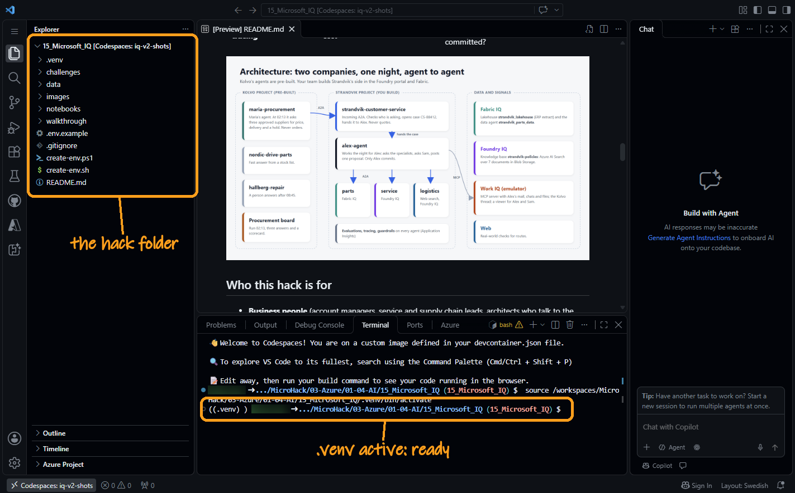
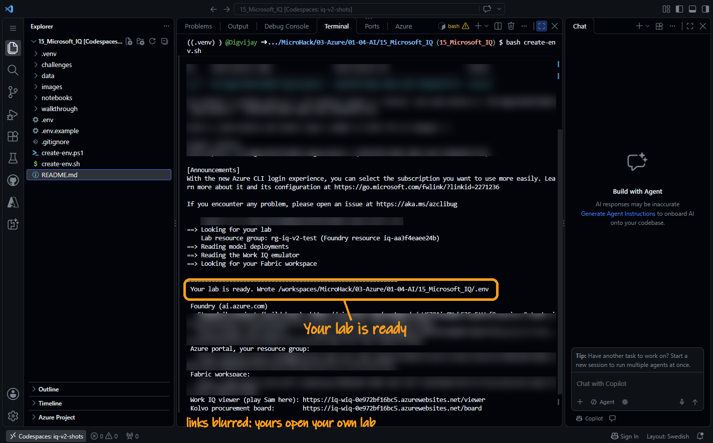
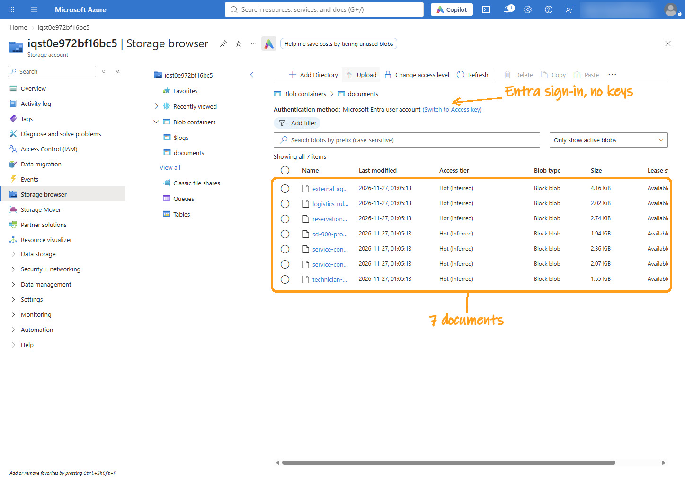
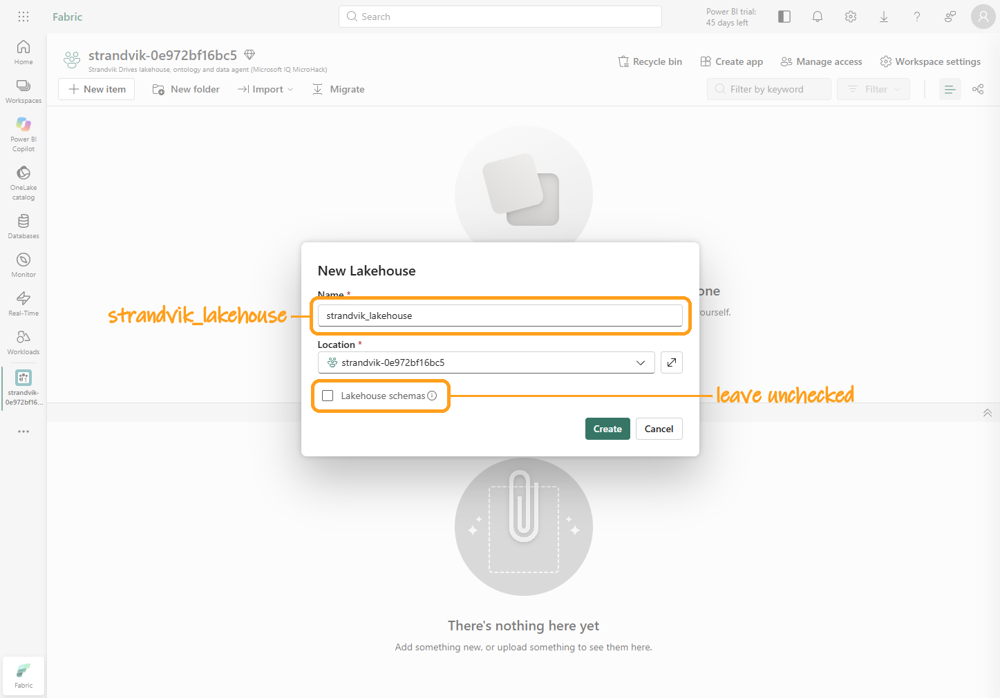
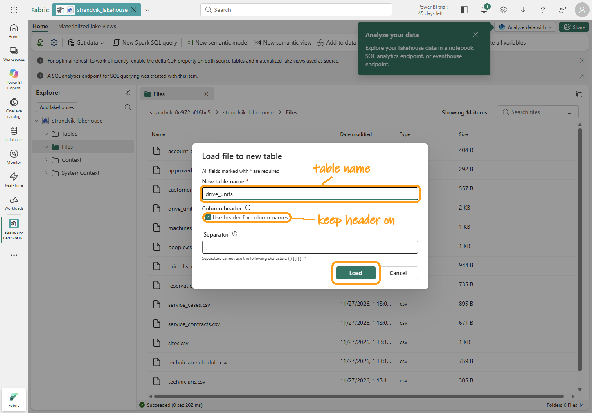
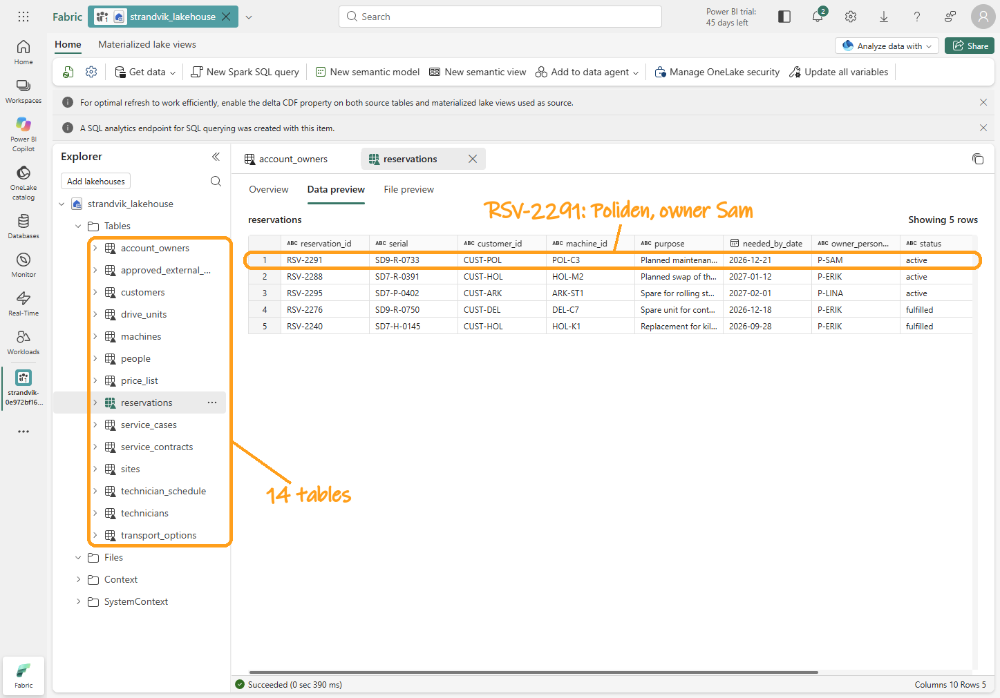

# Solution 1: Lights on

**[Back to Challenge 1](../../challenges/challenge-01.md)** - **[Home](../../README.md)** - [Next Solution](../challenge-02/solution-02.md)

**Clock: 02:10** · **Duration:** 45 minutes

## What good looks like

- `.env` filled for the lab, both roles have the three portals open.
- 7 documents in the `documents` blob container.
- 14 tables in the Fabric lakehouse `strandvik_lakehouse`.
- A paper map with units, machines, sites, customers, reservations and **owners**.

## Task 1 (builder): fill `.env`

### Option A: GitHub Codespace (recommended)

1. Sign in to GitHub, open the hack repository and select **Code** > **Codespaces** > **...** > **New with options...**.
2. Under **Dev container configuration**, choose **Azure / AI / Microsoft IQ**. Select **Create codespace**.
3. Wait until the terminal prints `Ready. Next step ... bash create-env.sh`. The setup creates `.venv` with Jupyter and the notebook packages.

<!-- SHOT: c01-codespace-ready | GitHub Codespaces (VS Code in the browser) | Terminal after the post-create script finished, hack folder open in the explorer | Highlight the "Ready. Next step" banner and the dev container name in the bottom-left -->


4. In the terminal (the hack folder is the working folder), run:

   ```bash
   bash create-env.sh
   ```

5. When asked, open `https://microsoft.com/devicelogin`, enter the code and sign in with the **lab user** (not your corporate account).
6. The script finds the lab resource group (tagged `microhack=15_Microsoft_IQ`), reads every endpoint and key, and writes `.env`. At the end it prints the Foundry links for **strandvik** and **kolvo**, the Azure portal link, the Fabric workspace link, the Work IQ viewer and the procurement board.

<!-- SHOT: c01-create-env-output | Codespace terminal | Output of bash create-env.sh: "Your lab is ready", the project links, the viewer and board URLs | Highlight the Strandvik project link and the line "Still empty:" if FABRIC_WORKSPACE_ID is missing. Blur keys. -->


### Option B: Windows without bash

```powershell
cd 03-Azure\01-04-AI\15_Microsoft_IQ
./create-env.ps1
```

Same result. Business participants on a locked-down laptop can skip `.env` entirely and use the portal links the builder shares.

### Expected `.env` (values differ per lab)

```text
PROJECT_ENDPOINT_STRANDVIK=https://iq-<hash>.services.ai.azure.com/api/projects/strandvik
PROJECT_ENDPOINT_KOLVO=https://iq-<hash>.services.ai.azure.com/api/projects/kolvo
MODEL_DEPLOYMENT_NAME=gpt-5.4-mini
STORAGE_ACCOUNT=iqst<hash>
DOCUMENTS_CONTAINER=documents
WORKIQ_MCP_URL=https://iq-wiq-<hash>....azurewebsites.net/mcp
WORKIQ_VIEWER_URL=https://.../viewer
WORKIQ_BOARD_URL=https://.../board
WORKIQ_KEY=<Alex's persona key>
WORKIQ_KEY_SAM=<Sam's persona key>
FABRIC_WORKSPACE_ID=<guid, or empty until the workspace exists>
```

## Task 2 (builder): open the three portals

1. **Foundry portal**: open the Strandvik project link from the script output (or [ai.azure.com](https://ai.azure.com), switch **New Foundry** on at the top, and pick the project **strandvik** of the `iq-<hash>` resource in the project picker at the top left). Check **Build** > **Agents** is empty. Open the **kolvo** project the same way and check that `maria-procurement`, `nordic-drive-parts` and `hallberg-repair` are listed.
2. **Azure portal**: open the resource group link. You see the Foundry resource `iq-<hash>`, the Search service `iq-srch-<hash>`, the storage account `iqst<hash>`, the Fabric capacity `iqcap<hash>`, Application Insights `iq-appi-<hash>` and the emulator `iq-wiq-<hash>`.
3. **Fabric portal**: open [app.fabric.microsoft.com](https://app.fabric.microsoft.com) with the lab user and go to **Workspaces** > `strandvik-<hash>`.

### No Fabric workspace?

1. Fabric portal > **Workspaces** > **+ New workspace**.
2. **Name**: `strandvik-<your initials>`. Expand **Advanced** > **License mode**: **Fabric capacity** > pick `iqcap<hash>`. Select **Apply**.
3. Run `bash create-env.sh` again so `FABRIC_WORKSPACE_ID` is filled (it looks for a workspace whose name starts with `strandvik`).

## Task 3 (builder): upload the documents to Blob Storage

### In the Azure portal

1. Download the 7 files in `data/documents/` to your machine (in the Codespace: select the files in the explorer > right-click > **Download...**; or download them from GitHub).
2. Azure portal > the lab resource group > the storage account `iqst<hash>` > **Storage browser** > **Blob containers** > `documents`.
3. If you see "You do not have permissions" or a key error, switch **Authentication method** to **Microsoft Entra user account** (shared key access is off; the lab user has Storage Blob Data Contributor).
4. Select **Upload** > drag the 7 files > **Upload**.

<!-- SHOT: c01-storage-browser-upload | Azure portal, storage account iqst<hash> > Storage browser > Blob containers > documents | Container after upload, listing the 7 .md files | Highlight the Authentication method set to Microsoft Entra user account and the 7 files -->


Expected files:

| File | Document |
|---|---|
| `external-agent-access-policy-eap-01.md` | EAP-01 |
| `reservation-policy-res-02.md` | RES-02 |
| `service-contract-kolvo-sc-kol-2024.md` | SC-KOL-2024 |
| `service-contract-poliden-sc-pol-2025.md` | SC-POL-2025 |
| `logistics-rules-log-03.md` | LOG-03 |
| `sd-900-product-sheet.md` | PS-SD900 |
| `technician-scheduling-fs-04.md` | FS-04 |

### Or with the notebook

Run section 1 of `notebooks/00-load-the-world.ipynb` (see Task 5).

## Task 4 (builder): load the lakehouse in the Fabric portal

1. Fabric portal > your workspace > **+ New item** > **Lakehouse**. **Name**: `strandvik_lakehouse`. Leave **Lakehouse schemas** off. Select **Create**.
2. In the lakehouse explorer, next to **Files** select **...** > **Upload** > **Upload files**. Select the 14 CSV files from `data/lakehouse/` and select **Upload**.

<!-- SHOT: c01-fabric-new-lakehouse | Fabric portal, workspace strandvik-<hash> > + New item > Lakehouse dialog | The "New lakehouse" dialog with the name strandvik_lakehouse and schemas unchecked | Highlight the name field and the schemas checkbox -->


3. Open **Files**, then for each CSV: **...** > **Load to Tables** > **New table**. Keep the table name (the file name without `.csv`), **Column header** on, **Separator** `,`. Select **Load**.
4. Repeat for all 14 files. If you get HTTP 430 or "capacity busy", wait 20 seconds and load again: an F2 runs few loads at a time.

<!-- SHOT: c01-fabric-load-to-table | Fabric portal, strandvik_lakehouse > Files > drive_units.csv > ... menu | The "Load to Tables" > "New table" dialog for drive_units.csv | Highlight "Load to Tables", the table name and the header option -->


5. Check: the **Tables** folder shows 14 tables. Select `reservations` and confirm the preview shows `RSV-2291`, `SD9-R-0733`, `P-SAM`.
6. Switch the lakehouse view to **SQL analytics endpoint** (top right) once, and select **Refresh** if a table is missing there. The data agent in challenge 3 reads the schema from this endpoint.

<!-- SHOT: c01-lakehouse-tables | Fabric portal, strandvik_lakehouse (Lakehouse view) | Tables folder expanded with 14 tables, reservations preview open | Highlight the table count and the RSV-2291 row -->


Expected tables and rows: `sites` 9, `customers` 6, `people` 8, `account_owners` 6, `approved_external_agents` 2, `machines` 15, `drive_units` 22, `reservations` 5, `technicians` 4, `technician_schedule` 6, `transport_options` 6, `price_list` 8, `service_contracts` 6, `service_cases` 5.

## Task 5 (builder, alternative): the load-the-world notebook

1. In the Codespace, open `notebooks/00-load-the-world.ipynb`.
2. **Select Kernel** (top right) > **Jupyter Kernel** > **Python (Microsoft IQ)**.
3. If the Azure CLI session is gone, run `az login --use-device-code` in the terminal first.
4. Select **Run All**. Section 1 uploads the 7 documents. Section 2 creates `strandvik_lakehouse`, uploads every CSV to `Files/strandvik/`, loads each as a table (waiting on HTTP 430), and refreshes the SQL endpoint metadata. The last cell prints a table of all tables and columns.
5. Takes 3 to 8 minutes on F2. It is safe to run again.

## Task 6 (business): the paper map

A good map looks like this (the business role does not need to be this complete, but must have the owners):

```text
Kolvo AB (customer, strategic)                 Poliden AB (customer, strategic)
  owner: Alex (KAM)                              owner: Sam (KAM, in Singapore)
  site: cab plant Hisingen, Gothenburg           site: Skelleftehamn
  contract SC-KOL-2024: 48 h replacement         contract SC-POL-2025: changes confirmed in writing
  machine: press line 2 (KOL-PL2, critical)      machine: crusher line C3 (POL-C3)
    requires SD-900                                requires SD-900
    runs on SD9-K-0412 (vibration alarm,           planned stop Mon 21 Dec: swap the worn unit
    half speed until Thu 17 Dec 06:00)

Candidate SD-900 units
  SD9-P-0981  Pune factory, new, tested          not reserved
  SD9-R-0733  Rotterdam warehouse, new           RESERVED: RSV-2291 for Poliden C3, needed 21 Dec,
                                                 owner Sam. Sam's Friday note: "will probably move"
Not candidates
  SD9-R-0750  sold (Delfzijl Port Cranes)        SD9-P-0902  in repair until 20 Jan
  SD7-R-0388  SD-700: does not fit an SD-900 press

People who decide
  Alex: any date or price to Kolvo     Sam: releases RSV-2291
  Maria: any Kolvo order               Poliden planner: confirms the stop date in writing
```

And one "may / may not" line per agent (from the scenario facts):

| Agent | May | May not |
|---|---|---|
| Maria's agent (Kolvo) | Ask approved suppliers for price and delivery | Order without Maria |
| Customer Service | Verify who is asking, open a case, hand over to the account owner | Quote, order or commit |
| Alex's agent | Orchestrate specialists, ask colleagues, send a proposal | Commit a date or price |
| Parts | Check stock, units, reservations | Sell or move a reserved unit |
| Logistics | Find routes and times, hold a flight | Book without approval |
| Service | Check contracts and technician slots | Change a contract |

## Checks for the coach

- [ ] `.env` has values (ask to see the variable names, not the keys).
- [ ] Storage browser: 7 files in `documents`.
- [ ] Fabric: 14 tables, `reservations` preview shows RSV-2291.
- [ ] Ask the business role: "Which two SD-900s could replace SD9-K-0412, and who owns the Rotterdam one?" Answer: SD9-P-0981 and SD9-R-0733, owner Sam.

## Troubleshooting

| Problem | Fix |
|---|---|
| `create-env.sh`: "no Microsoft IQ lab found" | Signed in with the wrong account. `az logout`, then run again and sign in with the lab user. Or pass the resource group: `bash create-env.sh <rg>`. |
| `FABRIC_WORKSPACE_ID` stays empty | Create the workspace (name starting with `strandvik`), assign the lab capacity, run the script again. |
| Storage browser: "This request is not authorized" | Switch Authentication method to Microsoft Entra user account. Wait a minute after the lab is created for the role to apply. |
| Fabric: "Load to Tables" greyed out | You selected a folder or a non-CSV file. Select one CSV file. |
| Fabric: HTTP 430 | The F2 capacity is busy. Wait 20 seconds and try again. |
| Fabric capacity paused | Azure portal > `iqcap<hash>` > **Resume**. |

**[Back to Challenge 1](../../challenges/challenge-01.md)** - **[Home](../../README.md)** - [Next Solution](../challenge-02/solution-02.md)
