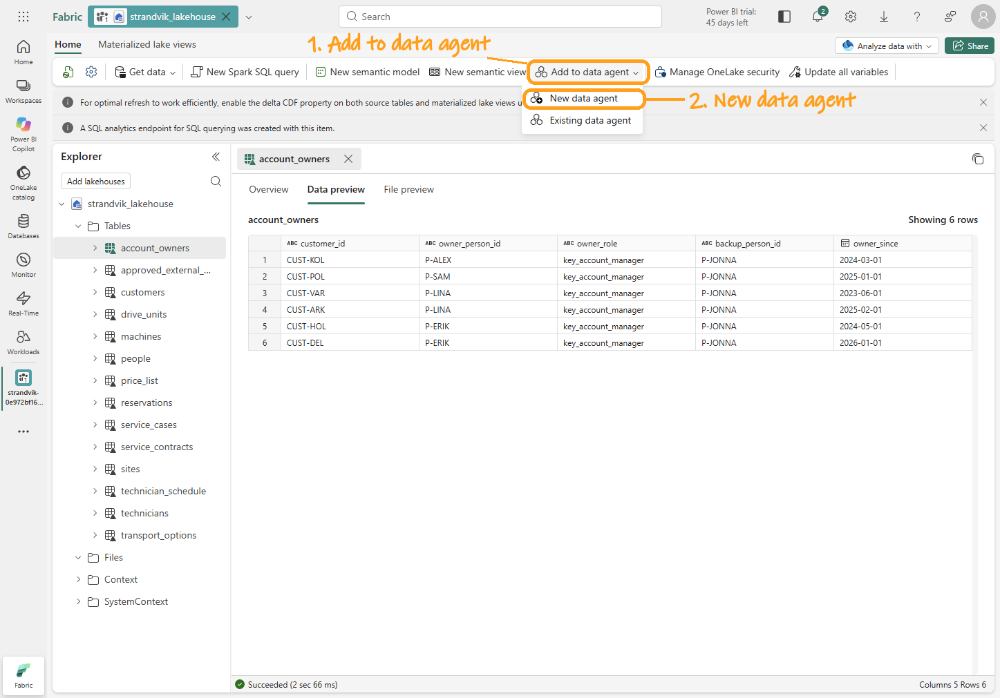
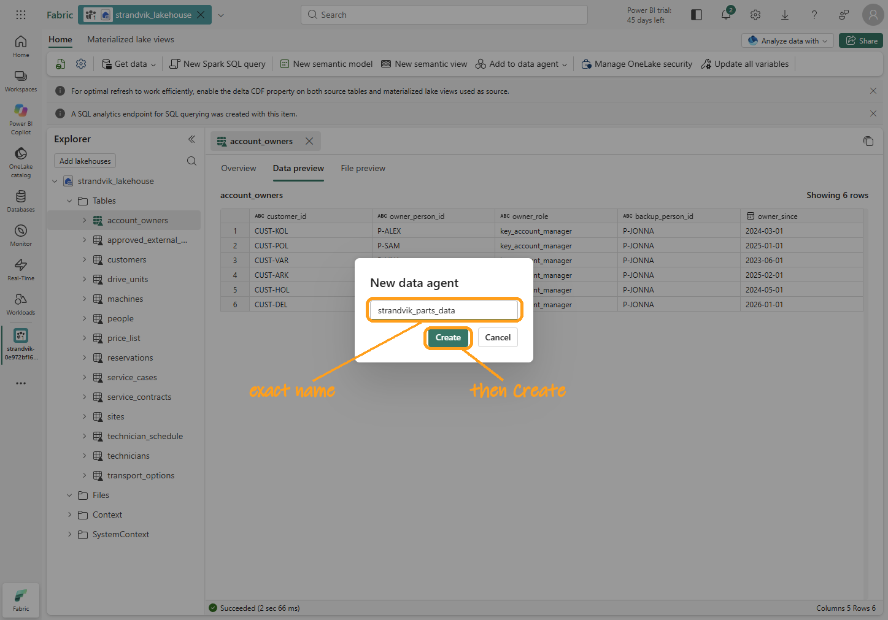
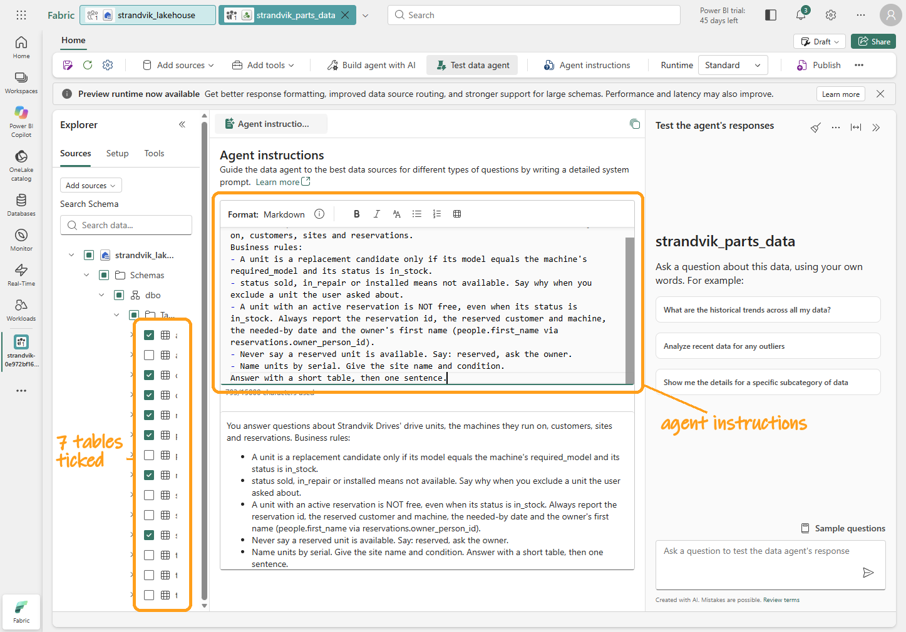
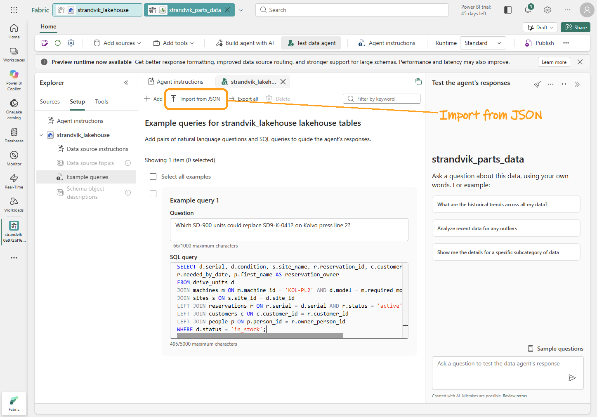
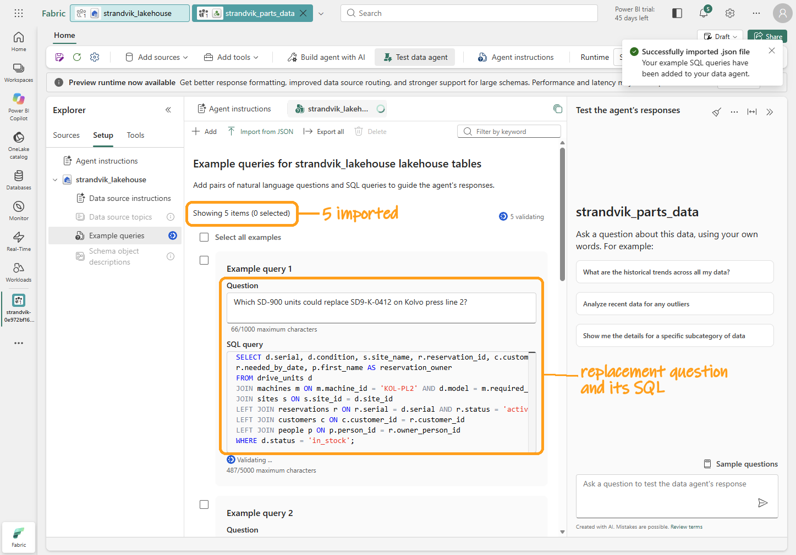
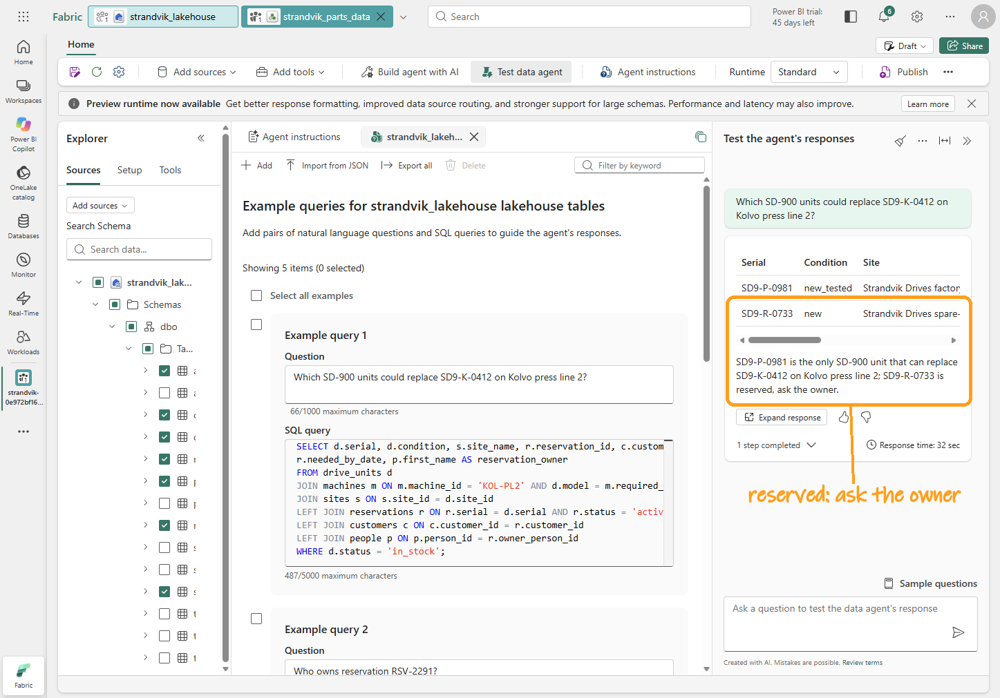
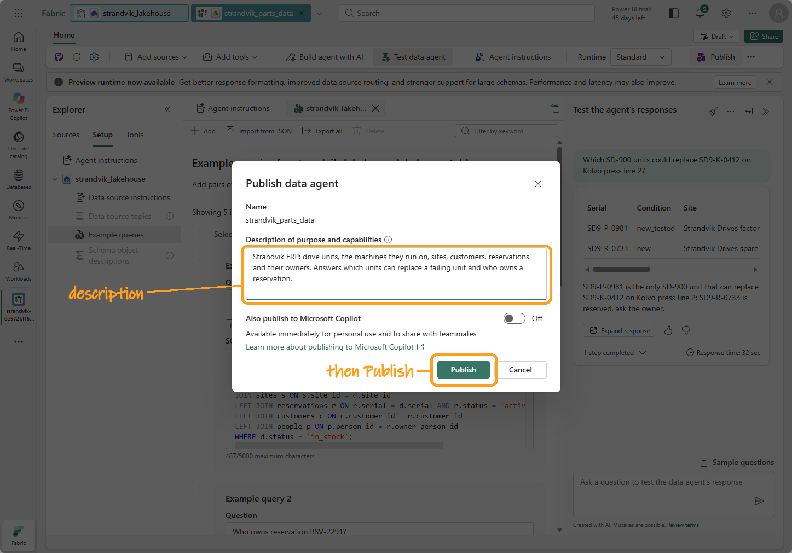
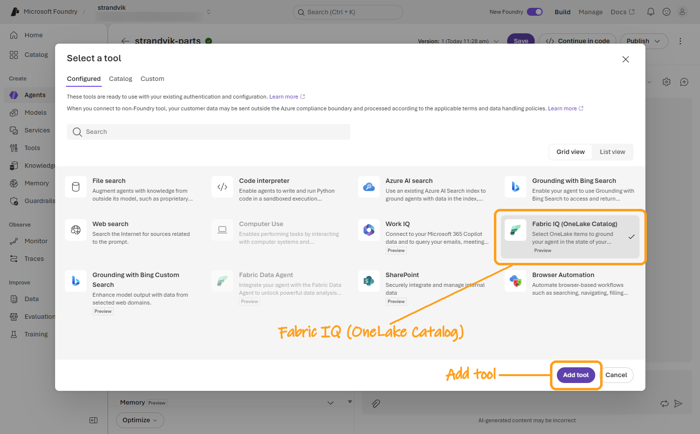
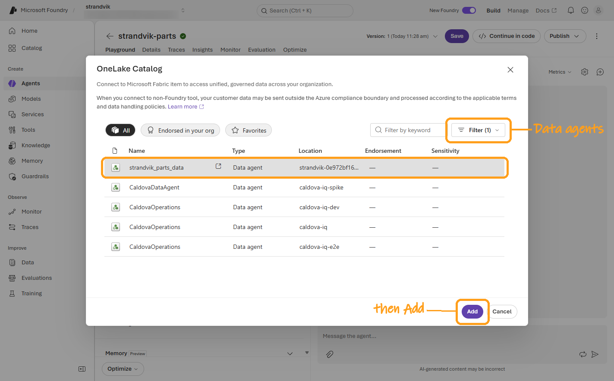
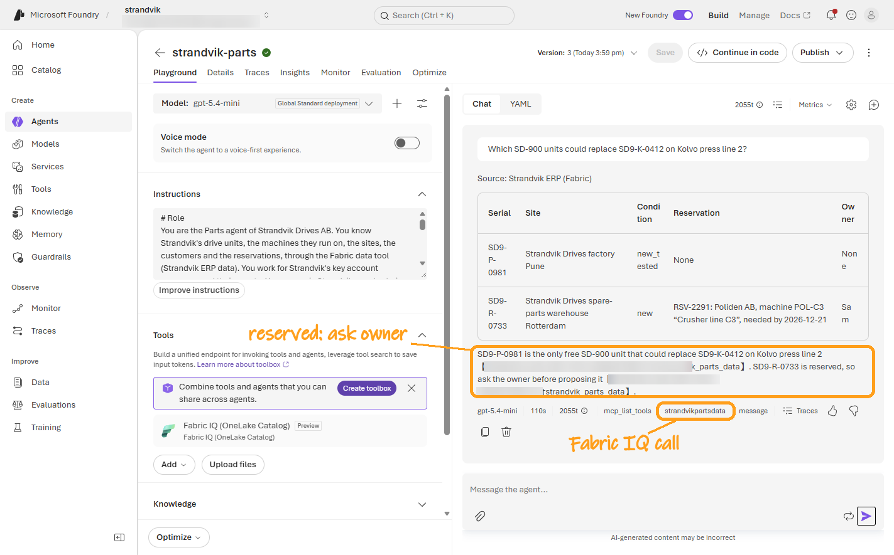

# Solution 3: Know the business

[Previous Solution](../challenge-02/solution-02.md) - **[Back to Challenge 3](../../challenges/challenge-03.md)** - **[Home](../../README.md)** - [Next Solution](../challenge-04/solution-04.md)

**Clock: 03:10** · **Duration:** 75 minutes

## What good looks like

- An **ontology on paper**: the business role's design, pasted into the data agent's instructions. (If your tenant shows an Ontology item, a real ontology `strandvik_ontology` is a bonus.)
- A published Fabric data agent `strandvik_parts_data` over `strandvik_lakehouse` that answers the replacement question correctly.
- `strandvik-parts` in the strandvik project, with the Fabric IQ tool, giving the same answer in the Foundry playground.

## First, in the first 10 minutes: is Fabric ready?

- **Capacity running.** If Fabric items do not open or the data agent does not answer, the Fabric capacity may be paused. Coach: Azure portal > the Fabric capacity > **Resume**.
- **Ontology on paper is the main path.** In the test tenant there was no **Ontology** item and no **Data agent** in the workspace **+ New item** list, and the Ontology API returned `FeatureNotAvailable`. The data agent is created from the lakehouse instead (Task 2). Do not let teams wait for an admin.
- **If your tenant shows Ontology (preview)** under **+ New item**, a team with spare time can also do the [optional ontology task](#optional-an-ontology-item-if-your-tenant-shows-it).

## Task 1 (business): the ontology design

Expected design (teams may name things differently):

| Entity type | Table | Key | Useful properties |
|---|---|---|---|
| DriveUnit | `drive_units` | `serial` | model, status, condition, notes |
| Machine | `machines` | `machine_id` | machine_name, criticality, required_model, status |
| Site | `sites` | `site_id` | site_name, site_type, city, country |
| Customer | `customers` | `customer_id` | customer_name, tier |
| Reservation | `reservations` | `reservation_id` | purpose, needed_by_date, status, policy_id |
| Person | `people` | `person_id` | first_name, company, role, current_location, time_zone |
| ServiceContract | `service_contracts` | `contract_id` | replacement_target_hours, uptime_credit_pct_per_day |
| Technician | `technicians` | `technician_id` | first_name, certified_models |
| TechnicianSlot | `technician_schedule` | `slot_id` | start_time, end_time, shift, status |
| ExternalAgent | `approved_external_agents` | `agent_id` | agent_name, allowed_requests, may_place_orders |

| Relationship | From > To | Join |
|---|---|---|
| runs on | Machine > DriveUnit | `machines.drive_unit_serial = drive_units.serial` |
| located at | DriveUnit > Site | `drive_units.site_id = sites.site_id` |
| belongs to | Machine > Customer | `machines.customer_id = customers.customer_id` |
| reserves | Reservation > DriveUnit | `reservations.serial = drive_units.serial` |
| reserved for | Reservation > Customer / Machine | `reservations.customer_id`, `reservations.machine_id` |
| **owned by** | **Reservation > Person** | `reservations.owner_person_id = people.person_id` |
| **account owner** | **Customer > Person** | `account_owners.customer_id`, `account_owners.owner_person_id` |
| covered by | Customer > ServiceContract | `customers.service_contract_id = service_contracts.contract_id` |
| scheduled at | TechnicianSlot > Site, Technician | `technician_schedule.site_id`, `technician_id` |
| acts for | ExternalAgent > Person, Customer | `acts_for_person_id`, `customer_id` |

The two bold relationships are the ones that make an agent say "ask Sam first". That is the point of the challenge.

### Example questions for the data agent

| Question | Expected answer |
|---|---|
| Which SD-900 units could replace SD9-K-0412 on Kolvo press line 2? | SD9-P-0981 (Pune, new and tested, not reserved) and SD9-R-0733 (Rotterdam, new, reserved RSV-2291 for Poliden crusher C3, needed 21 December, owner Sam) |
| Who owns reservation RSV-2291? | Sam, key account manager for Poliden (currently in Singapore) |
| Is SD9-R-0733 free to use? | No. Reserved under RSV-2291 for Poliden until its owner Sam releases it |
| What drive unit does Kolvo press line 2 run on, and what is its status? | SD9-K-0412, vibration alarm, press at half speed |
| Who is the account owner for Kolvo AB? | Alex |

### The Parts agent's may / may not

May check stock, units, reservations and owners. May not sell, reserve, release or move a unit, or say a reserved unit is available.

## Task 2 (builder): the Fabric data agent

1. Fabric portal > your workspace > open the lakehouse `strandvik_lakehouse`. In the ribbon select **Add to data agent** > **New data agent**.

<!-- SHOT: c03-add-to-data-agent | Fabric portal, workspace > strandvik_lakehouse, Home ribbon | Lakehouse ribbon with the Add to data agent menu open | Highlight Add to data agent and New data agent -->


2. In the name dialog enter `strandvik_parts_data` > **Create**.

<!-- SHOT: c03-new-data-agent | Fabric portal, lakehouse > Add to data agent > New data agent | Name dialog with strandvik_parts_data entered | Highlight the name field and Create -->


3. The data agent editor opens. In the explorer tree on the left, under `strandvik_lakehouse`, tick the 7 tables: `drive_units`, `machines`, `reservations`, `people`, `account_owners`, `customers`, `sites`.
4. In the **Agent instructions** editor at the top (Markdown), paste the business role's ontology on paper under a heading `Ontology (how Strandvik's business fits together)` (the entity and relationship tables from Task 1), then paste these rules below it:

   ```text
   You answer questions about Strandvik Drives' drive units, the machines they run on, customers, sites and reservations.
   Business rules:
   - A unit is a replacement candidate only if its model equals the machine's required_model and its status is in_stock.
   - status sold, in_repair or installed means not available. Say why when you exclude a unit the user asked about.
   - A unit with an active reservation is NOT free, even when its status is in_stock. Always report the reservation id, the reserved customer and machine, the needed-by date and the owner's first name (people.first_name via reservations.owner_person_id).
   - Never say a reserved unit is available. Say: reserved, ask the owner.
   - Name units by serial. Give the site name and condition.
   - Look for candidates at every Strandvik site (factories and warehouses). The customer's site is where a unit is installed, not where spares are kept.
   Answer in English with a short table, then one sentence.
   ```

<!-- SHOT: c03-data-agent-instructions | Fabric portal, strandvik_parts_data data agent editor | Explorer tree with the 7 lakehouse tables ticked and the Agent instructions editor filled with the ontology on paper and rules | Highlight the ticked tables and the Agent instructions editor -->


5. **Example queries**: in the editor select **Setup** > **Example queries**. The pane has **Add**, **Import from JSON** and **Export all**. Select **Import from JSON** and pick `data/fabric/data-agent-example-queries.json` from the repo (5 question and SQL pairs, format `{"question": "sql"}`). A "Preview runtime" banner may appear: that is expected. The main one looks like this:

   ```sql
   -- Which SD-900 units could replace SD9-K-0412 on Kolvo press line 2?
   SELECT d.serial, d.condition, s.site_name, r.reservation_id, c.customer_name AS reserved_for,
          r.needed_by_date, p.first_name AS reservation_owner
   FROM drive_units d
   JOIN machines m ON m.machine_id = 'KOL-PL2' AND d.model = m.required_model
   JOIN sites s ON s.site_id = d.site_id
   LEFT JOIN reservations r ON r.serial = d.serial AND r.status = 'active'
   LEFT JOIN customers c ON c.customer_id = r.customer_id
   LEFT JOIN people p ON p.person_id = r.owner_person_id
   WHERE d.status = 'in_stock';
   ```

   The other four cover the owner of RSV-2291, the account owner for Kolvo AB, all active reservations, and where SD9-R-0733 is.

<!-- SHOT: c03-data-agent-example | Fabric portal, strandvik_parts_data > Setup > Example queries | Example queries pane with the Add, Import from JSON and Export all buttons | Highlight Import from JSON -->


<!-- SHOT: c03-data-agent-examples-imported | Fabric portal, strandvik_parts_data > Setup > Example queries | The 5 imported question and SQL pairs listed, Preview runtime banner visible | Highlight the replacement question and its SQL -->


6. Test in the data agent chat: *Which SD-900 units could replace SD9-K-0412 on Kolvo press line 2?* The answer takes about 30 seconds.

   Expected:

   | Serial | Site | Condition | Reservation | Owner |
   |---|---|---|---|---|
   | SD9-P-0981 | Strandvik Drives factory Pune | new, tested | none | |
   | SD9-R-0733 | Strandvik Drives spare-parts warehouse Rotterdam | new | RSV-2291, Poliden AB, crusher line C3, needed 2026-12-21 | Sam |

   Not offered: SD9-R-0750 (sold to Delfzijl Port Cranes), SD9-P-0902 (in repair until 20 January), SD7-R-0388 (an SD-700). The point is the second row: SD9-R-0733 is reserved, so the answer is "ask Sam".

<!-- SHOT: c03-data-agent-answer | Fabric portal, strandvik_parts_data data agent | Chat answer to the replacement question with SD9-P-0981 available (Pune) and SD9-R-0733 reserved (RSV-2291 for Poliden, owner Sam) | Highlight the reserved row and "ask Sam" -->


7. **Publish** the data agent (top bar > **Publish**). In the dialog add a short description such as "Strandvik ERP: drive units, machines, reservations and owners". Leave **Also publish to Microsoft Copilot** off > **Publish**. After publishing, a **Draft / Published** switcher appears at the top of the editor.

<!-- SHOT: c03-publish-data-agent | Fabric portal, strandvik_parts_data > Publish | Publish dialog with the description filled and "Also publish to Microsoft Copilot" off | Highlight the description field and the Publish button -->


## Task 3 (builder): the Parts agent in Foundry

1. Foundry portal > project **strandvik** > **Build** > **Agents** > **New agent**. In the **Build an agent** dialog: **Agent name** `strandvik-parts`, **Interaction mode** Text > **Create agent and open playground**. The default model is `model-router`: switch **Model** to `gpt-5.4-mini`. If a default **Web search** tool is attached, remove it (**Actions for Web search** > **Remove**): the Parts agent answers from data only.
2. **Instructions** (paste):

   ```text
   # Role
   You are the Parts agent of Strandvik Drives AB. You know Strandvik's drive units, the machines they run on, the sites, the customers and the reservations, through the Fabric data tool (Strandvik ERP data). You work for Strandvik's key account managers and their agents. Your owner is Strandvik supply chain.

   # You may
   - Look up drive units: model, status, condition and location.
   - Find which units could replace a unit on a machine.
   - Report reservations: reservation id, customer, machine, needed-by date and the owner.

   # You may never
   - Sell, reserve, release or move a unit, or change a reservation.
   - Say a reserved unit is available. A reserved unit belongs to its reservation until its owner releases it (RES-02).
   - Quote prices or delivery dates. Other agents do that.

   # How to answer
   1. Always call the Fabric data tool. Never answer from memory, and never invent a serial.
   2. For a replacement question: find the machine and its required model; list every unit of that model that is in stock at any Strandvik site (factories and warehouses, not the customer's site); exclude sold, in repair and installed units and units of another model.
   3. For every candidate, check for an active reservation. If there is one, give the reservation id, the reserved customer and machine, the needed-by date and the owner's name, and say: "Reserved: ask the owner before proposing it."
   4. Answer with a short table (serial, site, condition, reservation, owner), then one or two sentences. Name the source: "Strandvik ERP (Fabric)".
   5. If the tool fails or returns nothing, say so. Do not guess.
   6. Answer in English.
   ```

3. **Add** > **Add tools** > **Configured** > **Fabric IQ (OneLake Catalog)** (preview) > **Add tool**.

<!-- SHOT: c03-select-fabric-iq | Foundry portal, strandvik-parts > Add > Add tools > Configured tab | "Select a tool" dialog with Fabric IQ (OneLake Catalog) selected | Highlight Fabric IQ (OneLake Catalog) (preview) and Add tool -->


4. A **OneLake Catalog** picker opens. It is pre-filtered to **Semantic model** (the filter shows **Filter (1)**). Open the filter > **Type** > untick **Semantic model**, tick **Data agent**. Select `strandvik_parts_data` > **Add**.

<!-- SHOT: c03-onelake-catalog-data-agent | Foundry portal, strandvik-parts > Fabric IQ (OneLake Catalog) picker | OneLake Catalog filtered to Type = Data agent with strandvik_parts_data selected | Highlight the Type filter (Data agent ticked) and the Add button -->


5. **Save**, then test in the playground with the same replacement question. Expected: the same two units, the reservation and Sam, and a tool call chip `strandvikpartsdata` under the answer. The first call is slow (about 96 seconds in testing). Wait for it.

<!-- SHOT: c03-parts-agent-playground | Foundry portal, strandvik project > Agents > strandvik-parts > Playground | Answer to the replacement question with the table and the strandvikpartsdata tool call chip | Highlight the tool chip and "Reserved: ask the owner" -->


## Optional: an ontology item, if your tenant shows it

Only when **+ New item** in the workspace offers **Ontology (preview)** and creating one works. If creation fails with `FeatureNotAvailable`, the tenant setting **Users can create ontology (preview) items** is off: skip this section.

> **Coach note:** Fabric IQ ontology is preview and its editor changes often. The flow below is the shape; it could not be verified in the test tenant.

1. Fabric portal > your workspace > **+ New item** > **Ontology (preview)**. **Name**: `strandvik_ontology` > **Create**.
2. Add an **entity type** `DriveUnit`. Bind it to data: lakehouse `strandvik_lakehouse`, table `drive_units`. Set **key** = `serial` and a display name property (`serial`).
3. Repeat for `Machine`, `Site`, `Customer`, `Reservation`, `Person` (minimum), and as many of the others as time allows.
4. Add the **relationships** from the table in Task 1. For each: source entity, target entity, and the columns that link them (for `owned by`: Reservation `owner_person_id` to Person `person_id`).
5. Save, and open the ontology's graph or preview to check that `RSV-2291` links to `SD9-R-0733`, to Poliden and to Sam.
6. Optionally add the ontology as a source of the data agent next to the lakehouse tables, and publish again.

> No screenshot: the Ontology item was not available in the test tenant. If your tenant shows it, the editor lists the entity types and lets you select a relationship such as Reservation > owned by > Person and its binding to the `reservations` table.

## Ontology on paper (the main path)

This is how the hack runs when the tenant has no Ontology item:

1. The **business role** writes the ontology design (Task 1) as text: entity types, keys, relationships and the two "owner" relationships.
2. The **builder** creates the data agent over the **lakehouse** tables (Task 2, steps 1 to 3) and pastes the business role's design at the top of the data agent instructions, under a heading `Ontology (how Strandvik's business fits together)` (Task 2, step 4).
3. Example queries (Task 2, step 5) do the rest.
4. The success criteria are the same with or without an ontology item. Ask the team to show the paper design at the finish and to tell you which path they used.

## Checks for the coach

- [ ] Data agent answer: SD9-P-0981 and SD9-R-0733 (RSV-2291, Sam), none of the three distractors.
- [ ] `strandvik-parts`: same answer, with a `strandvikpartsdata` tool call chip.
- [ ] Ontology on paper (or ontology item) with the "owned by" relationship from Reservation to Person.

## Troubleshooting

| Problem | Fix |
|---|---|
| Fabric items do not open, or the data agent never answers | The Fabric capacity is paused. Coach: Azure portal > the Fabric capacity > **Resume** |
| Data agent "cannot find table" | SQL analytics endpoint not synced: open it and **Refresh**, or run the last cell of notebook 00 |
| Data agent lists SD9-R-0733 as "available" | Add the reservation rule to the agent instructions and the replacement example query |
| Data agent lists SD7-R-0388 | Add the `required_model` rule |
| Fabric IQ tool not in **Configured** | Refresh the Foundry page. The data agent must be published |
| OneLake Catalog picker shows no data agent | It is filtered to **Semantic model**. Change the **Type** filter to **Data agent**. Check that the data agent is published |
| Playground seems stuck on the first question | The first Fabric call is slow (about 96 seconds in testing). Wait before retrying |
| Fabric IQ tool call fails with an auth error | The tool runs as the signed-in user: make sure the Foundry portal and Fabric are signed in with the same lab user, and the user is a member of the workspace |
| No **Data agent** or **Ontology** in the workspace **+ New item** list | Expected in the test tenant. Create the data agent from the lakehouse ribbon: **Add to data agent** > **New data agent**. If that is missing too, the tenant setting **Users can create and share Data agent item types (preview)** is off (admin) |

[Previous Solution](../challenge-02/solution-02.md) - **[Back to Challenge 3](../../challenges/challenge-03.md)** - **[Home](../../README.md)** - [Next Solution](../challenge-04/solution-04.md)
