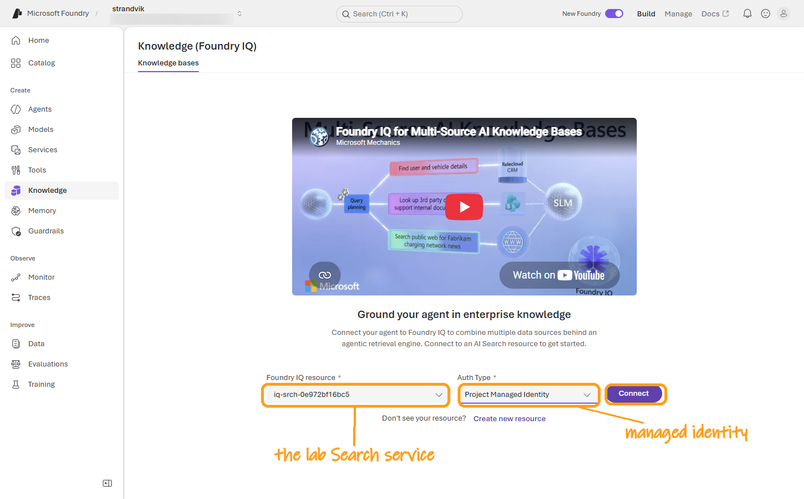
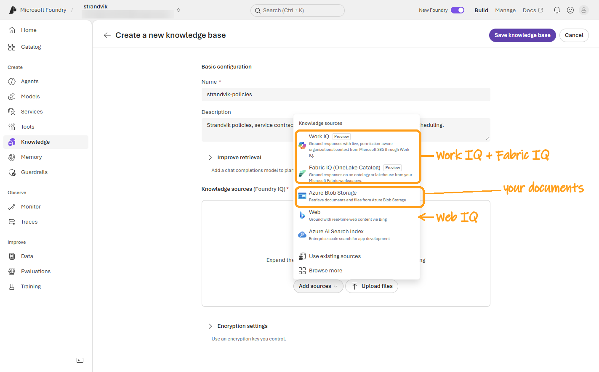
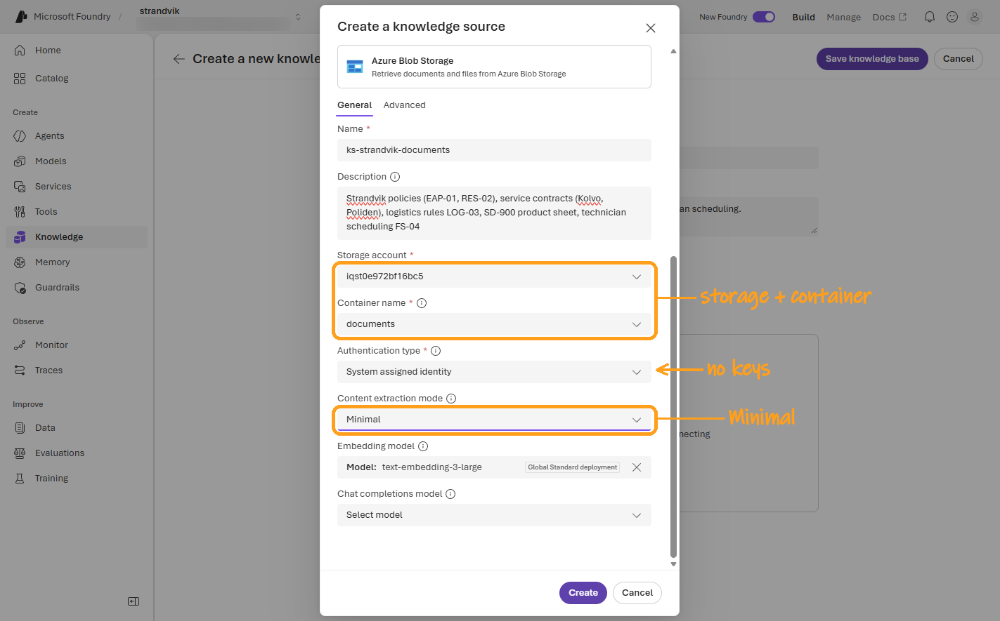
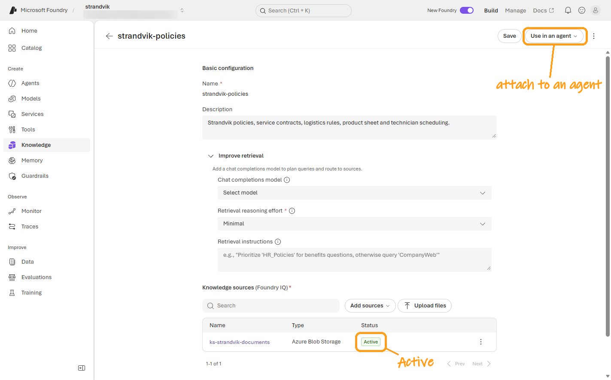
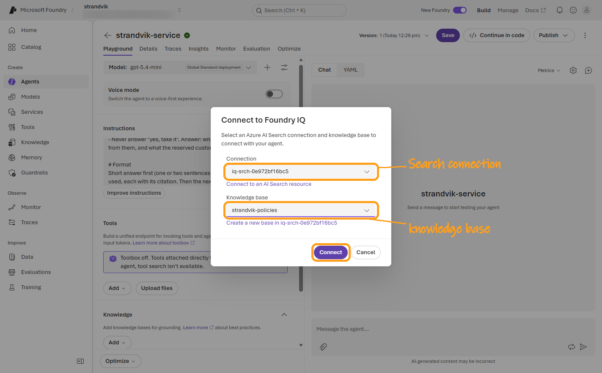
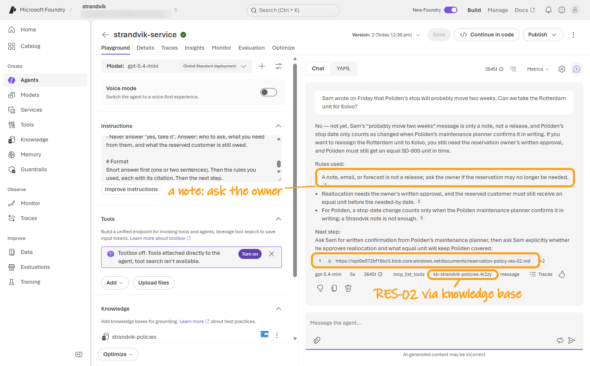

# Solution 4: Why didn't it take the unit?

[Previous Solution](../challenge-03/solution-03.md) - **[Back to Challenge 4](../../challenges/challenge-04.md)** - **[Home](../../README.md)** - [Next Solution](../challenge-05/solution-05.md)

**Clock: 03:41** · **Duration:** 60 minutes

## What good looks like

- Foundry IQ connected to the lab's Search service in the strandvik project.
- Knowledge base `strandvik-policies` with one Azure Blob Storage source over `documents`, status **Active**.
- `strandvik-service` with the knowledge base, answering with citations, and treating Sam's note as a reason to ask.

## Run the vote first

Stop the story clock at 03:41. Read the beat. Ask: "Is Sam's note enough to take the unit? Hands up if yes." Let one "yes" explain. Then point at RES-02 section 4.2: **a note is a reason to ask.** Restart the clock.

## Task 1 (builder): connect Foundry IQ to Search

1. Foundry portal > project **strandvik** > **Build** > **Knowledge**.
2. The first time, the page asks for a **Foundry IQ resource**: pick the lab's Search service `iq-srch-<hash>`.
3. **Auth Type**: **Project Managed Identity** (the lab gave the project identity Search Index Data Reader, Search Index Data Contributor and Search Service Contributor). **API Key** also works.
4. Select **Connect**.

<!-- SHOT: c04-foundry-iq-connect-search | Foundry portal, Build > Knowledge (first visit) | The "connect a Foundry IQ resource" panel with the Search service selected and Auth Type | Highlight the Foundry IQ resource dropdown, Auth Type and Connect -->


## Task 2 (builder): create the knowledge base

1. **Build** > **Knowledge** > **Create a knowledge base**.
2. **Name**: `strandvik-policies`. **Description**: `Strandvik policies, service contracts, logistics rules, product sheet and technician scheduling.`
3. **Improve retrieval**:
   - **Chat completions model**: leave empty. In testing the dropdown only showed "Browse more models".
   - **Retrieval reasoning effort**: **Low** (or Minimal).
   - **Retrieval instructions**: `Policies have ids such as EAP-01, RES-02, LOG-03, FS-04, SC-KOL-2024, SC-POL-2025. Prefer the document whose id the question names.`
4. **Knowledge sources** > **Add sources**. The menu offers **Work IQ (preview)**, **Fabric IQ (OneLake Catalog) (preview)**, **Azure Blob Storage**, **Web**, **Azure AI Search Index**, **Use existing sources** and **Upload files**. Choose **Azure Blob Storage**.

<!-- SHOT: c04-add-sources-menu | Foundry portal, Create a knowledge base > Knowledge sources > Add sources | The Add sources menu with the five source types | Highlight Azure Blob Storage -->


5. **Reload the page first** if you opened it before the models existed: the **Embedding model** list only shows deployments that existed when the page loaded.
6. Fill the **Create a knowledge source** form:

   | Field | Value |
   |---|---|
   | Name | `ks-strandvik-documents` |
   | Description | `The seven Strandvik documents: EAP-01, RES-02, SC-KOL-2024, SC-POL-2025, LOG-03, the SD-900 product sheet, FS-04` |
   | Storage account | `iqst<hash>` |
   | Container | `documents` |
   | Authentication type | **System assigned identity** |
   | Content extraction mode | **Minimal** |
   | Embedding model | `text-embedding-3-large` |
   | Chat completions model | empty (the dropdown may only show "Browse more models") |

   Use **Minimal**: the seven documents are text, so Standard is not needed. **Standard** fails in this lab with "Unable to connect to AI Services using managed identity ... Cognitive Services User", even when that role is granted, because the Foundry resource has local (key) authentication disabled.

7. **Create**, then **Save knowledge base**. The source goes **Creating** > **Active** in about one minute.

<!-- SHOT: c04-blob-knowledge-source | Foundry portal, Create a knowledge source (Azure Blob Storage) | The form with storage account, container documents, System assigned identity, Content extraction mode Minimal, embedding model | Highlight storage account, container, authentication, Minimal and embedding model -->


<!-- SHOT: c04-knowledge-base-ready | Foundry portal, Build > Knowledge > strandvik-policies | The knowledge base page with the source Active and the Use in an agent button | Highlight Active and Use in an agent -->


## Task 3 (business): the Service agent's instructions

```text
# Role
You are the Service agent of Strandvik Drives AB. You know Strandvik's service contracts, policies and field service scheduling, through the knowledge base "strandvik-policies" (Foundry IQ). You work for Strandvik's key account managers and their agents. Your owner is Noor, field service coordinator.

# You may
- Look up contract terms: replacement targets, uptime credits, who may order, how date changes are confirmed.
- Explain the policies: external agents (EAP-01), reservations (RES-02), logistics (LOG-03), product fit (SD-900 product sheet), technician scheduling (FS-04).
- Check technician slots and the notice they need, and propose (not make) a booking.

# You may never
- Change a contract, book or cancel a technician, release or move a reservation, or commit to a date or a price.

# Always
- Search the knowledge base before every answer about a contract, a policy, a reservation, a product or a technician.
- Cite the document id for every rule you use, for example "(RES-02 4.2)".
- If the documents do not answer the question, say so. Do not fill gaps from memory.

# The reservation rule (RES-02)
- A reserved unit belongs to its reservation until its owner releases it. The owner is the key account manager named on the reservation.
- A note, an email or a forecast is NOT a release. A note is a reason to ask. When anything suggests a reservation may no longer be needed, the answer is: ask the owner, and get the answer in writing (a chat message counts).
- Reallocation needs the owner's written approval. The reserved customer must still get an equal unit (same model, new or equal condition) before its needed-by date. The key account manager who reallocates carries the cost risk.
- For Poliden, a change of the maintenance stop date counts only when Poliden's maintenance planner confirms it in writing (SC-POL-2025).
- Never answer "yes, take it". Answer: who to ask, what you need from them, and what the reserved customer is still owed.

# Format
Short answer first (one or two sentences). Then the rules you used, each with its citation. Then the next step.
```

## Task 4 (builder): create `strandvik-service`

1. **Build** > **Agents** > **New agent**. In the **Build an agent** dialog: **Agent name** `strandvik-service`, **Interaction mode** Text > **Create agent and open playground**.
2. The default model is `model-router`: switch **Model** to `gpt-5.4-mini`. Paste the instructions.
3. A default **Web search** tool is attached. Remove it: **Actions for Web search** > **Remove**. The Service agent must answer from the policies only.
4. **Knowledge** > **Add** > **Connect to Foundry IQ**. Choose the **Connection** (the lab's Search connection) and the **Knowledge base** `strandvik-policies` > **Connect**. The agent calls the knowledge base as an MCP tool named `kb-strandvik-policies-...`.

<!-- SHOT: c04-connect-foundry-iq-to-agent | Foundry portal, strandvik project, Agents > strandvik-service > Knowledge > Add > Connect to Foundry IQ | Dialog with the Search connection and knowledge base strandvik-policies selected | Highlight Connection, Knowledge base and Connect -->


5. **Save** the agent.

## Task 5 (business): judge the answers

Ask the three questions from the challenge in the playground. Expected:

| Question | Expected answer | Sources |
|---|---|---|
| Sam wrote on Friday that Poliden's stop will probably move two weeks. Can we take the Rotterdam unit for Kolvo? | Not yet. SD9-R-0733 is reserved (RSV-2291) until its owner Sam releases it. A note is not a release: a note is a reason to ask. Ask Sam; his written approval (a chat message counts) is needed; Poliden must still get an equal SD-900 before 21 December; the reallocating KAM carries the cost risk. Poliden's planner must confirm any stop change in writing. | RES-02 4.1 to 4.5, SC-POL-2025 |
| What is the replacement target for Kolvo's press lines? | 48 hours from the request for critical units on press lines 1 to 3; Strandvik installs; uptime credit 0.5% of the annual contract value per day beyond the target. | SC-KOL-2024 |
| When can a Strandvik technician install at Kolvo this week? | Wednesday 16 December 22:00 to Thursday 17 December 06:00 (slot FS-5101, Jonas, SD-900 certified). A night install needs 24 hours' notice; installation takes 6 to 8 hours. | FS-04, SD-900 product sheet |

All three were verified in testing, each with citations: RES-02 ("a note is a reason to ask"), SC-KOL-2024 (48 hours) and FS-04 (slot FS-5101, Jonas).

<!-- SHOT: c04-service-agent-cites-res02 | Foundry portal, strandvik project, Agents > strandvik-service > Playground | Answer to "Sam wrote on Friday that Poliden's stop will probably move two weeks. Can we take the Rotterdam unit for Kolvo?" with citation chips and the kb tool chip | Highlight "a note is a reason to ask", the RES-02 citation and the knowledge base tool call -->


Scoring guide for the business role (1 to 5 each): **grounded** (the facts match the documents), **cites** (the right document ids), **stays in its lane** (proposes, never decides).

## Stretch: the knowledge graph (notebook 02)

1. The **business role** opens `data/foundry-iq/strandvik-ontology.jsonld`, reads the class comments and decides whether to change anything (for example add a `Technician` class). Save a copy and set `ONTOLOGY_FILE` in the first cell.
2. The **builder** opens `notebooks/02-knowledge-graph-stretch.ipynb`, kernel **Python (Microsoft IQ)**, sets `VERSION = "v1"` and selects **Run All**.
3. The notebook creates a knowledge source `strandvik-graph-v1` with `graphExtraction` (Search REST `2026-11-01-preview`, chat model `gpt-5.6-luna`, your ontology inline), waits for ingestion (a few minutes), creates the knowledge base `strandvik-graph-v1-kb` and asks: *The Rotterdam SD-900 is reserved. Who must approve moving it to Kolvo, and in what form?*
4. Expected: Sam, the reservation owner, in writing (a chat message counts), plus Poliden's planner for the stop date. The activity list shows graph retrieval.
5. In the Foundry portal the new knowledge base appears under **Build** > **Knowledge**. **Use in an agent** > `strandvik-service` (as a second knowledge base, or swap it in) and compare the answers.
6. Changed the ontology? The ontology is fixed when the source is created: set `VERSION = "v2"` and run again.

## Checks for the coach

- [ ] Knowledge source **Active**, attached to `strandvik-service`.
- [ ] Sam's note answer: "a note is a reason to ask", ask Sam, written approval, equal unit in time, with RES-02.
- [ ] 48 hours (SC-KOL-2024) and Wednesday night 22:00 to 06:00 (FS-04), cited.
- [ ] The business role's scores.

## Troubleshooting

| Problem | Fix |
|---|---|
| Embedding model missing in the form | Reload the page (the list is read when the page loads) |
| Source fails with "Unable to connect to AI Services using managed identity ... Cognitive Services User" | Content extraction mode is **Standard**. The Foundry resource has local auth disabled, so Standard fails even with the role granted. Recreate the source with **Minimal** |
| Chat completions model dropdown only shows "Browse more models" | Leave it empty. Retrieval works without it |
| Source stuck in Creating, or Failed | Container empty (upload the documents) or Search identity lacks Storage Blob Data Reader / Cognitive Services OpenAI User (coach: re-run the lab deployment) |
| Agent answers without a citation | Add "search the knowledge base before every answer ... cite the document id" to the instructions |
| Agent answers from the web | The default **Web search** tool is still attached. **Actions for Web search** > **Remove**, then **Save** |
| Agent says "yes, take the Rotterdam unit" | The reservation rule is missing or too soft. Paste the RES-02 block |
| Notebook 02: `chatCompletionModel` error | The chat model is only allowed together with `graphExtraction`; do not change that part of the notebook |
| Notebook 02: 403 | Azure CLI signed in with the wrong account, or the lab user lacks Search Service Contributor |

[Previous Solution](../challenge-03/solution-03.md) - **[Back to Challenge 4](../../challenges/challenge-04.md)** - **[Home](../../README.md)** - [Next Solution](../challenge-05/solution-05.md)
